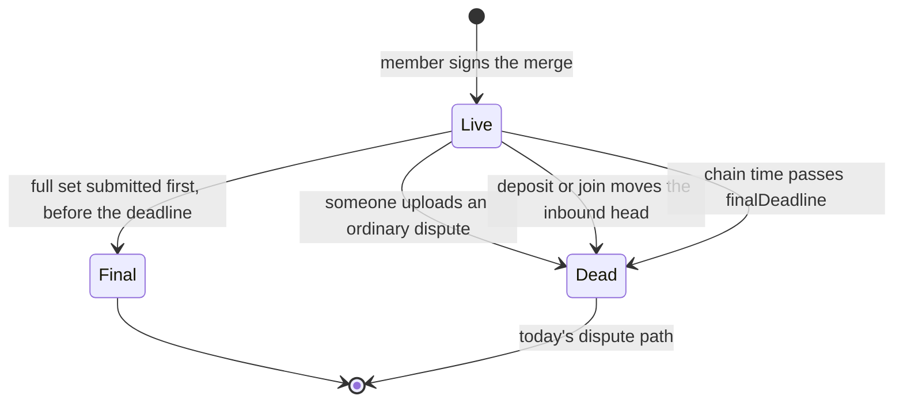
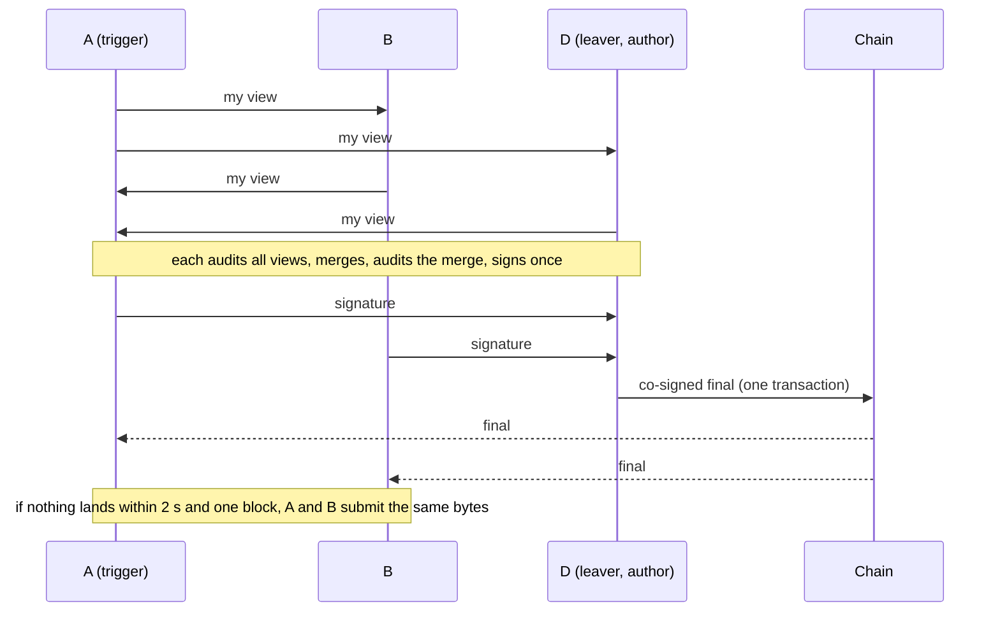

# Design: Co-signed final dispute

state-channels-plus · design only, no code · revision 13 · 2026-11-26 · proposal

## Overview

Members of a channel swap their dispute views over P2P, merge them with the contract's own `reduce`, and all sign the result. One transaction then settles the dispute, and the contract only checks signatures. Today's path stays as the fallback: each member uploads, the chain waits out an evidence period (30 s by default) and a kill period, and a reduce transaction finishes it.

Collecting signatures is the easy part. Most of the design is about what a signature does once it has left a member's hands, and what can go wrong around it.

### A signature can be used by anyone who holds it

Once a member sends its signature, any holder of the full set can submit the final. Two rules keep that safe:

- **It expires.** The signed bytes carry a new field, `finalDeadline`. After that chain time the contract refuses the final, so nobody can sit on the others' signatures and use them later.
- **It can't race today's path.** A final lands only as the first upload for its fork, before its deadline, and at the inbound head it pinned. An ordinary dispute upload, a deposit or a join kills every signature over it. The chain picks which path wins, so peers never have to agree off chain on who gave up.



### Every member must sign, so one honest member is enough

The contract needs a signature from every member of the on-chain signer set. An honest member signs only bytes it built itself, from views it checked itself. So one honest member blocks any wrong outcome, and a colluding group, majority or not, can only veto. A veto costs a few seconds and falls back to today's path. Agreement buys speed, never safety.

### A live signature freezes block signing, and that sets the timing

While a member holds a signature that could still land, it must not sign newer blocks: if the final landed, those blocks would be thrown away. That pause is dangerous for the next block writer. If the pause runs past its turn, the writer gets timed out and punished even though it did nothing wrong. A peer acting in bad faith could start a round just to cause that.

So a round may start only early enough in a turn that the writer still has time, after the hold ends, to get its block on chain. How early depends on block time. With the intended 2 s blocks, the fast path is open for the first 25 s of a 50 s turn (13 s if skipped slots force a 4 s bound).

```mermaid
gantt
    dateFormat ss
    axisFormat %S s
    title One 50 s turn, 2 s blocks
    section Fast path
    a round may start here        :a, 00, 25s
    section Latest start
    round and signature hold      :b, 25, 13s
    writer posts its block, mined :c, 38, 12s
```



### The local copy of the chain is not trusted

Each member runs a local copy of the contract (the local diamond) fed by chain events, and it can silently miss an event. So a member signs only on facts that the contract checks again at inclusion, facts pinned by a hash in the signed bytes, or facts it just read from the chain. A "yes" from the local copy alone never lets it sign. For this one decision the round reads the chain directly: one pinned read at the start, and a chain check of every fraud proof. Everything else works as today and recovers when the chain refuses something.

### Two traps the reviews found

- **Repairing the local copy inside `dispute()` deadlocks.** Replaying a missed event runs its handler, some handlers call `dispute()`, and the dispute mutex can't be taken twice. The round therefore never repairs anything. Repair happens after the mutex is released.
- **Checking a peer's view can move live state.** Today's auditor only ever runs on forks that already have a dispute window, so nobody is still writing to them. Here it runs on a live fork, where its replay could leave the state machine behind or store a block that never executes. A member therefore audits only views whose blocks it already executed, and the audit puts the state back as it found it.

### Who submits, and what if they don't

Nobody is elected. The merged dispute names its author (the leaver, or the owner of the most advanced state), and the author submits right away. Every other member waits 2 s plus one block. If the final still isn't on chain, each submits the same bytes. The chain refuses the extra copies and they change nothing.



### What it covers, and what it gives up

It covers a member leaving, a proven cheater, and online members who see things differently. In a two-member channel with a proven cheater, the honest member settles alone in one transaction.

Timeouts are out: a view carrying a timeout never starts a round, because an offline peer can't sign anyway. One case gets slower: today a member that kills a cheater's dispute and uploads its own in the same transaction can finalize at once. Here that goes through the evidence period (open question 2).

Before building, two things must hold up in real code: a harness spike runs real views through the real auditor on a live fork, and the block time gets measured (sections 16 and 17).

## 1. Core ideas

Every rule below follows from one of these three ideas. The failure table (section 13) only applies them to cases.

1. **Safety lives in each signature.** The contract needs a signature from every member of the on-chain threshold set. An honest member signs only bytes it built itself, from views its own auditor accepted, and only after that auditor accepted the merged dispute. It audits only views whose blocks it executed itself, so the merge extends its own latest block: it never signs away state it already signed. It follows one **signing rule**: every fact that lets it sign is (a) checked again by the contract at inclusion, (b) computed from input bound by a hash in the signed bytes, (c) read from the chain in one of the round's chain reads, or (d) a local fact that can only err toward "no". Kind (d) exists because the local diamond only lags the chain: a slash it holds is on chain. Any other local "yes" never lets a member sign. One honest signer is then enough for a correct final, whatever its local diamond missed. Agreement only buys liveness.
2. **The final and the ordinary path exclude each other on chain.** A final lands only as the first upload of its fork's window, only before a deadline written in its signed bytes, and only at the inbound head it pins. An ordinary upload, the deadline, or a deposit or join kills every signature over it. The chain orders the two paths, so peers need no "who stopped" protocol. A stale member can lose the round; it cannot land a wrong final.
3. **Failure is today's path.** The round uses nothing the ordinary path needs (no upload slot, no throttle), and auditing a view changes nothing the live pipeline reads. Every failure leaves through the same exit. The round never repairs the local diamond under the dispute mutex. A chain answer that disagrees with local data (a refusal, or the pin) means "you are stale": take today's path, and repair after the mutex is released, detached, through today's owner.

## 2. Key decisions

**Luke's (fixed):**

- Timeouts never go through a final. A view with a timeout starts no round, and nobody joins a round for one. A member joins only for a leave, a fraud proof or a forced inbound message.
- Chain reads only for the round's signing decision ("the local diamond is not trusted to be in sync" overrides "no chain pre-reads" there only). Everything else acts on local data and recovers when the chain refuses, after the mutex is released.
- Carried fraud proofs are checked on the chain with `runFraudProof.staticCall` at the head, while auditing a view.
- A member whose local snapshot is not the pin's runs no round.
- One round attempt per fork: "no round" closes the fork for that member.
- Do not wait for the light client. No central gatekeeper; `evidenceTime` target about 30 s.

**Under Luke's delegation:**

- Four new chain state reads: the pinned multicall (§4), the audit's proof check (§6), the carrier's pre-send check (§8), and the settle read of a signature that reached its deadline with no chain answer (§9). Header reads are clock reads. The auditor's anchor reads ([DisputeValidationService.ts#L566-L570](../../src/stateManager/dispute/DisputeValidationService.ts#L566-L570), [L619](../../src/stateManager/dispute/DisputeValidationService.ts#L619)) and the builder's construction reads ([DisputeBuilder.ts#L355-L386](../../src/disputeManager/DisputeBuilder.ts#L355-L386), [L518-L533](../../src/disputeManager/DisputeBuilder.ts#L518-L533)) are today's code, used unchanged.
- The turn rule keeps the margin that protects the writer: `finalDeadline + 3B + A + s <= M`. B is a deploy-time block-time bound, not the boot-time average; s = 1 s. With the intended 2 s blocks (Luke, 2026-11-25) the fast path covers the first 25 s of a 50 s turn (13 s if B must be 4 s).
- Every release of a hold re-signals the turn. A join is marked, not inferred. A full-set holder keeps the disputed-fork bit until its signature ends. One signature task per signer owns the end of a signature. A member audits only views whose blocks it executed, and the audit leaves the live pipeline as it found it. The pin check compares the inbound head and the snapshot only; a mismatch is repaired after the unlock. `FraudProofFacet.runFraudProof` is routed.

**Proposed** (open questions, section 19): one signed field `finalDeadline` and one co-signed branch; window-opening finals only; scope = leaves, proven slashes (including the 2-party one-transaction case) and online disagreements early in a turn, not timeouts or offline peers; symmetric round, no leader, one timer A; the author submits at once, other holders after 2 s and chain head h + 2.

## 3. Requirements and trust model

New requirement IDs are minted under `docs/spec/AGENTS.md`; Luke approves them.

1. **Q1 Outcome.** A final equals `reduce` over the views every signer's auditor accepted; every signer's auditor accepted the merge; the final's latest block extends every signer's own view. Any rejected view: no final. Every fact behind a signature follows the signing rule. Related: [`REQ-DIS-6-Y92H1M`](../../docs/spec/specification/disputes/disputes.md#req-dis-6-y92h1m), [`INV-DIS-5-J1QZ92`](../../docs/spec/specification/disputes/disputes.md#inv-dis-5-j1qz92), [`INV-DIS-8-1GY6Q5`](../../docs/spec/specification/disputes/disputes.md#inv-dis-8-1gy6q5), [`REQ-DIS-11-WQK8P2`](../../docs/spec/specification/disputes/disputes.md#req-dis-11-wqk8p2).
2. **Q2 Unanimity.** Every member of the on-chain threshold set (snapshot ∪ pending − on-chain slashed, [StateChannelCommon.sol#L76-L85](../../contracts/V1/StateChannelDiamondProxy/StateChannelCommon.sol#L76-L85)) signs, counted once ([UtilityFacet.sol#L46-L89](../../contracts/V1/StateChannelDiamondProxy/UtilityFacet.sol#L46-L89)). No quorum ([`REQ-FIN-7-RTZWQZ`](../../docs/spec/specification/protocol-model/finality.md#req-fin-7-rtzwqz)). Only members the same transaction slashes with a chain-verified proof are left out.
3. **Q3 Exclusivity.** A final never lands into a window that holds a commitment, and never after its deadline.
4. **Q4 Bounded signatures.** A signer is free at the first header past the deadline. It then settles from the chain, detached; the settle never holds the barrier.
5. **Q5 Chain fallback intact.** A failed round leaves the ordinary path as today ([`INV-TRUST-1-6TYWDH`](../../docs/spec/specification/security/trust-model.md#inv-trust-1-6tywdh)). A final uses no throttle or upload slot ([DisputeManagerFacet.sol#L80-L107](../../contracts/V1/StateChannelDiamondProxy/DisputeManagerFacet.sol#L80-L107)). After a failed round a member uploads only with a reason or more evidence, as today, plus one re-dispute per full-set holder whose signature ended without a window (§9). Timeouts always settle on the ordinary path.
6. **Q6 Signing barrier.** A member that sent a view signs no newer block on the fork while a final it signed could still land, also across a restart ([`REQ-DISPUTE-PIPE-8-BVR8XV`](../../docs/spec/specification/disputes/dispute-processing.md#req-dispute-pipe-8-bvr8xv); [DisputeManager.ts#L180-L192](../../src/disputeManager/DisputeManager.ts#L180-L192)).
7. **Q7 No honest writer loses its turn.** A hold ends early enough that the fork's next writer, if not proven, can get its calldata mined before it can be timed out, while blocks arrive within the bound B. At release the writer is told its turn again.
8. **Q8 No central gatekeeper.** No operator or elected leader decides the outcome or the submitter.
9. **Q9 Few duplicates** ([`REQ-DISPUTE-PIPE-6-6FZB9M`](../../docs/spec/specification/disputes/dispute-processing.md#req-dispute-pipe-6-6fzb9m)). With an honest author and no missed logs, another member submits only when its handler for the final has not run by chain head h + 2. Duplicates are refused and change nothing.
10. **Q10 RPC rules.** `*Service` + `*RpcMethods` pair, identity-bound dispatch, sends to participants only, bounded resources, no peer message reaches the fatal path ([`INV-RPC-1-SJS2T6`](../../docs/spec/specification/peer-communication/rpc.md#inv-rpc-1-sjs2t6), [`REQ-RPC-3-ZM9WR5`](../../docs/spec/specification/peer-communication/rpc.md#req-rpc-3-zm9wr5), [`REQ-RPC-4-9VX0B9`](../../docs/spec/specification/peer-communication/rpc.md#req-rpc-4-9vx0b9), [`REQ-RPC-5-CV1R1Y`](../../docs/spec/specification/peer-communication/rpc.md#req-rpc-5-cv1r1y)).

**Trust model.** Safety needs one honest member of the threshold set; the snapshot argument (§7) needs that member to be a snapshot participant (open question 8). If every signer colludes they can finalize anything, the accepted limit of [`REQ-TRUST-3-3YWEZR`](../../docs/spec/specification/security/trust-model.md#req-trust-3-3ywezr). A colluding strict subset, minority or majority, can only veto. The chain head does not reorg (open question 6). The local diamond is not trusted to be in sync: its stream can drop a log while the socket stays open, and the watermark then moves past the hole ([EventSyncService.ts#L194-L201](../../src/stateManager/eventSync/EventSyncService.ts#L194-L201)); the signing rule keeps safety independent of it. Spectators and watchtowers take no part.

## 4. When a round runs, and with whom

- **Where.** Inside `DisputeManager.dispute` ([DisputeManager.ts#L145](../../src/disputeManager/DisputeManager.ts#L145)), after the barrier ([L180-L192](../../src/disputeManager/DisputeManager.ts#L180-L192)) and `constructDispute` ([L197](../../src/disputeManager/DisputeManager.ts#L197)), before the upload. Every trigger funnels there. The new call `agree(forkId, constructed)` enters a round at most once per fork: every exit closes the fork, and a later call returns "no round" at once. A Byzantine member gets one bad round, a veto it holds anyway.
- **The pin.** The round starts with one `EventSyncService.readPinnedChainMembership` call ([EventSyncService.ts#L460-L503](../../src/stateManager/eventSync/EventSyncService.ts#L460-L503)). Today this multicall returns the slashed set, the snapshot and the balance with the inbound head at one block. It gains the threshold set and the fork's window creation time, both already routed ([StateChannelManagerProxy.sol#L97](../../contracts/V1/StateChannelDiamondProxy/StateChannelManagerProxy.sol#L97), [L117](../../contracts/V1/StateChannelDiamondProxy/StateChannelManagerProxy.sol#L117)). It runs no handler and writes nothing, so it is safe under the mutex. Its block, timestamp and values are the **pin**.
- **R** is the pin's threshold set. **T₀** is the targets of the fraud proofs carried by the own view (those construction would apply, [DisputeBuilder.ts#L355-L386](../../src/disputeManager/DisputeBuilder.ts#L355-L386)) and by the kept received views, whose proofs the join audit already checked on the chain. So a reason-less joiner does not wait for a member it saw proven.
- **No round**, with no added delay, when: the pinned read fails or throws; the pin shows a window for the fork; the own dispute's inbound head or the local snapshot is not the pin's (slashes are not compared: fewer listed slashes is the accepted race of §7, and the constructed list also holds pending targets, [DisputeBuilder.ts#L385-L400](../../src/disputeManager/DisputeBuilder.ts#L385-L400)); the own dispute carries a timeout; the own dispute has no reason and the call does not take the join mark (it continues as today: a reason-less upload is today's kill replacement, [EventHandler.ts#L341-L353](../../src/eventHandlers/EventHandler.ts#L341-L353), and its refusal today's missed-slash recovery, [DisputeManager.ts#L322-L324](../../src/disputeManager/DisputeManager.ts#L322-L324)); a member of R − T₀ has no open transport; the turn rule fails (§9).
- **Own reason** means `requireExistingDisputeWindow == false` ([DisputeBuilder.ts#L480](../../src/disputeManager/DisputeBuilder.ts#L480), rule [DisputeUtils.sol#L113-L121](../../contracts/V1/StateChannelDiamondProxy/utils/DisputeUtils.sol#L113-L121)): a leave, a fraud proof, a forced inbound message or a timeout. A timeout never starts or joins a round.
- **Repair from the pin.** When the pin disagreed with local data, `agree()` returns it. After the unlock, detached and observed like `requestDispute` ([DisputeManager.ts#L503-L510](../../src/disputeManager/DisputeManager.ts#L503-L510)), `dispute()` calls `synchronizeChainMembership(channelId, pin)` ([EventSyncService.ts#L514-L549](../../src/stateManager/eventSync/EventSyncService.ts#L514-L549)) for an inbound or snapshot mismatch, and the settle read (§9) for a window it has not seen. No new read. It treats the answer as today's caller does ([MembershipService.ts#L128-L155](../../src/stateManager/membership/MembershipService.ts#L128-L155)): `false` is logged and dropped; a throw goes to the fatal funnel ([EventSyncService.ts#L506-L513](../../src/stateManager/eventSync/EventSyncService.ts#L506-L513), [L399-L404](../../src/stateManager/eventSync/EventSyncService.ts#L399-L404)). Without it one dropped log would cost the fast path for good, since an ordinary upload is not refused for a missed snapshot.
- **Trivial round.** When R − T₀ is this member alone, steps 4-7 of §6 run at once on V = {own view}, with no messages and no timer. This keeps the 2-party one-transaction settlement when the cheater is proven.
- **Joining.** A member that receives a view for its active fork joins only when the fork is open, its bit is clear, the view passes the §5 checks and the §6 audit, the view has a reason of its own, and the turn rule holds. It marks the fork "join requested" and calls the existing detached `requestDispute(forkId)` once, which raises its barrier, builds its view, pins and enters the round. The first reason-less `agree()` call takes the mark and is answered "joined" whether or not a round runs (a pin mismatch, missing transport or turn rule ends it with no round, and it uploads nothing). Every other reason-less call (evidence add, kill replacement, §9 re-dispute) finds no mark and takes today's path, even while a view is kept. The received view is kept, checked against the pin and merged. If the bit is already set, the member's own `dispute()` is running: it does not join, and its own call, if it has a reason, meets the kept view. So two simultaneous triggers run one round.

## 5. Messages (RPC)

New pair `src/rpc/network/services/disputeAgreement/DisputeAgreementService.ts` + `DisputeAgreementRpcMethods.ts`, registered in [MainRpcService.ts#L40-L58](../../src/rpc/network/MainRpcService.ts#L40-L58), guarded by `HandshakeCompletedGuard` as in [IsForkDisputedService.ts#L16-L25](../../src/rpc/network/services/isForkDisputedService/IsForkDisputedService.ts#L16-L25). Two fire-and-forget endpoints, sent with `sendMultiple(R − self)` ([RpcHandler.ts#L61](../../src/rpc/network/RpcHandler.ts#L61)), never `broadcast` (it reaches spectators).

| Endpoint             | Params                                                        | When                                   |
| -------------------- | ------------------------------------------------------------- | -------------------------------------- |
| `onDisputeView`      | `{ encodedDispute, encodedAuditingData, encodedFraudProofs }` | once, at the sender's round start      |
| `onDisputeSignature` | `{ forkId, signature }`                                       | once, after the sender signs the merge |

- **View** = the constructed dispute with `finalDeadline` set to the sender's proposal (§7), its auditing data and the proofs construction would apply, all Codec-encoded (add a Codec type for the proof array if missing). It carries no signature.
- **Signature** carries no bytes. The receiver recovers it over its own merged digest with `recoverSigner` ([SignerRecoveryCache.ts#L135](../../src/cache/SignerRecoveryCache.ts#L135)); a recovered address other than the sender ends the round.
- **Receiver checks, on the Service** (RpcMethods only forwards), before any audit. _Ignored:_ a sender outside the threshold set (local set before the pin, R after), `disputer` not the sender, a fork that is not the active one or is closed, a second view from one sender (not punished; an equivocator sends different views to different peers anyway). _Rejected:_ a view with a timeout; `finalDeadline` 0 or not later than the receiver's chain time (`Clock.getTimeInSeconds`); auditing data that does not hash to `disputeAuditingDataHash` (builder [DisputeBuilder.ts#L459-L461](../../src/disputeManager/DisputeBuilder.ts#L459-L461), chain [DisputeManagerFacet.sol#L21-L24](../../contracts/V1/StateChannelDiamondProxy/DisputeManagerFacet.sol#L21-L24)); an inbound head that is not this member's pinned head (a member not yet pinned checks it when it pins). A rejected view ends a running round; a member not in a round does not join and its fork stays open.
- **Bounds.** Payload by the frame cap ([Rpc.ts#L31](../../src/rpc/Rpc.ts#L31)); work by one view, one signature and one audit per sender per fork.
- **State.** The Service holds only transport and round state: views and signatures by member for the active fork, the pin, the merged bytes, the round timer (via `timeoutManager`), the join mark (it dies with the `dispute()` call it was requested for, taken or not), the closed forks. Merge and finish live on `DisputeBuilder`, the signature task on `DisputeManager`, the signed record on `DisputeStorage`. Collected signatures never go to `storeDisputeConfirmation` (committed chain disputes only).

## 6. Agreement algorithm

Each member runs the same steps.

1. **Send** its view to R − self.
2. **Audit each view as it arrives.**
    - _Only executed blocks._ Audit a view only when its latest block is stored on this member's live path at or below the fork's live height (`getLatestBlockHeight`, [BlockStorage.ts#L246-L249](../../src/storage/BlockStorage.ts#L246-L249)), or the view has no block. Otherwise a joiner does not join and a member in a round ends it. Local, errs only toward "no"; costs the round only while a block is in flight, was withheld, or was double-signed.
    - _Proofs on the chain._ Run each carried proof with `runFraudProof.staticCall` at the head ([FraudProofFacet.sol#L31-L36](../../contracts/V1/StateChannelDiamondProxy/FraudProofFacet.sol#L31-L36)) with the send's replay gas; it must return its stated target. Another address or a revert makes the view invalid. A revert means "not judged" (under-funded replay, [StateChannelManagerProxy.sol#L398-L409](../../contracts/V1/StateChannelDiamondProxy/StateChannelManagerProxy.sol#L398-L409), or a proof the chain no longer judges, [FraudProofFacet.sol#L307-L310](../../contracts/V1/StateChannelDiamondProxy/FraudProofFacet.sol#L307-L310), [L361-L365](../../contracts/V1/StateChannelDiamondProxy/FraudProofFacet.sol#L361-L365)); it ends the round and is never fatal. The same check runs on the own view's proofs. `applyFraudProofs` ([L11-L29](../../contracts/V1/StateChannelDiamondProxy/FraudProofFacet.sol#L11-L29)) runs the same code at inclusion, so a chain change in between makes the final revert. With the light client the same call is answered from proven state.
    - _Then the existing auditor:_ `validateDispute(view, auditingData, pendingSlashes)` ([DisputeValidationService.ts#L68](../../src/stateManager/dispute/DisputeValidationService.ts#L68)). `pendingSlashes` (new, optional) = the targets of the view's verified proofs; the slash-subset check ([L734-L752](../../src/stateManager/dispute/DisputeValidationService.ts#L734-L752)) accepts them next to on-chain slashes. Without it every proof-carrying view is invalid (prototype S11). Its acceptance of a slash from the local set is signing-rule kind (d).
    - _The audit changes nothing live._ Today the auditor runs only on forks with a window, which never produce again. Its tail replay ([L347](../../src/stateManager/dispute/DisputeValidationService.ts#L347)) goes through the live ingest path ([L380-L384](../../src/stateManager/dispute/DisputeValidationService.ts#L380-L384)), which sets the shared state machine to each predecessor and keeps the advanced state ([BlockIngestService.ts#L160-L163](../../src/stateManager/ingest/BlockIngestService.ts#L160-L163), [L354-L359](../../src/stateManager/ingest/BlockIngestService.ts#L354-L359)). So the replay holds the state mutex for its whole tail (today per block, [L95](../../src/stateManager/ingest/BlockIngestService.ts#L95)) and puts back the state it found on every outcome (valid, invalid, throw), for every caller; the auditor reads states from storage ([DisputeValidationService.ts#L782-L786](../../src/stateManager/dispute/DisputeValidationService.ts#L782-L786)). The replay also stores what it runs ([BlockCommitService.ts#L78-L81](../../src/stateManager/block/BlockCommitService.ts#L78-L81), [L105-L108](../../src/stateManager/block/BlockCommitService.ts#L105-L108)); under the executed-blocks rule those blocks are already stored, so the store only merges signatures and moves no height or outbound head ([BlockStorage.ts#L59-L68](../../src/storage/BlockStorage.ts#L59-L68)). Without the rule, a block an audit stored but never executed would be "past" when it arrived live and never execute ([BlockQueueManager.ts#L329-L335](../../src/stateManager/ingest/BlockQueueManager.ts#L329-L335)). The spike checks whether the replay can be skipped for executed blocks, which would remove the whole-tail mutex and the restore (section 16).
    - A rejected view ends the round. The dispute fraud proof the auditor stores is keyed by the view's bytes ([DisputeFraudProofService.ts#L358-L378](../../src/stateManager/dispute/DisputeFraudProofService.ts#L358-L378)); with `finalDeadline != 0` those bytes are never an ordinary chain dispute, so nothing acts on it.
    - An auditor throw (missing data, read error, [L60-L66](../../src/stateManager/dispute/DisputeValidationService.ts#L60-L66), [L83-L86](../../src/stateManager/dispute/DisputeValidationService.ts#L83-L86)) ends the round and is logged, never fatal: the input was a peer message.
    - The auditor's inbound recovery ([L855-L861](../../src/stateManager/dispute/DisputeValidationService.ts#L855-L861)) may apply a recovered inbound log through the live handler, which calls no `dispute()` ([EventHandler.ts#L356-L376](../../src/eventHandlers/EventHandler.ts#L356-L376)), so it cannot wait on the round's mutex. The round adds no repair of its own.
3. **Proven members T.** P = the proofs carried in V (own view included) that passed the chain check. T = targets of proofs in P whose carrier is not itself a target in P. One pass, no fixed point: a proven member's proofs do not count. Wait for a view from every member of R − T, or the round timer A.
4. **Merge.** Sort the views of R − T by `disputer`; run `localDiamondContract.reduce.staticCall(sortedViews)` ([DisputeVerificationFacet.sol#L69-L73](../../contracts/V1/StateChannelDiamondProxy/DisputeVerificationFacet.sol#L69-L73)). Use `latestBlock` (highest `transactionCnt`, ties to lowest hash), the slash union and the self-removers. The timeout output is empty.
    - `reduce` reads the local diamond harmlessly: window timestamp and slashes to the window end are empty (no window on chain; the local diamond only lags); the inbound head, map and snapshot ([L93-L106](../../contracts/V1/StateChannelDiamondProxy/DisputeVerificationFacet.sol#L93-L106)) feed only inbound outputs the merge ignores, and cannot revert. Each view lists the on-chain slashes it saw, so the union covers them. A forge test pins this ([`OQ-39-C3EAMN`](../../docs/spec/specification/open-questions.md#oq-39-c3eamn) may make `reduce` stateless).
    - More than one self-remover: one dispute cannot carry it ([L533-L536](../../contracts/V1/StateChannelDiamondProxy/DisputeVerificationFacet.sol#L533-L536)); the round ends.
    - **Finish** with the tail of `DisputeBuilder.build` ([L476-L533](../../src/disputeManager/DisputeBuilder.ts#L476-L533)), made into one method used by `build` and the merge. Inputs: dispute input, auditing data, the latest state machine state (input of `computeDisputeOutputSnapshotData`, [L488-L493](../../src/disputeManager/DisputeBuilder.ts#L488-L493); for a merge it comes from storage, since the base's latest block was executed), the author, and whether a local "may omit" is confirmed on chain. The base is the first sorted view whose last block is `latestBlock`, or the first sorted view when none has a block ([DisputeVerificationFacet.sol#L113-L131](../../contracts/V1/StateChannelDiamondProxy/DisputeVerificationFacet.sol#L113-L131)); its state proof, auditing data and snapshot are used as they are. Four fields are replaced: `onChainSlashes` = slash union ∩ base snapshot participants; `selfRemoval` = the self-remover; `disputer` = the self-remover, else the base's disputer; `finalDeadline` = minimum over the views of R − T (a proven member's view never enters, so cannot move it). `requireExistingDisputeWindow` and `outputSnapshotDataHash` are recomputed. No reason of its own: the round ends.
    - **`postedAuditingData`** takes the local diamond's answer, with no chain confirmation of a "may omit" (unlike `build`, [DisputeBuilder.ts#L518-L533](../../src/disputeManager/DisputeBuilder.ts#L518-L533)). It only picks the entry point, never the outcome, and with no kill period never makes a signer slashable. It derives from the snapshot, which the pin covers; a snapshot posted mid-round can split digests, which costs only the round.
    - **Proofs to apply** = for each target in T, the first proof in sorted order that targets it.
5. **Audit the merge** with `validateDispute(merged, base auditing data, T)`. It catches anything the fold made that no view showed (prototype S2c). Rejected: the round ends. _Extend, never replace:_ every audited view's latest block lies on this member's live chain, one block per height ([BlockStorage.ts#L59-L61](../../src/storage/BlockStorage.ts#L59-L61)), so the highest extends all others, the own view's included. The merge alone would not give this: it picks by `transactionCnt` and hash ([L117-L131](../../contracts/V1/StateChannelDiamondProxy/DisputeVerificationFacet.sol#L117-L131)), and the auditor accepts a sibling it cannot prove final ([DisputeValidationService.ts#L180-L184](../../src/stateManager/dispute/DisputeValidationService.ts#L180-L184)). A sibling exists only after a double-sign, which the ordinary path slashes.
6. **Sign once.** Re-check the turn rule with the merged deadline. Write the signed record "fork F, digest D, `finalDeadline`" to `DisputeStorage` _before_ sending. Sign `Codec.encode(merged, Type.Dispute)` with `signDispute` ([SignatureUtils.ts#L67](../../src/utils/SignatureUtils.ts#L67)); send `onDisputeSignature`. Never a second final for a fork.
7. **Collect.** A mismatched signature ends the round. Signatures from all of R − T = the full set (§8).

**Why it converges, and why it is safe when it does not.** Honest members differ only in what they know: a proof, a leave, or a block in flight. The merge is a union over proofs and leaves; a block in flight ends the round at the member that lacks it. Same V and same pin give the same bytes; sorting fixes `reduce`'s input order, so `INV-DIS-5` order-independence does not matter. Different V or chain state gives different bytes, no digest collects every signature, and nothing lands. No retry and no second round: under unanimity any member can block anyway.

## 7. What is signed, and the contract branch

```
signature = personal_sign( keccak256( abi.encode(Dispute) ) )      // EIP-191, as today
Dispute   = { DisputeInput input, bool postedAuditingData, bytes32 outputSnapshotDataHash }
DisputeInput gains, as its last field:  uint256 finalDeadline      // chain timestamp; 0 = ordinary dispute
```

Verified by `verifyThresholdSigned` ([UtilityFacet.sol#L46-L89](../../contracts/V1/StateChannelDiamondProxy/UtilityFacet.sol#L46-L89)) after the canonical-encoding check ([DisputeManagerFacet.sol#L115-L116](../../contracts/V1/StateChannelDiamondProxy/DisputeManagerFacet.sol#L115-L116)). Struct: [DisputeTypes.sol#L22-L59](../../contracts/V1/types/DisputeTypes.sol#L22-L59).

| Field                                                              | Binds                                                                                                                                                 | Signing-rule leg                                                          |
| ------------------------------------------------------------------ | ----------------------------------------------------------------------------------------------------------------------------------------------------- | ------------------------------------------------------------------------- |
| `channelId`, `forkId`                                              | channel, fork (a window opens once)                                                                                                                   | own fork; pin shows no window                                             |
| `latestInboundMessageBlockHash` + height                           | the chain moment; a later deposit or join reverts every copy ([L50-L57](../../contracts/V1/StateChannelDiamondProxy/DisputeManagerFacet.sol#L50-L57)) | contract at inclusion                                                     |
| `finalDeadline`                                                    | marks a final, bounds its life                                                                                                                        | contract at inclusion; own proposal caps it                               |
| `stateProof`, `latestStateSnapshotHash`, `disputeAuditingDataHash` | agreed state and its data                                                                                                                             | own audit of hash-bound data over executed blocks; extends own view       |
| `onChainSlashes`                                                   | merged slashes                                                                                                                                        | local set (only lags) or chain; pending target from chain `runFraudProof` |
| `selfRemoval`, `disputer`                                          | leaver, author                                                                                                                                        | the leaver's own signature                                                |
| `timeout`                                                          | empty                                                                                                                                                 | any timeout view ends the round                                           |
| `outputSnapshotDataHash`                                           | the successor fork                                                                                                                                    | computed from hash-bound inputs                                           |
| `postedAuditingData`                                               | entry point                                                                                                                                           | liveness only                                                             |

- **Deadline.** Each view proposes `pin timestamp + A + g + 3B` (§11); the merge takes the minimum, so equal V gives equal value. A Byzantine proposal can only shorten it (a veto); an honest proposal caps it.
- **Only the merge is signed.** The finish method stops before the builder's signing line ([DisputeBuilder.ts#L544-L547](../../src/disputeManager/DisputeBuilder.ts#L544-L547)). The only signature over bytes with `finalDeadline != 0` is step 6's, which has a record and the barrier.
- **No round number.** Fork, inbound pin and deadline make each round's bytes unique, and there is one round per fork.
- **No domain separation** in the bytes ([OQ-29](../../docs/spec/specification/open-questions.md#oq-29-efy4nf)); here that reaches a finalization path (open question 10).

**Contract branch.** `_uploadDispute` gets one internal branch at the top on `finalDeadline != 0` ([DisputeManagerFacet.sol#L40-L45](../../contracts/V1/StateChannelDiamondProxy/DisputeManagerFacet.sol#L40-L45)): no route, no interface change. After the entry-point checks ([L9-L24](../../contracts/V1/StateChannelDiamondProxy/DisputeManagerFacet.sol#L9-L24), never failed by an honest carrier):

1. no window for the fork (`creationTimestamp == 0`), else `ErrorFinalWindowExists`. Check 1 is first, so every other refusal proves there was no window (§8 relies on it);
2. `block.timestamp <= finalDeadline`, else `ErrorFinalExpired`;
3. `_isDisputeThresholdFinal` ([L194-L212](../../contracts/V1/StateChannelDiamondProxy/DisputeManagerFacet.sol#L194-L212)), else `ErrorFinalNotThresholdSigned`;
4. unchanged shared checks: sender can participate ([L46-L49](../../contracts/V1/StateChannelDiamondProxy/DisputeManagerFacet.sol#L46-L49)), inbound pin ([L50-L57](../../contracts/V1/StateChannelDiamondProxy/DisputeManagerFacet.sol#L50-L57)), `requireExistingDisputeWindow == false`, `_disputeRaceConditionCheck` ([L146-L192](../../contracts/V1/StateChannelDiamondProxy/DisputeManagerFacet.sol#L146-L192), a no-op without a timeout);
5. canonical encoding, then the window is created already expired and the output committed, as today ([L117-L130](../../contracts/V1/StateChannelDiamondProxy/DisputeManagerFacet.sol#L117-L130)). No commitments to delete.

It skips sender == disputer ([L45](../../contracts/V1/StateChannelDiamondProxy/DisputeManagerFacet.sol#L45)), the throttle ([L80-L85](../../contracts/V1/StateChannelDiamondProxy/DisputeManagerFacet.sol#L80-L85)) and the already-posted check ([L104-L107](../../contracts/V1/StateChannelDiamondProxy/DisputeManagerFacet.sol#L104-L107)): a final is authorized by its signatures, and its sender only carries it. It does not forbid a timeout; no honest member signs one. The ordinary branch (`finalDeadline == 0`) is today's code minus `isThresholdFinal`, never final.

**Why the contract may skip reduction.**

- Every live member signed the exact output, at least one honestly, after its auditor accepted every view and the merge on signing-rule facts. That audit replaces the kill period.
- A colluding subset lacks the honest signature (prototype S8a).
- The set shrinks only through `applyFraudProofs` in the same transaction, verified by the chain; a failing proof slashes the carrier ([FraudProofFacet.sol#L17-L26](../../contracts/V1/StateChannelDiamondProxy/FraudProofFacet.sol#L17-L26)), the set does not shrink, and check 3 reverts (S8b).
- Check 1: a final never overrides evidence under judgement, so a withholder cannot erase an honest commitment with its own (S10, P6). Check 2: a withholder cannot keep signatures as an option (S8d, P5).
- The set cannot grow without moving the inbound head (pending members arrive through inbound messages); such a final reverts at check 3. A slash between signing and inclusion shrinks it: the extra signature is tolerated and the slash applies in the next fork, the race accepted on 2026-10-08 ([disputes.md#L218](../../docs/spec/specification/disputes/disputes.md#L218)).
- _Snapshots._ The bytes do not pin the chain's snapshot, but a snapshot posted between pin and inclusion is an ancestor of the final's latest block. A same-fork snapshot needs a threshold-signed milestone ([StateSnapshotFacet.sol#L54-L74](../../contracts/V1/StateChannelDiamondProxy/StateSnapshotFacet.sol#L54-L74)), so an honest snapshot participant signed that block or a descendant; every block it signed is an ancestor of its own latest block (an auditor rejects a view below the disputer's own signature, [DisputeValidationService.ts#L687-L705](../../src/stateManager/dispute/DisputeValidationService.ts#L687-L705)); the barrier stops it signing more; and every merge it signs extends that block. Otherwise a final on a sibling would stop the next fork's snapshot from linking the outbound run ([StateSnapshotFacet.sol#L100-L112](../../contracts/V1/StateChannelDiamondProxy/StateSnapshotFacet.sol#L100-L112)) and lock every later snapshot and withdrawal. After a final, a snapshot post on the fork reverts ([L85-L87](../../contracts/V1/StateChannelDiamondProxy/StateSnapshotFacet.sol#L85-L87)). A pending joiner signed no block, so this needs an honest snapshot participant (open question 8).
- No challenge path after a final is needed: a strict subset cannot finalize.

## 8. Submitter, grace, fallback, refusals

A full-set holder keeps its bit, starts its signature task (§9) and releases the mutex; the task submits. The mutex is held for at most one round.

- **Author first.** The merged `disputer` (the leaver, else the owner of the most advanced state) sends `multicallBestEffortLast([applyFraudProofs(T), upload])` ([StateChannelManagerProxy.sol#L374-L389](../../contracts/V1/StateChannelDiamondProxy/StateChannelManagerProxy.sol#L374-L389)) through a short `submitFinal` on the existing send code, or a plain upload when T is empty.
- **Carrier check.** Right before sending, every carrier runs `runFraudProof.staticCall` at the head for each proof it carries, and does not send if one fails or reverts: a failed proof slashes its carrier ([FraudProofFacet.sol#L19-L22](../../contracts/V1/StateChannelDiamondProxy/FraudProofFacet.sol#L19-L22)), which is no refusal one can react to. A chain change before inclusion remains, as today for any disputer; here the author carries other members' proofs (open question 13).
- **Grace and fallback.** h = chain head when the member got the full set. The author's transaction is in h + 1 at the earliest, h + 2 if sent late in a slot. Every other holder waits g = 2 s, then for head h + 2 (`waitForChainHead`, [EventSyncService.ts#L594-L640](../../src/stateManager/eventSync/EventSyncService.ts#L594-L640)), at most until `finalDeadline`, cut by the runtime abort. `waitForChainHead` rejects on a failed head read (its other callers expect that), so the task's own loop catches it, counts "not yet" and waits again. If `close` has not ended the task, it submits the same transaction, with no chain read first. A member whose handler already ran sends nothing; one whose handler has not run, or that missed the log, sends one duplicate, refused at check 1. All remaining holders submit when the author withholds (open question 3).
- **Refusals.** `submitFinal` reads both forms (a reverted plain upload, `MulticallLastCallFailed` in a mined multicall) through `lastCallRefusal` ([DisputeManager.ts#L306](../../src/disputeManager/DisputeManager.ts#L306), [L763](../../src/disputeManager/DisputeManager.ts#L763)). None is fatal, unlike an unhandled ordinary refusal ([L417-L427](../../src/disputeManager/DisputeManager.ts#L417-L427)). A refusal is only a decoded contract error of the final's own call, from the estimate or the mined receipt.
    - `ErrorFinalWindowExists`: the chain holds a window.
    - Any other refusal (`ErrorFinalExpired`, `RaceConditionDisputeInboundNotLatest`, `ErrorFinalNotThresholdSigned`, ...): no window.
    - **Not sent:** a revert of the whole multicall (only the proof leg can cause it, since only the last call is best effort, [StateChannelManagerProxy.sol#L378-L385](../../contracts/V1/StateChannelDiamondProxy/StateChannelManagerProxy.sol#L378-L385); e.g. `RaceConditionBlockHeightTooOld` after a snapshot post), a failed send, a provider error, an unreadable receipt. The final was never judged or may still be mined: keep what is held, wait for `close` or the deadline.
- **Duplicates are harmless.** A duplicate `applyFraudProofs` skips already-slashed targets ([FraudProofFacet.sol#L17](../../contracts/V1/StateChannelDiamondProxy/FraudProofFacet.sol#L17)), so it never slashes its carrier. Each costs one nonce on the zero-fee lane.

## 9. Barrier, signature task, turn rule, exits

**Barrier.** Today it is the disputed-fork bit (`storeDisputedFork`, [DisputeStorage.ts#L44-L46](../../src/storage/DisputeStorage.ts#L44-L46)). It becomes "the bit, or a live signed record", one `DisputeStorage` predicate read at the three barrier reads: production ([BlockProductionService.ts#L192-L199](../../src/stateManager/block/BlockProductionService.ts#L192-L199)), counter-signing ([BlockCommitService.ts#L181-L185](../../src/stateManager/block/BlockCommitService.ts#L181-L185)), intake ([ValidationService.ts#L217-L228](../../src/stateManager/ingest/ValidationService.ts#L217-L228), used by [BlockQueueManager.ts#L167-L183](../../src/stateManager/ingest/BlockQueueManager.ts#L167-L183)).

- The bit means "I already disputed this fork". Today it stays set after a successful upload; only the two rollbacks in `dispute()` clear it ([DisputeManager.ts#L202](../../src/disputeManager/DisputeManager.ts#L202), [L429](../../src/disputeManager/DisputeManager.ts#L429)). Other readers keep that meaning: the early return ([L174-L179](../../src/disputeManager/DisputeManager.ts#L174-L179)), the leave ([LeaveChannelService.ts#L359](../../src/stateManager/membership/LeaveChannelService.ts#L359)), `canAddEvidence` ([DisputeBuilder.ts#L113](../../src/disputeManager/DisputeBuilder.ts#L113)), the audit ([EventHandler.ts#L712](../../src/eventHandlers/EventHandler.ts#L712), [L758](../../src/eventHandlers/EventHandler.ts#L758)).
- A **full-set holder** has disputed in that sense and keeps the bit, so a queued `dispute()` returns early and cannot kill its own final.
- A **signer without the full set** clears the bit through the rollback when it returns; its signed record holds the barrier. The record exists only for this case.

**Signature task.** A signature is dead once the chain has a window for F, a block's timestamp is past `finalDeadline`, the inbound head moved, or the chain refused the final's call. Each fact is monotone on a non-reorging head. Every signer starts one detached task on `DisputeManager`, observed like `requestDispute` ([DisputeManager.ts#L503-L510](../../src/disputeManager/DisputeManager.ts#L503-L510)) and timed via `timeoutManager`. `dispute()` starts it before releasing the mutex, so no other `dispute()` runs in between. The task holds the bit (full-set holder) or the record (any other signer); if `close` already took it, the task ends at once. A full-set holder's task also submits (§8). It re-reads the head header each block (headers only, so a missed log never holds the barrier past the deadline) and releases on the first of:

1. **`close(forkId)`.** The `DisputeCommitted` handler calls `disputeAgreementService.close(forkId)` right after the local diamond write and before `getRelevantWindow` ([EventHandler.ts#L519-L527](../../src/eventHandlers/EventHandler.ts#L519-L527)), so it closes even when no relevant window is found. In one synchronous call `close` ends the round and the task, drops the fork's record, and clears the bit when it belongs to the round: a full-set holder's, or a reason-less call still inside the round. A call with a reason inside the round keeps its bit, like any upload in flight. The audit that follows then reads the bit correctly ([EventHandler.ts#L712](../../src/eventHandlers/EventHandler.ts#L712), [L758-L764](../../src/eventHandlers/EventHandler.ts#L758-L764), [DisputeBuilder.ts#L113-L114](../../src/disputeManager/DisputeBuilder.ts#L113-L114)). A final is adopted; on a non-final window the audit decides as today (a member whose bit is its own ordinary upload kills only; others add evidence only if `canAddEvidence` finds more, [EventHandler.ts#L778-L797](../../src/eventHandlers/EventHandler.ts#L778-L797)). No hand-back: intake drops blocks of a fork with a window.
2. **A refusal** (§8). `ErrorFinalWindowExists`: release and settle. Any other: release and, if it held the bit, re-dispute, with no settle read.
3. **A header past `finalDeadline` without `close`.** Release at once, then settle: the member may have missed the window's logs, including its own landed final (a successful submitter gets no refusal).

A moved inbound head kills the signature early, but a signer without the full set gets no refusal, so its record stays to the deadline, which the turn rule bounds.

**Release.** On a refusal or a header, the task drops what it holds and runs the failed-upload hand-back ([DisputeManager.ts#L452-L473](../../src/disputeManager/DisputeManager.ts#L452-L473)), so no posted block is lost. A hold can drop more than one posted block (a Byzantine next writer, alone or with a colluder, posts h and h + 1 during it), and the writer of h + 1 is known only after h executes, so the hand-back is chained at commit: after every commit, step 12 of [BlockCommitService.ts#L169-L177](../../src/stateManager/block/BlockCommitService.ts#L169-L177) first hands back the stored posted block for height + 1 by `nextToWrite`, if any, through `TimeoutManager` with no delay (as step 11 schedules its post), instead of leaving it to the timeout check a full `timeoutWaitTime` later. Outside a hold that block was already ingested at its event, and the copy settles as a past or queued duplicate. Each chained commit fires today's turn signal (step 10), so the next honest writer gets every posted block and its turn at local execution speed after release. The hand-back gains one more step: when no posted block was handed back and this member is the fork's next writer, it fires `P2pEventHooksUtils.notifyTurn` ([P2pEventHooksUtils.ts#L164-L194](../../src/utils/P2pEventHooksUtils.ts#L164-L194)) again. During the hold the writer's move was dropped: `playTransaction` returns `undefined` under the barrier ([BlockProductionService.ts#L49](../../src/stateManager/block/BlockProductionService.ts#L49)), the signer still reports it sent ([LocalP2pSigner.ts#L158-L164](../../src/evm/signer/LocalP2pSigner.ts#L158-L164)), and the turn fired only once, at the previous commit ([BlockCommitService.ts#L146-L156](../../src/stateManager/block/BlockCommitService.ts#L146-L156)). Every hold ends through this hand-back (signature task, joiner that returns without signing, failed ordinary upload, boot record), so every hold re-signals. The release never waits for a chain answer. If the own final landed unseen, the member is in today's missed-log state until the settle adopts it; any upload meanwhile is refused as a lost race and settles.

**Settle from the chain** with `loadSynchronizedWindowCommitments` ([EventSyncService.ts#L385-L414](../../src/stateManager/eventSync/EventSyncService.ts#L385-L414)) whenever the chain may hold an unseen window: on `ErrorFinalWindowExists`; on the two lost-race refusals of an ordinary upload ([DisputeManager.ts#L366-L371](../../src/disputeManager/DisputeManager.ts#L366-L371), [L406-L414](../../src/disputeManager/DisputeManager.ts#L406-L414)), which today only log; on a pin showing a window the round was not closed for; on a task reaching the deadline without `close` (the one settle that answers no refusal).

- _Always detached, after the unlock._ The read replays missed logs through live handlers, some of which call `dispute()` ([EventHandler.ts#L213-L243](../../src/eventHandlers/EventHandler.ts#L213-L243), [L758-L764](../../src/eventHandlers/EventHandler.ts#L758-L764), [L794-L796](../../src/eventHandlers/EventHandler.ts#L794-L796)), and joins in-flight handler promises ([EventSyncService.ts#L768-L776](../../src/stateManager/eventSync/EventSyncService.ts#L768-L776)); awaited inside `dispute()` it could join its own caller, and the mutex has no re-entry ([Mutex.ts#L20-L46](../../src/utils/Mutex.ts#L20-L46)).
- A recovered final drives the existing `isFinal` adoption ([EventHandler.ts#L550](../../src/eventHandlers/EventHandler.ts#L550)). The settle holds nothing, so it has no deadline: `undefined` (log not recoverable yet) retries next block until it answers or the runtime aborts, as the reduce path does ([ReductionExecutor.ts#L99-L108](../../src/stateManager/reduction/ReductionExecutor.ts#L99-L108)); a throw goes to the fatal funnel, as there ([EventSyncService.ts#L399-L404](../../src/stateManager/eventSync/EventSyncService.ts#L399-L404)).
- _It decides from the read's answer_, because an already-handled log is never dispatched again ([EventSyncService.ts#L219-L220](../../src/stateManager/eventSync/EventSyncService.ts#L219-L220)). It decides only adoption and the re-dispute. A commitment in the list = a window: its handler owns the fork; the task is done. No commitment = no window, or a window whose commitments were all killed; the list cannot tell them apart ([LocalDiamond.sol#L193-L212](../../contracts/V1/StateChannelDiamondProxy/LocalDiamond.sol#L193-L212); today's kill replacement reads the same list, [EventHandler.ts#L340-L345](../../src/eventHandlers/EventHandler.ts#L340-L345)). For a bit holder a re-dispute is right in both. A record holder in the all-killed case is in today's missed-log state until that window's logs arrive.

**Re-dispute.** A task that held the bit and finds no commitment (a non-`WindowExists` refusal, or the settle) calls `dispute(forkId)` once. While the bit was held every trigger returned early and nothing re-arms it: the timeout check ([ParticipantTimeoutService.ts#L519-L531](../../src/stateManager/chainFallback/ParticipantTimeoutService.ts#L519-L531)), `onChainSlashed` ([EventHandler.ts#L238-L242](../../src/eventHandlers/EventHandler.ts#L238-L242)), the force-join deadline ([ChannelJoinService.ts#L656-L662](../../src/stateManager/membership/ChannelJoinService.ts#L656-L662)), the leave watchdog ([LeaveChannelService.ts#L359](../../src/stateManager/membership/LeaveChannelService.ts#L359)). Construction finds them again. The round is closed, so the call takes today's path. With nothing new it uploads reason-less: usually refused with `RaceConditionDisputeWindowNotOpen`, which runs today's missed-slash recovery ([DisputeManager.ts#L322-L324](../../src/disputeManager/DisputeManager.ts#L322-L324)); if another holder's re-dispute opened a window first, accepted as redundant evidence ([DisputeManagerFacet.sol#L59-L70](../../contracts/V1/StateChannelDiamondProxy/DisputeManagerFacet.sol#L59-L70)). At most one extra upload per holder. A signer without the full set never re-disputes: its bit was clear, so its triggers ran.

**Restart.** `DisputeStorage` is in memory ([DisputeStorage.ts#L19-L20](../../src/storage/DisputeStorage.ts#L19-L20)), and a signature cannot be rebuilt from the chain. Proposed: at boot a participant writes one channel-wide record with deadline `t + A + g + 3B`, t = the boot head header's timestamp (the chain's clock, which the record is compared with). A header watcher like the signature task drops it at the first header past that deadline and runs the hand-back on the current fork (no round, so no settle or re-dispute). B is the configured bound, so a slower chain before the restart is covered. Through the one predicate it also bars intake; the member catches up afterwards. Alternative: persist the record (plan 26). Open question 5.

**Turn rule.** The timeout clock runs from the previous block's relevant timestamp ([ParticipantTimeoutService.ts#L104-L115](../../src/stateManager/chainFallback/ParticipantTimeoutService.ts#L104-L115)) into `dispute()` ([L531](../../src/stateManager/chainFallback/ParticipantTimeoutService.ts#L531)) and knows nothing of the barrier. Today a barrier always comes with a window, and a window older than a timeout's `minTimeStamp` refuses it ([DisputeManagerFacet.sol#L184-L190](../../contracts/V1/StateChannelDiamondProxy/DisputeManagerFacet.sol#L184-L190)). A hold has no window, so without a rule a free peer message could stall an honest writer into a timeout.

- M = `getPreviousRelevantTimestamp(next height, next writer) + timeoutWaitTime` ([Storage.ts#L204](../../src/storage/Storage.ts#L204), [time.ts#L20-L30](../../src/types/time.ts#L20-L30)), the writer's calldata `maxTimestamp` ([CalldataPostingService.ts#L50-L52](../../src/stateManager/chainFallback/CalldataPostingService.ts#L50-L52)).
- Budget after the hold: release by `finalDeadline + B` (first header past the deadline); s for header delivery, the re-signal and the writer's move; A before it posts calldata ([BlockCommitService.ts#L157-L166](../../src/stateManager/block/BlockCommitService.ts#L157-L166)); two blocks to mine the post with `block.timestamp <= M` ([StateChannelManagerProxy.sol#L162-L166](../../contracts/V1/StateChannelDiamondProxy/StateChannelManagerProxy.sol#L162-L166)). A posted block refuses every timeout for its height.
- **Rule:** when the fork's next writer is in R − T, a member joins and signs only if `finalDeadline + 3B + A + s <= M`. A joiner tests the received view's deadline (the merge is a minimum, never later); inside `agree()` the minimum of its own proposal and the kept views' deadlines; at step 6 the merged deadline. With the deadline at pin + A + g + 3B, the round must start by `timeoutWaitTime − (2A + g + 6B + s)` after the previous block (§11). When the next writer is proven or already slashed, nobody honest is held and the rule does not apply, so a cheater caught in its own turn still gets the one-transaction settlement.
- It protects the writer only while blocks arrive within B; a slower chain delays every calldata post, today's too.
- M is local. A member that missed `BlockCalldataPosted` computes an earlier M and declines rounds it could join. The opposite error needs the writer itself to hold the wrong M, which misjudges its own deadline today too.
- No honest writer produces during a hold (it holds the barrier). A writer that produced before joining has a block not everyone signed, so it posts calldata ([CalldataPostingService.ts#L14-L17](../../src/stateManager/chainFallback/CalldataPostingService.ts#L14-L17)); the hand-back keeps that block.
- The rule bounds holds caused by others' messages only. The boot record and a holder's one re-dispute are the member's own work and delay only itself.

**Exits.** `agree()` returns when the round closes, at the latest at A; at once on a closed fork or with no round. `dispute()` never waits for a signature to end.

| `agree()` returned                                                             | `dispute()` then                                                                                                                                                                                                                                                                                                                                                                                     |
| ------------------------------------------------------------------------------ | ---------------------------------------------------------------------------------------------------------------------------------------------------------------------------------------------------------------------------------------------------------------------------------------------------------------------------------------------------------------------------------------------------- |
| the full set                                                                   | keeps the bit, starts the signature task, releases the mutex; the task submits                                                                                                                                                                                                                                                                                                                       |
| "joined" (this reason-less call took the join mark; no full set, round or not) | returns through the rollback at L202, clearing the bit. Signed: its task holds the record and hands back at release. Not signed: runs the hand-back now (today the rollback returns inside the `try` and skips it, [DisputeManager.ts#L201-L208](../../src/disputeManager/DisputeManager.ts#L201-L208), and the bit was held up to A). A window that exists is handled by the audit.                 |
| nothing                                                                        | continues as today. With a reason: uploads with `finalDeadline = 0`; its window kills the final if the final has not landed, else it is refused as a lost race and settles. A reason-less call without the mark (evidence add after a window, [EventHandler.ts#L794](../../src/eventHandlers/EventHandler.ts#L794), kill replacement, re-dispute) uploads as today. If it signed, its task runs too. |

In every row, a pin that disagreed with local data starts the §4 repair after the unlock. No member needs to know whether others succeeded: the chain admits one path (prototype P4). A joined leaver has its own reason, so its leave is never lost. `killDispute` takes no DisputeManager mutex ([DisputeManager.ts#L530-L537](../../src/disputeManager/DisputeManager.ts#L530-L537)), so a kill never queues behind a round. **Disposal:** the round timer, the task, the settles and the repair go through `timeoutManager` or the runtime abort signal; nothing settles after the cut, and no dispose method is added ([`REQ-RUNTIME-3`](../../docs/spec/specification/runtime/execution.md#req-runtime-3-vqxw59)).

## 10. Pipeline interaction

- **Block validation is untouched.** Deviations still go through `AValidationStrategy` into `dispute()`; the round sits behind that funnel.
- **`dispute()` gains one call**, `localRpc.disputeAgreementService.agree(forkId, constructed)`, returning the full set, "joined" or nothing, plus the pin when it disagreed. No new flags in the ordinary handlers.
- **Adoption is untouched.** The client adopts a final with no audit ([EventHandler.ts#L550](../../src/eventHandlers/EventHandler.ts#L550)); ReductionExecutor's already-reduced short-circuit covers the reducer ([ReductionExecutor.ts#L255](../../src/stateManager/reduction/ReductionExecutor.ts#L255)).
- **Reduced result in the local diamond.** A final transaction emits `DisputeReducedResultCommitted` (timestamp `now − evidenceTime`, reducer `msg.sender`, [StateChannelCommon.sol#L665-L690](../../contracts/V1/StateChannelDiamondProxy/StateChannelCommon.sol#L676-L701)) before `DisputeCommitted`, whose final branch in the local diamond then overwrites it with `disputeCreationTimestamp` and the disputer ([LocalDiamond.sol#L171-L179](../../contracts/V1/StateChannelDiamondProxy/LocalDiamond.sol#L171-L179)), so the values end up wrong. The branch stays a writer, because a recovered `DisputeCommitted` is the only log the settle brings back ([EventSyncService.ts#L745-L750](../../src/stateManager/eventSync/EventSyncService.ts#L745-L750)). It now writes the window creation time it receives (= `block.timestamp − evidenceTime`) and skips the write when the reduced-result handler ([LocalDiamond.sol#L222-L228](../../contracts/V1/StateChannelDiamondProxy/LocalDiamond.sol#L222-L228)) already set the fork. After a recovery the reducer is the disputer, not the carrier; only a reduce challenge reads it, and a backdated final window has none open.
- **Malformed co-signatures.** `verifyThresholdSigned` uses reverting `ECDSA.recover` ([UtilityFacet.sol#L69](../../contracts/V1/StateChannelDiamondProxy/UtilityFacet.sol#L69)); an honest carrier has recovered every signature already.
- **Light client (PRs #600-#613).** Not waited for. The round's reads are direct contract calls at the head, which a light-client provider proves unchanged; settling stays needed because #610 does not change event-driven handling.

## 11. Timing

A = `agreementTime` (5 s default, read at boot, [P2pRuntimeHostRoot.ts#L488-L493](../../src/rpc/internal/roots/P2pRuntimeHostRoot.ts#L488-L493)). B = block-time bound, set at deployment next to `agreementTime` ([StateChannelManagerProxy.sol#L128-L131](../../contracts/V1/StateChannelDiamondProxy/StateChannelManagerProxy.sol#L128-L131)), returned with the other times ([StateChannelCommon.sol#L257-L259](../../contracts/V1/StateChannelDiamondProxy/StateChannelCommon.sol#L249-L251)) and read at boot: the same for every member, fixed after boot. Not the Clock's average, which is taken once over ten blocks and is 0 with fewer than two ([Clock.ts#L115-L139](../../src/Clock.ts#L115-L139)). s = 1 s. g = 2 s. `timeoutWaitTime` = p2p + agreement + chain fallback = 50 s at defaults ([time.ts#L20-L30](../../src/types/time.ts#L20-L30), [StateChannelManagerProxy.sol#L26-L29](../../contracts/V1/StateChannelDiamondProxy/StateChannelManagerProxy.sol#L26-L29)).

| Item                                                         | Value                                                                      | Reason                                                                         |
| ------------------------------------------------------------ | -------------------------------------------------------------------------- | ------------------------------------------------------------------------------ |
| Round timer                                                  | A, from each member's own start                                            | the ticket; the model's happy round takes about 1.7 s                          |
| Grace for non-authors                                        | g, then head h + 2                                                         | the ticket; h + 2 covers a late-slot send                                      |
| Signed deadline                                              | min over views of (pin time + A + g + 3B)                                  | head lag B, round A, author inclusion B, grace g, fallback inclusion B         |
| Turn window                                                  | head ≤ previous relevant timestamp + `timeoutWaitTime` − (2A + g + 6B + s) | turn rule                                                                      |
| Added delay before an ordinary upload (member with a reason) | ≤ A (+1 block)                                                             | it leaves at its timer (P9: 0 s at 6 s blocks); with no round, one pinned read |
| Hold of a reason-less signer, Byzantine trigger only         | ≤ deadline + 1 block, ending at least s + A + 2B before M                  | P5: 36 s                                                                       |
| Audit per view                                               | not measured                                                               | the model assumes 200 ms; the spike measures it, anchor reads included         |

**Fallback inside the deadline.** After a full-length round the deadline leaves g + 2B; the worst fallback needs g + 4B (2B to h + 2, 2B to inclusion). It fits when A minus the real round length is at least B: up to about B = 3 s at defaults. Otherwise a withheld final's fallback copies can expire and the ordinary path follows. Liveness only, accepted: a later deadline would shorten the turn window.

**Fast path by block-time bound** (turn window = `37 − 6B` s of a 50 s turn at defaults; a chain with 2 s blocks that sometimes skips a slot needs B = 4 s):

| B            | Deadline after pin | Fast-path window |
| ------------ | ------------------ | ---------------- |
| 1 s          | 10 s               | first 31 s       |
| 2 s          | 13 s               | first 25 s       |
| 3 s          | 16 s               | first 19 s       |
| 4 s          | 19 s               | first 13 s       |
| 6 s          | 25 s               | first 1 s        |
| above ~6.1 s | ~25 s+             | none             |

Common triggers come early in a turn (an invalid or double-signed block is caught on arrival), so B ≤ 4 s covers them; at 6 s the fast path is off. The ordinary path is delayed by at most A against the ~30 s `evidenceTime` target. The long hold blocks only new block signing, only in the adversarial case, never past a writer's turn.

## 12. Sequences

```
Happy path (A triggers; B, C join; D leaves, so D is the author):
  A: dispute(): barrier, construct, pin matches, turn rule -> onDisputeView to B, C, D
  B, C, D: audit viewA (reason, no timeout, turn rule) -> requestDispute: barrier, own view (D: selfRemoval), pin
  all: send views; audit views and proofs; T; sort; reduce; finish; audit merge; record; sign; send signatures
  all: full set -> keep bit, start signature task, unlock
  D -> chain: [applyFraudProofs(T)] + uploadDispute(final)  => DisputeReducedResultCommitted + DisputeCommitted(isFinal)
  A, B, C: close() ends each task, normally before h+2; a handler still running at h+2 sends one refused duplicate
Author withholds:   A, B, C hold the full set at h; wait 2 s and head h+2; all submit
                    A: FINAL   B, C: ErrorFinalWindowExists -> settle (detached), adopt
Bad signature to C: C has a reason -> ordinary upload now; A holds the full set, in grace
                    C lands first -> close(): A's task ends, bit cleared, A adds evidence only if canAddEvidence
                    A lands first -> C refused as lost race -> settles after unlock, adopts. Never both.
Trigger withholds:  B sends a valid view with a reason, never signs. A, C, D join, sign, time out at A,
                    return; records hold the barrier until a header past finalDeadline
                    (>= s + A + 2B before M) -> hand-back, turn re-signalled, settle detached.
                    B's late final -> ErrorFinalExpired
```

## 13. Failure modes

| Case                                                                                                                         | What happens                                                                                                                                                                                                                                                             |
| ---------------------------------------------------------------------------------------------------------------------------- | ------------------------------------------------------------------------------------------------------------------------------------------------------------------------------------------------------------------------------------------------------------------------ |
| No transport to R − T₀, pinned read fails, own or received view has a timeout, late in the turn                              | No round, nobody joins, today's path, no delay (S4a, P9). In a running round a timeout view ends it.                                                                                                                                                                     |
| Only the member itself outside T₀                                                                                            | Trivial round: one transaction with proofs and final.                                                                                                                                                                                                                    |
| Missed inbound or snapshot log, or an ordinary `DisputeCommitted`                                                            | Pin disagrees: no round, today's path, repair after the unlock. Next fork's round can run.                                                                                                                                                                               |
| Missed `ChainSlashed`, or missed `BlockCalldataPosted`                                                                       | Slash: not compared, the round runs, one slash fewer listed, applied next fork. Calldata post: M too early, so it declines a round it could join.                                                                                                                        |
| Local diamond would judge a proof differently                                                                                | Not consulted: the chain judges. A chain change before inclusion reverts the final; no honest carrier sends a proof failing at send time.                                                                                                                                |
| Missed the final's logs                                                                                                      | Settles from the chain: a non-author holder through its duplicate's refusal; any signer (the successful submitter included) at its deadline; a member with a reason at its lost-race refusal.                                                                            |
| Trigger (timeout, slash, force-join) while a holder keeps its bit                                                            | Returns early. Signature ends with a window: the audit decides. Without: one `dispute()` finds it.                                                                                                                                                                       |
| Proof leg reverts, or send fails with no decoded refusal                                                                     | Not sent: wait for `close` or the deadline.                                                                                                                                                                                                                              |
| Member silent, refusing without a proof against it, or audit throwing                                                        | Timer A, exit rule; unanimity is a veto. Ordinary upload delayed ≤ A (+1 block) (P9).                                                                                                                                                                                    |
| Junk or invalid view or proof, deadline 0 or past, auditing data not matching its hash, or a trigger's view without a reason | Ends the round; nobody carries the proof, nobody is slashed; nobody joins, so no barrier is raised. Ordinary path judges as today.                                                                                                                                       |
| Byzantine trigger, valid view with a reason, then withholds                                                                  | Joiners sign, close at A, return. Records hold the barrier to the deadline block; a move meanwhile is dropped; release re-signals; the writer has s + A + 2B before M (P5). The next block is produced and signed as before.                                             |
| Byzantine with a valid proof against it, silent or selective                                                                 | In T: not needed, slashed in the same transaction, final lands (P7, P8). A joiner that saw the proof in a kept view needs no transport to it. Its own proofs do not count, so split delivery does not change T. It can still veto with an ordinary upload or a bad view. |
| Equivocation, a peer signing two outcomes, a late view, or a snapshot posted mid-round                                       | Different digests, no full set, no attribution, no retry; exit rule. Honest members sign one final per fork, so at most one outcome is complete (S5a, S5b, S6, P4).                                                                                                      |
| View holds a block the member has not executed (in flight, withheld, double-signed sibling)                                  | Not audited: no join, or the round ends. Today's path slashes a double-signer. A snapshot on the other branch is never orphaned.                                                                                                                                         |
| Any audited view, behind or at the tip, valid or not                                                                         | State machine, height and outbound head left as found; a round ending without a window leaves the live pipeline as it was.                                                                                                                                               |
| Member already on the ordinary path receives a view                                                                          | Bit set: no join. Others end at their timer or when its window lands (P10).                                                                                                                                                                                              |
| Two members trigger at once                                                                                                  | Each own call meets the other's view in one round. Same V, same bytes.                                                                                                                                                                                                   |
| Withholding author or last signer                                                                                            | Fallback after grace (S7a). If nobody can submit, signatures die at the deadline (P5).                                                                                                                                                                                   |
| Deposit or join before inclusion                                                                                             | Every copy reverts (join at check 3, deposit at the inbound pin); each task ends with no window. A final is never rebuilt: the inbound retry ([DisputeManager.ts#L384-L393](../../src/disputeManager/DisputeManager.ts#L384-L393)) is ordinary-only.                     |
| Slash before inclusion                                                                                                       | Set shrinks; final lands; slash applies next fork.                                                                                                                                                                                                                       |
| Pending joiner in R that cannot validate                                                                                     | Ends its round; no full set; today's path (open question 8).                                                                                                                                                                                                             |
| Restart after signing                                                                                                        | Boot record holds the barrier, intake included, until a header past the longest possible deadline, then re-signals.                                                                                                                                                      |
| Chain stalls                                                                                                                 | No header passes the deadline; records hold. The ordinary path is stalled too.                                                                                                                                                                                           |
| Disposal mid-round                                                                                                           | Timers and waits cut; nothing settles after the cut.                                                                                                                                                                                                                     |

## 14. Change surface

**Contracts**

- [DisputeTypes.sol#L32-L59](../../contracts/V1/types/DisputeTypes.sol#L32-L59): `DisputeInput.finalDeadline`. Changes the encoding everywhere: Codec types, typechain, builder, harness.
- [DisputeManagerFacet.sol](../../contracts/V1/StateChannelDiamondProxy/DisputeManagerFacet.sol#L40-L130): the co-signed internal branch, three errors, `isThresholdFinal` and its final block removed from the ordinary path.
- `FraudProofFacet.runFraudProof` routed: `_registerRoute(FraudProofFacet.runFraudProof.selector, …)` in the proxy constructor (next to [StateChannelManagerProxy.sol#L62-L66](../../contracts/V1/StateChannelDiamondProxy/StateChannelManagerProxy.sol#L62-L66)), a `StateChannelManagerInterface` declaration, and the exclusion removed from [ProxySelectorRoutingFixture.ts#L57-L58](../../test/fixtures/ProxySelectorRoutingFixture.ts#L57-L58). A handler writes only the state machine's scratch state through `executeStateTransition` ([StateChannelManagerProxy.sol#L340-L354](../../contracts/V1/StateChannelDiamondProxy/StateChannelManagerProxy.sol#L340-L354)), which the routed `applyFraudProofs` already reaches.
- [LocalDiamond.sol#L171-L179](../../contracts/V1/StateChannelDiamondProxy/LocalDiamond.sol#L171-L179): final branch writes the chain's timestamp, only when the fork's reduced result is unset.
- B: one deploy-time value next to `agreementTime` ([StateChannelManagerStorage.sol#L14-L18](../../contracts/V1/StateChannelDiamondProxy/StateChannelManagerStorage.sol#L23-L27), [StateChannelManagerProxy.sol#L128-L131](../../contracts/V1/StateChannelDiamondProxy/StateChannelManagerProxy.sol#L128-L131)), returned by the same times getter and read at boot.

**Off-chain**

- New `src/rpc/network/services/disputeAgreement/` pair, plus one field and one constructor line in [MainRpcService.ts#L40-L58](../../src/rpc/network/MainRpcService.ts#L40-L58).
- [EventSyncService.ts#L460-L503](../../src/stateManager/eventSync/EventSyncService.ts#L460-L503): two more multicall entries (threshold set; window creation time of a fork given as one optional argument); `PinnedChainMembership` ([L125-L132](../../src/stateManager/eventSync/EventSyncService.ts#L125-L132)) gains two fields. Existing callers (`refreshOnChainEligibility`, `recoverOnChainSlashes`) unchanged. No new chain-read function.
- [DisputeManager.ts](../../src/disputeManager/DisputeManager.ts#L145): the `agree` call and exit table; the signature task with `submitFinal`, refusal handling, head-wait retry, deadline settle, hand-back and one re-dispute; the hand-back's turn re-signal ([L452-L473](../../src/disputeManager/DisputeManager.ts#L452-L473)); detached settle on the two lost-race refusals; detached repair. `waitForChainHead` unchanged.
- [BlockCommitService.ts#L169-L177](../../src/stateManager/block/BlockCommitService.ts#L169-L177): step 12 hands back the stored posted block for the next height and next writer, with no delay, before scheduling the timeout check (§9 Release, chained hand-back).
- [DisputeBuilder.ts](../../src/disputeManager/DisputeBuilder.ts#L476): the finish method (input, auditing data, latest state machine state, author, confirm-on-chain flag); `finalDeadline` on views.
- [DisputeValidationService.ts#L68](../../src/stateManager/dispute/DisputeValidationService.ts#L68): optional `pendingSlashes` to the slash-subset check; the tail replay ([L347](../../src/stateManager/dispute/DisputeValidationService.ts#L347)) holds the state mutex for the whole tail and restores the state machine on every outcome; the ingest path skips its per-block lock ([BlockIngestService.ts#L95](../../src/stateManager/ingest/BlockIngestService.ts#L95)) for an entry run under it.
- [DisputeStorage.ts](../../src/storage/DisputeStorage.ts#L44): signed record, boot record, barrier predicate, called from [BlockProductionService.ts#L194](../../src/stateManager/block/BlockProductionService.ts#L194), [BlockCommitService.ts#L185](../../src/stateManager/block/BlockCommitService.ts#L185), [ValidationService.ts#L222](../../src/stateManager/ingest/ValidationService.ts#L222).
- [EventHandler.ts#L519](../../src/eventHandlers/EventHandler.ts#L519): one `close(forkId)` on `DisputeCommitted`, after the local diamond write.
- `LoggerUtils`: metadata for views and rounds. Harness and tests that build threshold-final disputes set `finalDeadline`.

**Spec** (re-map under `docs/spec/AGENTS.md`, plus Q1-Q10 and a new agreement stage in dispute-processing):

| ID                                                                                                                                                                                                                          | Change                                                                                                                                                                                                                                                                                                                                                                                                                                                                                 |
| --------------------------------------------------------------------------------------------------------------------------------------------------------------------------------------------------------------------------- | -------------------------------------------------------------------------------------------------------------------------------------------------------------------------------------------------------------------------------------------------------------------------------------------------------------------------------------------------------------------------------------------------------------------------------------------------------------------------------------- |
| [`REQ-DIS-2-PKVZ7E`](../../docs/spec/specification/disputes/disputes.md#req-dis-2-pkvz7e)                                                                                                                                   | Sender-bound limits apply to ordinary uploads only.                                                                                                                                                                                                                                                                                                                                                                                                                                    |
| [`REQ-DIS-4-6J6YYG`](../../docs/spec/specification/disputes/disputes.md#req-dis-4-6j6yyg), §4.3 ([disputes.md#L218](../../docs/spec/specification/disputes/disputes.md#L218))                                               | Becomes the co-signed branch: needs `finalDeadline`, a new window and the deadline; deletes no commitments.                                                                                                                                                                                                                                                                                                                                                                            |
| [`REQ-DISPUTE-PIPE-5-RZZB48`](../../docs/spec/specification/disputes/dispute-processing.md#req-dispute-pipe-5-rzzb48)                                                                                                       | A view audit runs its proofs on the chain, checks its auditing-data hash, audits only executed blocks, and leaves the live state machine as found.                                                                                                                                                                                                                                                                                                                                     |
| [`REQ-DISPUTE-PIPE-6-6FZB9M`](../../docs/spec/specification/disputes/dispute-processing.md#req-dispute-pipe-6-6fzb9m)                                                                                                       | Gains the final's submit and fallback rule.                                                                                                                                                                                                                                                                                                                                                                                                                                            |
| [`REQ-DISPUTE-PIPE-8-BVR8XV`](../../docs/spec/specification/disputes/dispute-processing.md#req-dispute-pipe-8-bvr8xv)                                                                                                       | The barrier also holds while a signature is live.                                                                                                                                                                                                                                                                                                                                                                                                                                      |
| [`REQ-MIRROR-4-H9C4YS`](../../docs/spec/specification/enforcement/local-mirror.md#req-mirror-4-h9c4ys)                                                                                                                      | For a co-signature the adverse answer is "accept"; a local "accept" counts only under the signing rule.                                                                                                                                                                                                                                                                                                                                                                                |
| [Stage 3](../../docs/spec/specification/disputes/dispute-processing.md#stage-3--chain-intake-auditor-role), threshold-final kill path ([L161-L164](../../docs/spec/specification/disputes/dispute-processing.md#L161-L164)) | Chain intake still never receives disputes from peers; a view is a proposal. A kill into an open window no longer makes the sender's dispute final (open question 2).                                                                                                                                                                                                                                                                                                                  |
| [`REQ-LIF-7-0XZBDM`](../../docs/spec/specification/settlement/lifecycle.md#req-lif-7-0xzbdm), leaver post ([L317-L320](../../docs/spec/specification/settlement/lifecycle.md#L317-L320))                                    | A hold is a pause without a window; "threshold-final at upload" means a co-signed final.                                                                                                                                                                                                                                                                                                                                                                                               |
| Planned tests on threshold-final                                                                                                                                                                                            | `REQ-DISPUTE-PIPE-14-5C2SXH.T1`, `REQ-ENFDIS-1-8CSA6B.T1`, `REQ-FP-7-4DD0D7.T3`, `.T5`, `REQ-JOINSIG-1-8X1A4V.T1`, `REQ-JOINSIG-4-3NBKHK.T1`, `REQ-LIF-7-0XZBDM.T1`, `REQ-SP-7-70EMAT.T5`, `REQ-SP-8-9ZCCEJ.T2`, `.T4`, `REQ-TJOIN-5-Q795M7.T1`, and the 22 test files matching `isThresholdFinal\|threshold-final\|ThresholdFinal` under `test/`: each sets `finalDeadline` and full signatures, or is re-pointed at the ordinary outcome (always, when its final carries a timeout). |
| Future Work "Fast-path finalization with threshold evidence" (disputes.md, around L556)                                                                                                                                     | Becomes Q1-Q10.                                                                                                                                                                                                                                                                                                                                                                                                                                                                        |

## 15. Test plan

Each case is a static `it` (or forge test) mapped to Q1-Q10; IDs are minted with the spec tooling, planned tests keep the owning requirement ID, exact tests map to permutation IDs.

**Forge.** (1) A full-set final from a non-author finalizes; the reduced fork equals `outputSnapshotDataHash` (Q2). (2) One signature missing: `ErrorFinalNotThresholdSigned`, no window (Q2). (3) Into an existing window (ordinary commitment, and a final), and a duplicate in the same and a later block: `ErrorFinalWindowExists`, state unchanged (Q3). (4) After `finalDeadline`: `ErrorFinalExpired`; at the deadline it lands (Q4). (5) From a throttled sender, and one that posted on another fork: lands, throttle untouched (Q5). (6) Full signatures with `finalDeadline == 0`: lands non-final (Q3). (7) `multicallBestEffortLast([applyFraudProofs(F), final])` without F's signature finalizes; with a forged proof the carrier is slashed and the final reverts (Q2). (8) A proof-carrying duplicate after a final: mined, `MulticallLastCallFailed` carries `ErrorFinalWindowExists`, carrier not slashed (Q9). (9) 2 members, one proven: one signature plus `applyFraudProofs` finalizes in one transaction (Q2). (10) Inbound head moved after signing: reverts for every carrier; a join after signing reverts at check 3 (Q3). (11) Routed `runFraudProof`: valid proof returns its target, junk returns another address, under-funded replay and below-snapshot proof revert, no state change (Q1). (12) `reduce` over windowless views gives the same `latestBlock`, slash union and self-removers with and without inbound, snapshot and slash storage; the union equals the listed slashes (Q1). (13) Why extension matters: post snapshot K, land a final on a sibling of K, then `updateStateSnapshotFork` for the output reverts (Q1).

**Unit** (harness, no mocks, `test/AGENTS.md`):

- _DisputeBuilder finish and merge_ (Q1): identical views → identical bytes on every peer; higher `transactionCnt` wins, tie → lowest hash; no block anywhere → first sorted view is base; slash union filtered to snapshot participants; one self-remover becomes author; two → no merge; no own reason → no merge; `finalDeadline` is the minimum; `postedAuditingData` is the local answer.
- _DisputeValidationService_ (Q1, Q10): a pending-proof view accepted with `pendingSlashes`, rejected without. Missing data throws and the round ends non-fatally. On a live fork, auditing a view behind, at the tip, invalid, and one whose replay throws each leave state machine, height and outbound head unchanged, and the next live block executes and is signed. A peer whose local diamond is frozen before the last slash, inbound block and calldata post never accepts a view a current peer rejects, and both accept the valid one.
- _DisputeAgreementService_ (Q1, Q2, Q5, Q7, Q10). Ignored: non-member sender, disputer ≠ sender, other fork, second view from one sender; a closed fork (also after "no round") ignores later views. No join: timeout view, reason-less view, deadline + 3B + A + s past M with the next writer in R − T, any view while the bit is set. The turn rule is skipped when the next writer is proven or slashed on chain (round runs late). Proofs are judged by the chain: a frozen local diamond still accepts a real proof; a chain-rejected proof and a reverting `staticCall` end the round non-fatally. The round ends on a timeout view, a deadline 0 or not later than chain time, an auditing-data hash mismatch, a wrong inbound head, an invalid view, a mismatched signature, a missing view at A. A merged deadline failing the turn rule → no signature; an own proposal failing while a kept view's earlier deadline passes → enters the round. Single-pass T ignores a proven member's proofs; a stored proof dropped by construction is in neither T₀ nor T; R − T₀ = self signs at once; a reason-less joiner with no transport to a member proven by a kept view still enters; join via `requestDispute` once. The record is written before the signature is sent; never a second final per fork. A view with an unexecuted latest block (in flight, above height) or a sibling of a stored block is not audited (no join, or the round ends); views behind, at the tip, or blockless are audited and their merge signed. A reason-less joiner whose pin, transport or turn rule fails gets "joined", rolls back and uploads nothing.
- _Round start_ (Q1, Q5): R is the pinned set at the inbound head's block. No round and no added delay when the pinned read fails or throws, the chain has an unseen window, the own dispute has a timeout, or an inbound or snapshot log was missed; in the last cases the repair runs after unlock, the next fork's round runs, and a `false` repair is dropped non-fatally. A missed `ChainSlashed` does not stop the round. No repair call under the mutex.
- _DisputeManager_ (Q3-Q6, Q9). The author submits; a non-author submits after grace and h + 2 only if `close` has not ended its task; both after unlock; a failed head read is retried next block. A holder keeps the bit: a queued `requestDispute` returns at once and the final lands. A carrier whose chain proof check fails does not send. `ErrorFinalWindowExists` (revert and inside `MulticallLastCallFailed`) settles; `ErrorFinalExpired`, `RaceConditionDisputeInboundNotLatest` and `ErrorFinalNotThresholdSigned` clear the bit, hand back and re-dispute once, non-fatally. A proof-leg revert (`RaceConditionBlockHeightTooOld` after a snapshot post), a failed send and a provider error keep the bit and wait for `close` or the deadline. A timeout, slash or force-join arriving during a hold is uploaded after the signature ends without a window; with nothing new, one reason-less upload, refused, runs the slash refresh; two holders re-disputing: the second lands as evidence or is refused, non-fatally. `close` on a non-final window clears a holder's bit before the audit (a holder with a proof adds evidence, not only the kill); `close` clears a reason-less joiner's bit inside `agree()`; a member with a reason keeps its bit. A window log handled between `agree()` and the task's start ends the task at once; a deadline settle that finds commitments for an already-handled log ends with no re-dispute. Missed final logs: a non-author sends one duplicate and settles; the successful submitter and a signer without the full set settle at the deadline; a lost-race uploader settles after unlock; each adopts; an unrecoverable read retries next block; the barrier releases at the first header past the deadline before any answer, and the next writer's calldata lands before M. A reason-less own dispute without the mark runs no round and uploads as today, with or without a kept view (kill replacement after a missed `DisputeCommitted`); later evidence adds and kill replacements on a joined fork find no mark and upload as today. A member with a reason and no full set uploads at once, signed or not; a reason-less joiner that did not sign hands back on return; one that signed returns at close and its record holds to the deadline block. Release re-signals: a move during a hold is dropped, `onTurn` fires again at release and the repeated move plays; no re-signal when a posted block was handed back or this member is not the next writer; a failed ordinary upload re-signals too. Two posted blocks during a hold (h by the next writer, h + 1 by it again or by a colluder) are both ingested after release, h by the hand-back and h + 1 at h's commit, and the honest writer at h + 2 produces before its M and is not timed out; a posted block already ingested at its event is a harmless duplicate at commit. A reason found at A + 1 s by a reason-less signer uploads within one block; on a window, only if `canAddEvidence` finds more. After a restart nothing is signed before a header past the boot record's deadline (from the boot head's timestamp, configured B); release re-signals.
- _LocalDiamond_ (Q1): after a final the reduced result equals the chain's with `DisputeReducedResultCommitted` first, second, or absent.

**E2E** (parachain, static `it`). (1) A leave settles in one transaction, no `reduceAndFinalize` (Q1). (2) A double-signer is slashed in the final's multicall (Q2). (3) 2 peers, double-signer offline: the honest peer finalizes in one transaction (Q2). (4) An offline peer's timeout takes today's path, no round, no delay (Q5). (5) A peer silent mid-round: the trigger uploads after A, same outcome as today (Q5). (6) Author withholds: another submits after grace; duplicates harmless (Q9). (7) Honest author, repeated runs: the final lands once; every other member's transaction is refused at check 1, changes nothing, slashes nobody (Q9). (8) Withholding trigger early, mid and late in a turn, with the writer moving during the hold, and once with a colluding pair that posts two blocks during the hold before an honest writer's turn: the move is dropped, release re-signals, the writer moves again, is never timed out, its calldata lands before M when needed, the next block is signed by every honest member; the late final is refused (Q4, Q7). (9) Junk proof against an honest member: round ends, nobody slashed (Q1). (10) A double-signer splits honest peers: exactly one path lands, nothing erased, joiners with nothing new upload nothing (Q3, Q5). (11) A deposit mid-round: today's path (Q3). (12) A merge of real views (one with `selfRemoval`) passes `validateDispute` on every peer with equal `computeDisputeOutputSnapshotData` (Q1). (13) Disposal mid-round: nothing settles after the cut (Q5). (14) Final's logs dropped at one peer's subscription: as non-author holder its duplicate is refused; as successful submitter and as signer without the full set it settles at the deadline; each adopts (Q4, Q9). (15) `StateSnapshotUpdated` dropped at the trigger: no round, ordinary upload, repair after unlock, no mutex left held, next fork's round runs; a dropped `ChainSlashed` does not stop the round (Q5). (16) 2 peers, a cheater's invalid block caught late in its own turn: one-transaction final (Q2, Q7).

## 16. Prerequisites

- **Harness spike** (no src change, `execOnHost`, two peers). (1) On a live fork, audit a view with today's auditor, end the round with no window, record what moved (state machine, height, outbound head) and whether the next block is produced. (2) Build two real views, one with `selfRemoval`; merge them as §6 step 4; run `validateDispute` on the merge on both peers; compare `computeDisputeOutputSnapshotData`. If the auditor rejects a merge whose `disputer` was swapped to the leaver, name the auditor check that changes before this design is accepted. (3) Record per-view audit time. (4) Check whether the tail replay can be skipped for views whose blocks this member executed; if so, the auditor change shrinks to that skip and the whole-tail mutex and restore go.
- **Parachain block time.** The intended block time is 2 s (Luke, 2026-11-25). Measure the real interval, how often a slot is skipped, and header delivery, to set B to 2 s or, if slots are skipped often, 4 s, and to confirm s (open question 11).

## 17. Residual risks (not provable on paper; the spike or measurement must confirm)

1. **Merge passes the real auditor.** The swapped `disputer` and replaced fields of §6 step 4 are accepted by `validateDispute` on every peer, with equal output hashes (spike 2). If not, an auditor change is needed and the design is not ready.
2. **The audit leaves the live pipeline untouched.** The whole-tail state mutex and restore are enough, with no stray height, outbound-head or queue effect (spike 1), or the replay can be skipped for executed blocks (spike 4).
3. **Audit time** fits inside A with all views and the merge, anchor reads included (spike 3; the model assumes 200 ms).
4. **Block-time bound B and slack s.** The parachain's real interval, skipped slots, header delivery and the chained hand-back's local execution of up to two posted blocks fit the chosen B and s = 1 s. If B > ~6 s the fast path does not exist.
5. **Fallback fit.** The worst fallback fits the deadline only when A minus the real round is at least B (§11).
6. **No reorg at the head** the round reads (open question 6).
7. **`reduce` over windowless views** ignores local inbound, snapshot and slash storage (forge 12).
8. **The model's gaps.** The prototype passes 35/35 but does not model the turn rule, trivial round, restart record, pinned read or settle, and four scenarios model timeouts in a final, a path Luke removed. Those rules rest on the unit and E2E plan above.

## 18. Prototype and rejected alternatives

A discrete-event model of the round (kept outside this PR) passes 35/35 scenarios. S1-S12 are revision-1 scenarios; P1-P10 are those RESULTS.md calls R1-R10. S2c, S2d, S7c and P3 model a timeout in a final.

Rejected: one co-signed variant per submitter (self-removal binds to `disputer`, so outcomes differ; n² signatures); a leader (election and leader failure); majority quorum (unanimity is protocol-wide); a TS merge or TS proof check (second owner of a Solidity rule); retry or a second round (only latency under unanimity); count-based finality for `finalDeadline == 0` (unbounded, can erase commitments); no ordinary action until the signature dies (delays the trigger's upload up to the deadline); waiting for signature death or the fallback inside `dispute()` (holds the mutex, fraud found meanwhile queues); an on-chain clock change so a hold pauses the timeout (moves the timeout rule for every fork); forced on-chain exit for signers (heavier, still needs exclusivity); upload ordinary first and co-sign in parallel (conflicts with window-opening finals, two transactions); queue or reject a move dropped during a hold (new store, or a changed signer contract on every drop path; the turn signal already means "move now"); the measured average as B (taken once, can be 0, an average not a bound); a separate signed type with domain and round number (one field does it; domain separation is protocol-wide).

## 19. Open questions for Luke

1. **Contract branch.** Accept `DisputeInput.finalDeadline` and the co-signed branch? It drops the sender-bound checks for finals and retires count-based finality for ordinary uploads. Proposed: yes. It is what makes the fallback, exclusivity and bounded signatures work.
2. **Window-opening finals only.** A final never lands into an open window, so the auditor's kill-or-add-evidence uploads stay ordinary. What changes: today a member that kills a cheater's dispute and uploads its own in one multicall finalizes at once when the set shrinks to itself; under this design that takes evidence period + kill period + a reduce transaction, at least `evidenceTime` (30 s default) later. The no-window case keeps one-transaction settlement through the trivial round. Proposed: accept. A sender-alone exception would let a colluding last member erase an honest commitment.
3. **Fallback shape.** All remaining holders submit at once, as the ticket asks (n − 2 cheap reverts when the author withholds), or stagger by sorted address, one block per rank? Proposed: all at once.
4. **Timing.** Round timer A, grace 2 s, deadline pin time + A + g + 3B, fallback at h + 2. Measure inclusion latency and audit time on the parachain before fixing the values? Proposed: yes (section 16).
5. **Restart.** A boot record that bars signing until a header past the boot head's timestamp + A + g + 3B (proposed: no durable store), or persist the signed record with the persistence layer (plan 26)? Cost of the boot record: it is the one hold the turn rule does not bound, so a member that restarts as the next writer late in its turn can miss M and be timed out; and it closes intake, so the member drops every block for A + g + 3B (10-25 s) and catches up afterwards. Both costs hit only the restarted member.
6. **Best head vs finalized head.** The release assumes the head the round reads does not reorg. Accept that for the parachain's fast finality (proposed), or release only on finalized blocks, which lengthens every hold?
7. **Multiple leavers.** Ordinary path (proposed), or a contract change so one dispute carries several self-removals?
8. **Pending joiners in R.** Accept that a pending joiner that cannot validate views blocks the fast path? And state in the trust model that the co-signed path assumes an honest snapshot participant, not only an honest member of the threshold set (the §7 snapshot argument needs it)? Proposed: accept both.
9. **OQ-14.** With no timeout in a final, the timeout-fold fix ([OQ-14](../../docs/spec/implementation/open-questions.md#oq-14-5c8kv7)) no longer guards this design. Fix it on its own, outside this PR (proposed), or keep it in the same PR?
10. **OQ-29 domain separation.** Resolve it before co-signed finals ship, since a replayed final finalizes (proposed), keeping the mechanism protocol-wide, not in this field?
11. **Block time and the turn window.** Settled: the parachain's intended block time is 2 s (Luke, 2026-11-25), and the turn rule keeps its full margin. With B = 2 s the fast path covers the first 25 s of a 50 s turn. If the chain skips slots often enough that B must be set to 4 s, it covers the first 13 s. The block-time measurement (section 16) only decides between those two values.
12. **Is the scope worth it?** With 2 s blocks (open question 11) the fast path covers most of the early turn. The fast path helps leaves, proven slashes and online disagreements early in a turn, not timeouts or offline peers; with B ≤ 4 s it covers the common triggers, at 6 s it is off. Cost: one signed field, one contract branch, one deploy-time time value, one routed facet function, two entries in an existing multicall, one RPC pair.
13. **A carried proof that turns invalid before inclusion.** It slashes its carrier, and on this path the author carries other members' proofs. The same risk exists today on the ordinary path. Proposed: decide it there; this design adds no new class of risk.
