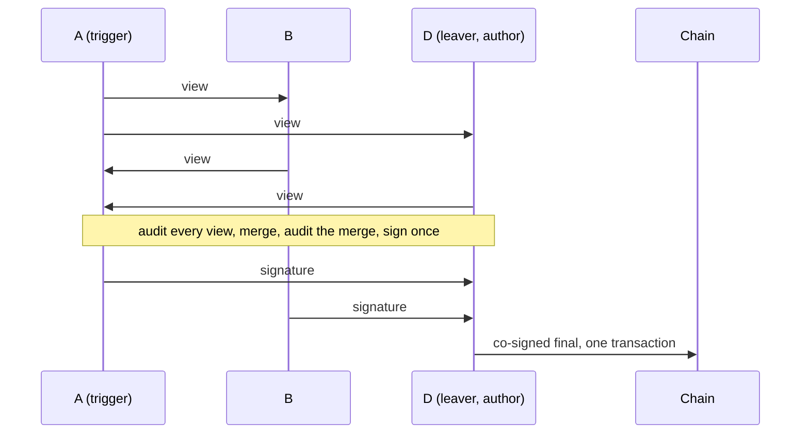
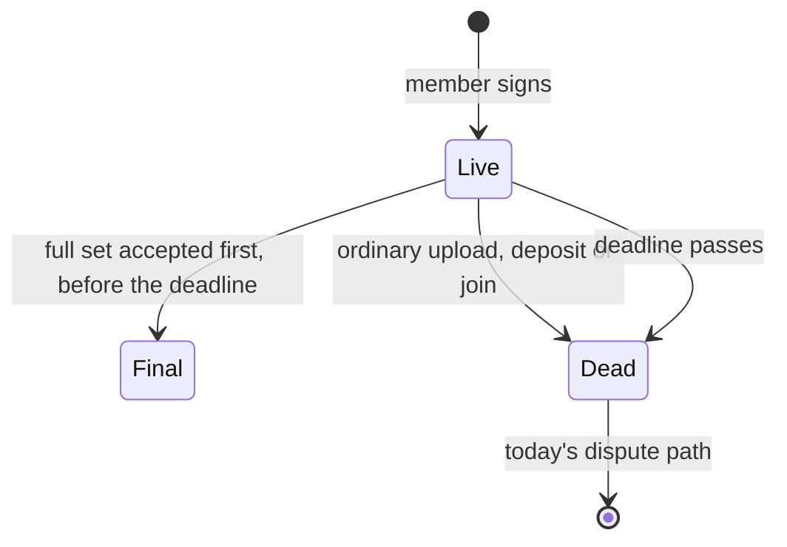

# Design: Co-signed final dispute

state-channels-plus · design only, no code · revision 13 · 2026-11-26 · proposal

## Overview

When a fork is disputed, members exchange their dispute views over P2P. Each member merges all views with the contract's own `reduce`, and every member signs the merged dispute. This doc calls that signed dispute the _final_. One transaction then settles the fork: the contract checks the signatures and does not reduce again. If a round fails for any reason, peers fall back to today's path. Every member uploads its own dispute, the chain waits out the evidence period and the kill period, and a reduce transaction finishes the dispute.



A signature stays usable after the round ends, because anyone who holds the full set of signatures can submit it. So the signed bytes carry an expiry time, `finalDeadline`. The contract accepts a final only if it is the first upload for its fork and the inbound head written into it is still the latest one. (The inbound head is the latest deposit or join passed from the chain into the channel.) An ordinary dispute upload, a deposit or a join therefore makes every copy of the final fail. The chain decides which path wins, so peers never need to agree on who gave up.



Every member of the on-chain signer set has to sign, so one honest member can block a wrong outcome. A colluding group of any size can only veto the final, and a veto sends everyone to today's path.

While a member's signature could still be accepted on chain, the member stops signing new blocks, because an accepted final would throw those blocks away. This pause must not push the next writer past its timeout, so a round may only start early in a turn. The round, the pause and the writer's catch-up together take 13 s plus six block times, because six of the steps wait for a block. With 2 s blocks that is 25 s, so a round must start in the first 25 s of a 50 s turn. Section 10 works through an example.

The local diamond can miss chain events without noticing. So a member signs only on facts that the contract checks again, facts fixed by a hash in the signed bytes, or facts it has just read from the chain.

Today's auditor only runs on forks that already have a dispute window. Here the fork is still live. So a member audits only views whose blocks it has already executed, and the audit leaves the state machine as it found it. Replaying a missed event can call `dispute()` again, and the dispute mutex isn't re-entrant. So the round never repairs the local diamond.

The author of the merged dispute submits it first. The author is the leaver, or else the member that holds the most advanced state. The other members wait 2 s and one block. If the chain has not accepted the final by then, they send the same bytes, and the chain refuses the duplicates.

Timeouts stay on today's path, since an offline peer can't sign. One case gets slower than today. Today a member can kill a cheater's dispute and upload its own in the same transaction, and that finalizes at once. Under this design it no longer finalizes at once (open question 2).

## Terms

| Term                               | Meaning                                                                                                                                                                                                                                                           |
| ---------------------------------- | ----------------------------------------------------------------------------------------------------------------------------------------------------------------------------------------------------------------------------------------------------------------- |
| final                              | the merged dispute that every member signed. It settles the fork in one transaction, with no evidence period or kill period.                                                                                                                                      |
| ordinary path, ordinary upload     | today's dispute flow. Each member uploads its own dispute. Then come the evidence period, the kill period and a reduce transaction.                                                                                                                               |
| round                              | one exchange of views and signatures for one fork                                                                                                                                                                                                                 |
| view                               | one member's own dispute for the fork, sent to the others as a proposal                                                                                                                                                                                           |
| merge                              | the dispute every member computes from all views with the contract's `reduce`                                                                                                                                                                                     |
| signer set, R                      | the members whose signatures the contract requires (the on-chain threshold set)                                                                                                                                                                                   |
| T                                  | members proven to have cheated by a fraud proof carried in the round. The final slashes them and needs no signature from them.                                                                                                                                    |
| full set                           | signatures from every member of R − T                                                                                                                                                                                                                             |
| author                             | the member named as `disputer` in the final. It submits the final first.                                                                                                                                                                                          |
| member with all signatures, sender | a member that holds the full set of signatures; the sender is whoever sends the final transaction                                                                                                                                                                 |
| inbound head                       | the latest inbound message (a deposit or join passed from the chain into the channel) that a dispute builds on. The contract refuses a dispute whose inbound head is no longer the latest.                                                                        |
| round-start read                   | the one chain read a member makes when its round starts, and the values it returned: inbound head, snapshot, signer set and the fork's dispute window, all at one block                                                                                           |
| window                             | the on-chain dispute window of a fork, opened by its first dispute upload                                                                                                                                                                                         |
| commitment                         | a dispute recorded in a window. An ordinary upload adds one.                                                                                                                                                                                                      |
| disputed-fork flag                 | today's flag that means "I already disputed this fork"                                                                                                                                                                                                            |
| signed record                      | the entry "fork, digest, `finalDeadline`" a member writes to `DisputeStorage` before it sends its signature                                                                                                                                                       |
| signing pause                      | the rule "do not sign or accept new blocks on this fork". Today it is on while the disputed-fork flag is set. Here it is also on while a final the member signed could still be accepted on chain. It is a flag check, not a lock: the dispute mutex is separate. |
| re-feed of dropped blocks          | when a pause ends, the member feeds the blocks the next writer posted on chain during the pause (which the pause made it drop) back into its pipeline. Today the same step runs after a failed upload.                                                            |
| check the chain for the outcome    | read the fork's window commitments from the chain (`loadSynchronizedWindowCommitments`) to learn an outcome the member may have missed, and adopt it                                                                                                              |
| follow-up dispute                  | the one `dispute()` call a member with all signatures makes when its signature ended without a window, to pick up the triggers it ignored during the pause                                                                                                        |
| writer, turn, M                    | the member due to produce the next block, the time it has for that, and the moment it can be timed out                                                                                                                                                            |
| relevant timestamp                 | the time a writer's turn is measured from: the previous block's timestamp if the writer signed that block, else the later of that timestamp and the time the block was posted on chain                                                                            |
| local diamond                      | each member's in-memory copy of the contract, fed by chain events. It can lag the chain.                                                                                                                                                                          |
| A, B, g, s                         | agreement time (5 s), block-time bound (2 s intended), grace before others submit (2 s), slack (1 s)                                                                                                                                                              |

## 1. Core ideas

1. Every member must sign, so one honest member is enough. It signs only a merge that it built and checked itself, using facts it can trust (the signing rule, section 2). Whether members agree affects only speed.
2. The chain picks one path. A final must be the first upload for its fork, and the chain must accept it before the deadline in its signed bytes. An ordinary upload, a deposit or a join kills it. Peers never have to agree on who gave up.
3. Any failure falls back to today's path. The round takes nothing that the ordinary path needs. A member that finds its local data out of date takes today's path.

## 2. Requirements and trust model

The appendix lists the spec IDs and code locations for each requirement.

1. **Outcome.** The final is what `reduce` produces from the members' views. Before signing, each member checks every view and the merged result with its own auditor. It also makes sure the final builds on the latest block of its own view. If any member rejects a view, there is no final. A member signs only on facts that the signing rule (below) allows.
2. **Unanimity.** Every member of the on-chain threshold set (snapshot ∪ pending − on-chain slashed) signs. Each signature counts once, as everywhere else in the SDK. The only members left out are those that the same transaction slashes, with a proof that the chain verifies.
3. **Exclusivity.** A final and ordinary disputes never mix on one fork. If anyone has already uploaded an ordinary dispute for the fork, the chain refuses the final. So a final can never wipe out evidence that is still being judged. The chain also refuses a final after its deadline.
4. **Signatures expire.** A signer is free again at the first block whose timestamp is past the deadline. It then checks the chain for the outcome in the background, and the signing pause does not wait for that check.
5. **Chain fallback intact.** A failed round leaves the ordinary path as it is today. A final uses no throttle or upload slot. After a failed round a member uploads only if it has a reason or more evidence, as today. The one addition: a member that held all signatures, but whose final was never accepted, uploads one ordinary dispute afterwards, because its usual dispute triggers were paused while it waited (§8). A timeout is always handled on the ordinary path.
6. **Signing pause.** A member stops signing new blocks on the fork as soon as it sends its view. After it signs a final, it keeps not signing them until the final is accepted on chain or its signature expires.
7. **No honest writer loses its turn.** The pause from point 6 must end early enough that the next block writer can still post its block on chain before it can be timed out. This holds unless the writer is a proven cheater, and as long as a new chain block comes at least every B seconds. When the pause ends, the writer is told again that it is its turn.
8. **No central gatekeeper.** No operator or elected leader decides the outcome or who submits.
9. **Few duplicates.** When the author is honest, the other members normally send nothing. A member sends its own copy of the final only if, two blocks after it collected all signatures, it still has not seen the final accepted on chain (its node is slow to process the event, or missed it). The chain refuses such a copy, and it changes nothing.
10. **RPC rules.** The round is one new service in the existing network RPC framework (a `*Service` and `*RpcMethods` pair registered like every other service, §4). It adds two one-way messages and no transport or request/response protocol of its own. The usual rules apply: messages are tied to the sender's identity, go to participants only, use bounded resources, and no message from a peer can crash the node.

**Trust model.** Safety needs one honest member of the threshold set. That member must also be a snapshot participant, not only a pending joiner (§6, open question 7). If every signer colludes, they can finalize anything; the spec already accepts this. A colluding strict subset, whether a minority or a majority, can only veto. The design assumes the chain head does not reorg (open question 5). The local diamond is not trusted to be in sync. Its event stream can drop a log while the socket stays open. The watermark (the last block whose logs the member processed) then moves past the missing log, so the gap goes unnoticed. The signing rule keeps safety independent of the local diamond. Spectators and watchtowers take no part.

**Signing rule.** A member's local diamond may be out of date, so before signing it relies only on facts that cannot mislead it:

- facts the contract checks again when it accepts the final;
- facts fixed by a hash in the signed bytes;
- facts it read from the chain during the round;
- local facts that can only be wrong toward "no". The local diamond only lags the chain, so a slash it already holds really is on chain.

A member also audits only views whose blocks it executed itself. The merge then builds on its own latest block, so it never signs away state it already signed. With this rule one honest signer is enough for a correct final, whatever its local diamond missed.

The round reads the chain four times, all for this decision:

1. once at round start (§3);
2. each fraud proof, while auditing views (§5);
3. the same proofs again, right before the final is sent (§7);
4. once after a signature expires, to learn whether the final was accepted (§8).

Reading block headers for the chain time does not count. Everything else uses local data, and when the chain refuses something, the member recovers after the dispute mutex is released.

## 3. When a round runs, and with whom

### Where the round starts

Every dispute trigger already ends up in `DisputeManager.dispute` ([DisputeManager.ts#L145](../../src/disputeManager/DisputeManager.ts#L145)). The round is one new call there, `agree(forkId, constructed)`. It sits after the member has taken the dispute mutex and set its disputed-fork flag, so it has stopped signing new blocks on the fork ([L180-L192](../../src/disputeManager/DisputeManager.ts#L180-L192)), and after its own dispute is built ([L197](../../src/disputeManager/DisputeManager.ts#L197)), and before the upload.

A member runs at most one round per fork. Every way out of `agree()` closes the fork for that member, and a later call returns "no round" at once. A Byzantine member can therefore spoil one round, which is no more than the veto it already has.

### Which disputes can start a round

Only a dispute with a reason of its own: a leave, a fraud proof or a forced inbound message. In code this is `requireExistingDisputeWindow == false` ([DisputeBuilder.ts#L480](../../src/disputeManager/DisputeBuilder.ts#L480), rule [DisputeUtils.sol#L113-L121](../../contracts/V1/StateChannelDiamondProxy/utils/DisputeUtils.sol#L113-L121)). A timeout is also a reason, but it never starts or joins a round. A dispute with no reason ("reason-less") can only add to a window that already exists.

### The round-start read

The round starts with one `EventSyncService.readPinnedChainMembership` call ([EventSyncService.ts#L460-L503](../../src/stateManager/eventSync/EventSyncService.ts#L460-L503)). This multicall already returns the slashed set, the snapshot and the channel balance with the inbound head, all at one block. It gains two values that the proxy already routes: the threshold set and the fork's window creation time ([StateChannelManagerProxy.sol#L97](../../contracts/V1/StateChannelDiamondProxy/StateChannelManagerProxy.sol#L97), [L117](../../contracts/V1/StateChannelDiamondProxy/StateChannelManagerProxy.sol#L117)). The call runs no event handler and writes nothing, so it is safe to make while holding the dispute mutex. Its block, timestamp and values are the **round-start read**. Every member in the round makes its own round-start read, the trigger and each joiner alike. None relies on another member's read, because that would mean trusting a peer's claim about the chain. So a round costs one multicall per member.

### Who must sign

A member does not wait for anyone it holds a valid fraud proof against (call them T₀): the final slashes those members in the same transaction, so their signatures are not needed. It knows them from proofs it built itself ([DisputeBuilder.ts#L355-L386](../../src/disputeManager/DisputeBuilder.ts#L355-L386)) and from proofs in received views, which it checked on chain. So it waits for R − T₀, where R is the signer set from the round-start read.

If that leaves only the member itself, it signs and submits at once, with no messages and no timer. In a 2-member channel with a proven cheater, this keeps today's one-transaction settlement.

### When no round runs

The member goes straight to today's path, with no added delay, if any of these holds:

- the round-start read fails or throws;
- the round-start read shows the fork already has a window;
- its own dispute's inbound head, or its local snapshot, differs from the round-start read (its local data is stale). Slashes are not compared: a list with fewer slashes is the race §6 accepts, and the member's own list also holds pending targets ([DisputeBuilder.ts#L385-L400](../../src/disputeManager/DisputeBuilder.ts#L385-L400));
- its own dispute carries a timeout;
- its own dispute is reason-less and did not come in to join a round (see below). It then uploads as today: as the replacement upload after a kill ([EventHandler.ts#L341-L353](../../src/eventHandlers/EventHandler.ts#L341-L353)), and if the chain refuses it, today's missed-slash recovery runs ([DisputeManager.ts#L322-L324](../../src/disputeManager/DisputeManager.ts#L322-L324));
- it has no open connection to some member of R − T₀;
- the turn rule fails (§8).

### Joining another member's round

A member that receives a view for its active fork joins only if all of these hold:

1. it has not already run a round on the fork, and its own disputed-fork flag is clear;
2. the view passes the message checks (§4) and the audit (§5);
3. the view has a reason of its own;
4. the turn rule holds.

To join, it marks the fork "join requested" and calls the existing `requestDispute(forkId)` once, in the background. That call sets the member's disputed-fork flag (so it stops signing new blocks), builds the member's own view, makes its round-start read and enters the round. The received view is kept and later checked against the round-start read and merged.

The mark lets `agree()` tell this call apart from other reason-less calls. The first reason-less call takes the mark and is answered "joined", whether or not a round then runs; if none runs (round-start read disagrees with local data, missing connection, turn rule), it uploads nothing. Every other reason-less call (adding evidence, a replacement upload after a kill, a §8 follow-up dispute) finds no mark and goes the usual way.

If the member's flag is already set, its own `dispute()` is already running, so it does not join. If that call has a reason, it simply meets the kept view. Two members that trigger at the same time therefore end up in a single round.

### A member with stale local data

A member whose local data disagrees with its round-start read skips the round and takes today's path. Fixing a local diamond that missed events belongs to event sync and the light client work, not to this design.

## 4. Messages (RPC)

The new pair is `src/rpc/network/services/disputeAgreement/DisputeAgreementService.ts` + `DisputeAgreementRpcMethods.ts`. It is registered in [MainRpcService.ts#L40-L58](../../src/rpc/network/MainRpcService.ts#L40-L58) and guarded by `HandshakeCompletedGuard`, as in [IsForkDisputedService.ts#L16-L25](../../src/rpc/network/services/isForkDisputedService/IsForkDisputedService.ts#L16-L25). It has two fire-and-forget endpoints. Both are sent with `sendMultiple(R − self)` ([RpcHandler.ts#L61](../../src/rpc/network/RpcHandler.ts#L61)), never with `broadcast`, which also reaches spectators.

| Endpoint             | Params                                                        | When                                   |
| -------------------- | ------------------------------------------------------------- | -------------------------------------- |
| `onDisputeView`      | `{ encodedDispute, encodedAuditingData, encodedFraudProofs }` | once, when the sender's round starts   |
| `onDisputeSignature` | `{ forkId, digest, signature }`                               | once, after the sender signs the merge |

- **View.** The constructed dispute with `finalDeadline` set to the sender's proposal (§6), plus its auditing data and the proofs construction would apply. All three are Codec-encoded (add a Codec type for the proof array if missing). A view carries no signature.
- **Signature.** It carries the digest of the merged dispute the sender signed, not the dispute bytes. The digest is `keccak256(Codec.encode(merged, Type.Dispute))`, the same hash `signDispute` signs under the EIP-191 prefix (§6). The receiver first recovers the signer over the stated digest with `recoverSigner` ([SignerRecoveryCache.ts#L135](../../src/cache/SignerRecoveryCache.ts#L135)). If that is not the sender, the signature is invalid. If it is the sender but the digest differs from the receiver's own merged digest, the sender merged something different, so the members disagree. Either way the round ends, and the log names which case it was, with both digests for a disagreement.
- **Receiver checks.** These run on the Service (RpcMethods only forwards), before any audit.
    - _Ignored:_ a sender outside the threshold set (the local set before the round-start read, R after); a `disputer` that is not the sender; a fork that is not the active one, or is closed; a second view from the same sender. A second view is not punished, because an equivocator sends different views to different peers anyway.
    - _Rejected:_ a view with a timeout; `finalDeadline` 0 or not later than the receiver's chain time (`Clock.getTimeInSeconds`); auditing data that does not hash to `disputeAuditingDataHash` (builder [DisputeBuilder.ts#L459-L461](../../src/disputeManager/DisputeBuilder.ts#L459-L461), chain [DisputeManagerFacet.sol#L21-L24](../../contracts/V1/StateChannelDiamondProxy/DisputeManagerFacet.sol#L21-L24)); an inbound head that is not the inbound head from this member's round-start read. A member that has not pinned yet checks the inbound head when it makes its round-start read.
    - A rejected view ends a running round. A member not in a round does not join, and its fork stays open.
- **Bounds.** The frame cap bounds the payload ([Rpc.ts#L31](../../src/rpc/Rpc.ts#L31)). Work is bounded to one view, one signature and one audit per sender per fork.
- **State.** The Service holds only transport and round state: views and signatures by member for the active fork, the round-start read, the merged bytes, the round timer (via `timeoutManager`), the join mark and the closed forks. The join mark dies with the `dispute()` call it was requested for, whether that call took it or not. Merge and finish live on `DisputeBuilder`, the signature task on `DisputeManager`, and the signed record on `DisputeStorage`. Collected signatures never go to `storeDisputeConfirmation`, which holds only disputes committed on chain.

## 5. Agreement algorithm

Each member runs the same steps.

1. **Send** its view to R − self.
2. **Audit each view as it arrives.**
    - _Only executed blocks._ Audit a view only if its latest block is stored on this member's live path at or below the fork's live height (`getLatestBlockHeight`, [BlockStorage.ts#L246-L249](../../src/storage/BlockStorage.ts#L246-L249)), or if the view has no block. Otherwise a joiner does not join, and a member in a round ends it. The check is local and can only be wrong toward "no". It costs the round only while a block is in flight, was withheld, or was double-signed.
    - _Proofs on the chain._ Run each carried proof with `runFraudProof.staticCall` at the head ([FraudProofFacet.sol#L31-L36](../../contracts/V1/StateChannelDiamondProxy/FraudProofFacet.sol#L31-L36)), with the replay gas the real send would use. It must return its stated target. If it returns another address or reverts, the view is invalid. A revert means "not judged". It comes from an under-funded replay ([StateChannelManagerProxy.sol#L398-L409](../../contracts/V1/StateChannelDiamondProxy/StateChannelManagerProxy.sol#L398-L409)) or from a proof the chain no longer judges ([FraudProofFacet.sol#L307-L310](../../contracts/V1/StateChannelDiamondProxy/FraudProofFacet.sol#L307-L310), [L361-L365](../../contracts/V1/StateChannelDiamondProxy/FraudProofFacet.sol#L361-L365)). A revert ends the round and is never fatal. The same check runs on the proofs in the member's own view. `applyFraudProofs` ([L11-L29](../../contracts/V1/StateChannelDiamondProxy/FraudProofFacet.sol#L11-L29)) runs the same code at inclusion, so if the chain changes in between, the final reverts. With the light client, the same call is answered from proven state.
    - _Then the existing auditor:_ `validateDispute(view, auditingData, pendingSlashes)` ([DisputeValidationService.ts#L68](../../src/stateManager/dispute/DisputeValidationService.ts#L68)). `pendingSlashes` is a new optional argument: the targets of the view's verified proofs. The slash-subset check ([L734-L752](../../src/stateManager/dispute/DisputeValidationService.ts#L734-L752)) accepts them alongside on-chain slashes. Without it, every view that carries a proof is invalid (prototype S11). When the auditor accepts a slash from the local set, that is signing-rule kind (d).
    - _The audit leaves live state alone._ Today the auditor runs only on forks with a window, and such forks never produce blocks again. Its tail replay ([L347](../../src/stateManager/dispute/DisputeValidationService.ts#L347)) goes through the live ingest path ([L380-L384](../../src/stateManager/dispute/DisputeValidationService.ts#L380-L384)). That path sets the shared state machine to each predecessor and keeps the advanced state ([BlockIngestService.ts#L160-L163](../../src/stateManager/ingest/BlockIngestService.ts#L160-L163), [L354-L359](../../src/stateManager/ingest/BlockIngestService.ts#L354-L359)). So the replay holds the state mutex for its whole tail, where today it takes the mutex per block ([L95](../../src/stateManager/ingest/BlockIngestService.ts#L95)). It also puts back the state it found on every outcome (valid, invalid, throw), for every caller. The auditor reads states from storage ([DisputeValidationService.ts#L782-L786](../../src/stateManager/dispute/DisputeValidationService.ts#L782-L786)). The replay also stores the blocks it runs ([BlockCommitService.ts#L78-L81](../../src/stateManager/block/BlockCommitService.ts#L78-L81), [L105-L108](../../src/stateManager/block/BlockCommitService.ts#L105-L108)). Under the executed-blocks rule those blocks are already stored. So the store only merges signatures, and it moves no height or outbound head ([BlockStorage.ts#L59-L68](../../src/storage/BlockStorage.ts#L59-L68)). Without the rule, a block that an audit stored but never executed would count as "past" when it arrived live, and it would never execute ([BlockQueueManager.ts#L329-L335](../../src/stateManager/ingest/BlockQueueManager.ts#L329-L335)). The spike checks whether the replay can be skipped for executed blocks. That would remove the whole-tail mutex and the restore (section 15).
    - A rejected view ends the round. The auditor stores a dispute fraud proof keyed by the view's bytes ([DisputeFraudProofService.ts#L358-L378](../../src/stateManager/dispute/DisputeFraudProofService.ts#L358-L378)). With `finalDeadline != 0` those bytes are never an ordinary chain dispute, so nothing acts on that proof.
    - An auditor throw (missing data, read error, [L60-L66](../../src/stateManager/dispute/DisputeValidationService.ts#L60-L66), [L83-L86](../../src/stateManager/dispute/DisputeValidationService.ts#L83-L86)) ends the round and is logged. It is never fatal, because the input was a peer message.
    - The auditor's inbound recovery ([L855-L861](../../src/stateManager/dispute/DisputeValidationService.ts#L855-L861)) may apply a recovered inbound log through the live handler. That handler calls no `dispute()` ([EventHandler.ts#L356-L376](../../src/eventHandlers/EventHandler.ts#L356-L376)), so it cannot wait on the round's mutex. The round itself adds no repair.
3. **Proven members T.** P is the set of proofs carried in V (the own view included) that passed the chain check. T is the set of targets of proofs in P whose sender is not itself a target in P. This is a single pass with no fixed point, so a proven member's proofs do not count. Wait for a view from every member of R − T, or until the round timer A runs out.
4. **Merge.** Sort the views of R − T by `disputer` and run `localDiamondContract.reduce.staticCall(sortedViews)` ([DisputeVerificationFacet.sol#L69-L73](../../contracts/V1/StateChannelDiamondProxy/DisputeVerificationFacet.sol#L69-L73)). Use its `latestBlock` (highest `transactionCnt`, ties go to the lowest hash), its slash union and its self-removers. Its timeout output is empty.
    - `reduce` reads the local diamond, but harmlessly. The window timestamp and the slashes up to the window end are empty, since there is no window on chain and the local diamond only lags. The inbound head, inbound map and snapshot ([L93-L106](../../contracts/V1/StateChannelDiamondProxy/DisputeVerificationFacet.sol#L93-L106)) feed only inbound outputs, which the merge ignores, and they cannot revert. Each view lists the on-chain slashes it saw, so the union covers them. A forge test checks this ([`OQ-39-C3EAMN`](../../docs/spec/specification/open-questions.md#oq-39-c3eamn) may make `reduce` stateless).
    - More than one self-remover: one dispute cannot carry more than one ([L533-L536](../../contracts/V1/StateChannelDiamondProxy/DisputeVerificationFacet.sol#L533-L536)), so the round ends.
    - **Finish** with the tail of `DisputeBuilder.build` ([L476-L533](../../src/disputeManager/DisputeBuilder.ts#L476-L533)), turned into one method that `build` and the merge both use. Its inputs are the dispute input, the auditing data, the latest state machine state, the author, and whether a local "may omit" is confirmed on chain. The state is the input of `computeDisputeOutputSnapshotData` ([L488-L493](../../src/disputeManager/DisputeBuilder.ts#L488-L493)); for a merge it comes from storage, since the base's latest block was executed. The base is the first sorted view whose last block is `latestBlock`, or the first sorted view if no view has a block ([DisputeVerificationFacet.sol#L113-L131](../../contracts/V1/StateChannelDiamondProxy/DisputeVerificationFacet.sol#L113-L131)). Its state proof, auditing data and snapshot are used as they are. Four fields are replaced. `onChainSlashes` becomes the slash union ∩ the base snapshot's participants. `selfRemoval` becomes the self-remover. `disputer` becomes the self-remover, or else the base's disputer. `finalDeadline` becomes the minimum over the views of R − T; a proven member's view never enters, so it cannot move the deadline. `requireExistingDisputeWindow` and `outputSnapshotDataHash` are recomputed. If the merge has no reason of its own, the round ends.
    - **`postedAuditingData`** takes the local diamond's answer. Unlike `build` ([DisputeBuilder.ts#L518-L533](../../src/disputeManager/DisputeBuilder.ts#L518-L533)), it gets no chain confirmation of a "may omit". The flag only picks the entry point, never the outcome, and with no kill period it never makes a signer slashable. It derives from the snapshot, which the round-start read covers. A snapshot posted mid-round can make members compute different digests, which costs only the round.
    - **Proofs to apply**: for each target in T, the first proof in sorted order that targets it.
5. **Audit the merge** with `validateDispute(merged, base auditing data, T)`. This catches anything the fold produced that no view showed (prototype S2c). If the merge is rejected, the round ends. _The merge extends every view._ Every audited view's latest block lies on this member's live chain, which has one block per height ([BlockStorage.ts#L59-L61](../../src/storage/BlockStorage.ts#L59-L61)). So the highest of them extends all the others, the own view's included. The merge alone does not guarantee this. It picks by `transactionCnt` and hash ([L117-L131](../../contracts/V1/StateChannelDiamondProxy/DisputeVerificationFacet.sol#L117-L131)), and the auditor accepts a sibling block it cannot prove final ([DisputeValidationService.ts#L180-L184](../../src/stateManager/dispute/DisputeValidationService.ts#L180-L184)). A sibling exists only after a double-sign, and the ordinary path slashes that.
6. **Sign once.** Re-check the turn rule with the merged deadline. Write the signed record "fork F, digest D, `finalDeadline`" to `DisputeStorage` _before_ sending. Sign `Codec.encode(merged, Type.Dispute)` with `signDispute` ([SignatureUtils.ts#L67](../../src/utils/SignatureUtils.ts#L67)) and send `onDisputeSignature`. A member never signs a second final for a fork.
7. **Collect.** An invalid signature, or one over a different digest, ends the round. Signatures from all of R − T make the full set (§7).

**Convergence.** Honest members differ only in what they know: a proof, a leave, or a block in flight. The merge is a union over proofs and leaves. A block in flight ends the round at the member that lacks it. The same V and the same round-start read give the same bytes. Sorting fixes the order of `reduce`'s input, so `INV-DIS-5` order-independence does not matter here. A different V or chain state gives different bytes. Then no digest collects every signature, and nothing is submitted, which is safe. There is no retry and no second round, since under unanimity any member can block anyway.

## 6. What is signed, and the contract branch

```
signature = personal_sign( keccak256( abi.encode(Dispute) ) )      // EIP-191, as today
Dispute   = { DisputeInput input, bool postedAuditingData, bytes32 outputSnapshotDataHash }
DisputeInput gains, as its last field:  uint256 finalDeadline      // chain timestamp; 0 = ordinary dispute
```

The contract verifies the signatures with `verifyThresholdSigned` ([UtilityFacet.sol#L46-L89](../../contracts/V1/StateChannelDiamondProxy/UtilityFacet.sol#L46-L89)), after the canonical-encoding check ([DisputeManagerFacet.sol#L115-L116](../../contracts/V1/StateChannelDiamondProxy/DisputeManagerFacet.sol#L115-L116)). The struct is in [DisputeTypes.sol#L22-L59](../../contracts/V1/types/DisputeTypes.sol#L22-L59).

| Field                                                              | Binds                                                                                                                                                 | Signing-rule leg                                                                     |
| ------------------------------------------------------------------ | ----------------------------------------------------------------------------------------------------------------------------------------------------- | ------------------------------------------------------------------------------------ |
| `channelId`, `forkId`                                              | channel and fork (a window opens only once)                                                                                                           | own fork; the round-start read shows no window                                       |
| `latestInboundMessageBlockHash` + height                           | the chain moment. A later deposit or join reverts every copy ([L50-L57](../../contracts/V1/StateChannelDiamondProxy/DisputeManagerFacet.sol#L50-L57)) | the contract checks it at inclusion                                                  |
| `finalDeadline`                                                    | marks a final and bounds its life                                                                                                                     | the contract checks it at inclusion; the member's own proposal caps it               |
| `stateProof`, `latestStateSnapshotHash`, `disputeAuditingDataHash` | the agreed state and its data                                                                                                                         | own audit of hash-bound data over executed blocks; extends own view                  |
| `onChainSlashes`                                                   | merged slashes                                                                                                                                        | local set (it only lags) or chain; a pending target from the chain's `runFraudProof` |
| `selfRemoval`, `disputer`                                          | leaver, author                                                                                                                                        | the leaver's own signature                                                           |
| `timeout`                                                          | empty                                                                                                                                                 | any view with a timeout ends the round                                               |
| `outputSnapshotDataHash`                                           | the successor fork                                                                                                                                    | computed from hash-bound inputs                                                      |
| `postedAuditingData`                                               | entry point                                                                                                                                           | affects liveness only                                                                |

- **Deadline.** Each view proposes `round-start time + A + g + 3B` (§10). The merge takes the minimum, so equal V gives an equal value. A Byzantine proposal can only shorten the deadline, which amounts to a veto, and an honest proposal caps it.
- **Only the merge is signed.** The finish method stops before the builder's signing line ([DisputeBuilder.ts#L544-L547](../../src/disputeManager/DisputeBuilder.ts#L544-L547)). The only signature over bytes with `finalDeadline != 0` is the one from step 6, which comes with a signed record and the signing pause.
- **No round number.** Fork, inbound head and deadline make each round's bytes unique, and there is one round per fork.
- **No domain separation** in the bytes ([OQ-29](../../docs/spec/specification/open-questions.md#oq-29-efy4nf)). Here the missing separation reaches a finalization path (open question 9).

**Contract branch.** `_uploadDispute` gets one internal branch at the top, taken when `finalDeadline != 0` ([DisputeManagerFacet.sol#L40-L45](../../contracts/V1/StateChannelDiamondProxy/DisputeManagerFacet.sol#L40-L45)). It needs no new route and no interface change. After the entry-point checks ([L9-L24](../../contracts/V1/StateChannelDiamondProxy/DisputeManagerFacet.sol#L9-L24)), which an honest sender never fails, the branch checks:

1. no window exists for the fork (`creationTimestamp == 0`), else `ErrorFinalWindowExists`. Check 1 comes first, so every other refusal proves there was no window (§7 relies on this);
2. `block.timestamp <= finalDeadline`, else `ErrorFinalExpired`;
3. `_isDisputeThresholdFinal` ([L194-L212](../../contracts/V1/StateChannelDiamondProxy/DisputeManagerFacet.sol#L194-L212)), else `ErrorFinalNotThresholdSigned`;
4. the unchanged shared checks: the sender can participate ([L46-L49](../../contracts/V1/StateChannelDiamondProxy/DisputeManagerFacet.sol#L46-L49)), the inbound-head check ([L50-L57](../../contracts/V1/StateChannelDiamondProxy/DisputeManagerFacet.sol#L50-L57)), `requireExistingDisputeWindow == false`, and `_disputeRaceConditionCheck` ([L146-L192](../../contracts/V1/StateChannelDiamondProxy/DisputeManagerFacet.sol#L146-L192), a no-op without a timeout);
5. the canonical encoding. Then the window is created already expired and the output is committed, as today ([L117-L130](../../contracts/V1/StateChannelDiamondProxy/DisputeManagerFacet.sol#L117-L130)). There are no commitments to delete.

The branch skips the sender == disputer check ([L45](../../contracts/V1/StateChannelDiamondProxy/DisputeManagerFacet.sol#L45)), the throttle ([L80-L85](../../contracts/V1/StateChannelDiamondProxy/DisputeManagerFacet.sol#L80-L85)) and the already-posted check ([L104-L107](../../contracts/V1/StateChannelDiamondProxy/DisputeManagerFacet.sol#L104-L107)). The signatures authorize a final, and its sender only carries it. The branch does not forbid a timeout, because no honest member signs one. The ordinary branch (`finalDeadline == 0`) is today's code without `isThresholdFinal`, so an ordinary upload is never final.

**Why the contract can skip reduction.**

- Every live member signed the exact output, and at least one of them signed honestly. Each signed only after its auditor accepted every view and the merge, using signing-rule facts. That audit replaces the kill period.
- A colluding subset lacks the honest signature (prototype S8a).
- The set shrinks only through `applyFraudProofs` in the same transaction, which the chain verifies. A failing proof slashes its sender ([FraudProofFacet.sol#L17-L26](../../contracts/V1/StateChannelDiamondProxy/FraudProofFacet.sol#L17-L26)). Then the set does not shrink, and check 3 reverts (S8b).
- Because of check 1, a final never overrides evidence under judgement, so a withholder cannot erase an honest commitment with its own (S10, P6). Because of check 2, a withholder cannot keep signatures to use later (S8d, P5).
- The set cannot grow without moving the inbound head, because pending members arrive through inbound messages. Such a final reverts at check 3. A slash between signing and inclusion shrinks the set. The extra signature is tolerated, and the slash applies in the next fork. This race was accepted on 2026-10-08 ([disputes.md#L218](../../docs/spec/specification/disputes/disputes.md#L218)).
- _Snapshots._ The bytes do not fix the chain's snapshot. Still, a snapshot posted between the round-start read and inclusion is an ancestor of the final's latest block. The reasoning goes as follows. A snapshot on the same fork needs a threshold-signed milestone ([StateSnapshotFacet.sol#L54-L74](../../contracts/V1/StateChannelDiamondProxy/StateSnapshotFacet.sol#L54-L74)), so an honest snapshot participant signed that block or a descendant. Every block that participant signed is an ancestor of its own latest block, because an auditor rejects a view below the disputer's own signature ([DisputeValidationService.ts#L687-L705](../../src/stateManager/dispute/DisputeValidationService.ts#L687-L705)). The signing pause stops it from signing more, and every merge it signs extends that block. Without this, a final on a sibling block would stop the next fork's snapshot from linking the run of outbound message blocks ([StateSnapshotFacet.sol#L100-L112](../../contracts/V1/StateChannelDiamondProxy/StateSnapshotFacet.sol#L100-L112)). That would lock every later snapshot and withdrawal. After a final, a snapshot post on the fork reverts ([L85-L87](../../contracts/V1/StateChannelDiamondProxy/StateSnapshotFacet.sol#L85-L87)). A pending joiner signed no block, so this argument needs an honest snapshot participant (open question 7).
- A final needs no challenge path afterwards, because a strict subset cannot finalize.

## 7. Submitter, grace, fallback, refusals

A member with all signatures keeps its disputed-fork flag, starts its signature task (§8) and releases the mutex. The task then submits. So the mutex is held for at most one round.

- **Author first.** The merged `disputer` (the leaver, else the owner of the most advanced state) sends `multicallBestEffortLast([applyFraudProofs(T), upload])` ([StateChannelManagerProxy.sol#L374-L389](../../contracts/V1/StateChannelDiamondProxy/StateChannelManagerProxy.sol#L374-L389)). It sends through a short `submitFinal` built on the existing send code. When T is empty it sends a plain upload.
- **Sender check.** Right before sending, every sender runs `runFraudProof.staticCall` at the head for each proof it carries. If one fails or reverts, it does not send. A failed proof slashes its sender ([FraudProofFacet.sol#L19-L22](../../contracts/V1/StateChannelDiamondProxy/FraudProofFacet.sol#L19-L22)), and the sender cannot react to that as it can to a refusal. The chain can still change before inclusion, as it can today for any disputer. Here the author also carries other members' proofs (open question 11).
- **Grace and fallback.** Let h be the chain head when the member got the full set. The author's transaction is in block h + 1 at the earliest, or h + 2 if it was sent late in a slot. Every other member with all signatures waits g = 2 s, then waits for head h + 2 (`waitForChainHead`, [EventSyncService.ts#L594-L640](../../src/stateManager/eventSync/EventSyncService.ts#L594-L640)). It waits at most until `finalDeadline`, and the runtime abort cuts the wait. `waitForChainHead` rejects when a head read fails, because its other callers expect that. So the task's own loop catches the rejection, counts it as "not yet" and waits again. If `close` has not ended the task by then, the task submits the same transaction, with no chain read first. A member whose handler for the final already ran sends nothing. A member whose handler has not run, or that missed the log, sends one duplicate, which check 1 refuses. If the author withholds, all remaining members with all signatures submit (open question 3).
- **Refusals.** `submitFinal` reads both forms of refusal through `lastCallRefusal` ([DisputeManager.ts#L306](../../src/disputeManager/DisputeManager.ts#L306), [L763](../../src/disputeManager/DisputeManager.ts#L763)): a reverted plain upload, and `MulticallLastCallFailed` in a mined multicall. No refusal is fatal, unlike an unhandled ordinary refusal ([L417-L427](../../src/disputeManager/DisputeManager.ts#L417-L427)). A refusal is only a decoded contract error from the final's own call, taken from the estimate or the mined receipt.
    - `ErrorFinalWindowExists`: the chain holds a window.
    - Any other refusal (`ErrorFinalExpired`, `RaceConditionDisputeInboundNotLatest`, `ErrorFinalNotThresholdSigned`, ...): there is no window.
    - **Not sent.** These cases are not refusals: a revert of the whole multicall, a failed send, a provider error, an unreadable receipt. Only the proof leg can revert the whole multicall, since only the last call is best effort ([StateChannelManagerProxy.sol#L378-L385](../../contracts/V1/StateChannelDiamondProxy/StateChannelManagerProxy.sol#L378-L385)). An example is `RaceConditionBlockHeightTooOld` after a snapshot post. In these cases the chain never judged the final, or may still include it. So the member keeps what it holds and waits for `close` or the deadline.
- **Duplicates are harmless.** A duplicate `applyFraudProofs` skips targets that are already slashed ([FraudProofFacet.sol#L17](../../contracts/V1/StateChannelDiamondProxy/FraudProofFacet.sol#L17)), so it never slashes its sender. Each duplicate costs one nonce on the zero-fee lane.

## 8. Signing pause, signature task, turn rule, exits

**Signing pause.** Today the signing pause is the disputed-fork flag (`storeDisputedFork`, [DisputeStorage.ts#L44-L46](../../src/storage/DisputeStorage.ts#L44-L46)). It becomes "the disputed-fork flag, or a live signed record". That is one `DisputeStorage` predicate, read at the three places that check the signing pause: block production ([BlockProductionService.ts#L192-L199](../../src/stateManager/block/BlockProductionService.ts#L192-L199)), counter-signing ([BlockCommitService.ts#L181-L185](../../src/stateManager/block/BlockCommitService.ts#L181-L185)) and intake ([ValidationService.ts#L217-L228](../../src/stateManager/ingest/ValidationService.ts#L217-L228), used by [BlockQueueManager.ts#L167-L183](../../src/stateManager/ingest/BlockQueueManager.ts#L167-L183)).

- The disputed-fork flag means "I already disputed this fork". Today it stays set after a successful upload. Only the two rollbacks in `dispute()` clear it ([DisputeManager.ts#L202](../../src/disputeManager/DisputeManager.ts#L202), [L429](../../src/disputeManager/DisputeManager.ts#L429)). Its other readers keep that meaning: the early return ([L174-L179](../../src/disputeManager/DisputeManager.ts#L174-L179)), the leave ([LeaveChannelService.ts#L359](../../src/stateManager/membership/LeaveChannelService.ts#L359)), `canAddEvidence` ([DisputeBuilder.ts#L113](../../src/disputeManager/DisputeBuilder.ts#L113)) and the audit ([EventHandler.ts#L712](../../src/eventHandlers/EventHandler.ts#L712), [L758](../../src/eventHandlers/EventHandler.ts#L758)).
- A **member with all signatures** has disputed in that sense and keeps the disputed-fork flag. So a queued `dispute()` returns early and cannot kill the member's own final.
- A **signer without the full set** clears the disputed-fork flag through the rollback when `dispute()` returns. Its signed record then keeps the signing pause on. The record exists only for this case.

**Signature task.** A signature is dead once any of these is true: the chain has a window for F, a block's timestamp is past `finalDeadline`, the inbound head moved, or the chain refused the final's call. Once true, each of these stays true on a head that does not reorg. Every signer starts one detached task on `DisputeManager`, observed like `requestDispute` ([DisputeManager.ts#L503-L510](../../src/disputeManager/DisputeManager.ts#L503-L510)) and timed via `timeoutManager`. `dispute()` starts the task before it releases the mutex, so no other `dispute()` runs in between. The task holds the disputed-fork flag (for a member with all signatures) or the record (for any other signer). If `close` already took it, the task ends at once. For a member with all signatures, the task also submits (§7). The task re-reads the head header every block. It reads only headers, so a missed log never keeps the signing pause on past the deadline. It releases on the first of these:

1. **`close(forkId)`.** The `DisputeCommitted` handler calls `disputeAgreementService.close(forkId)` right after the local diamond write and before `getRelevantWindow` ([EventHandler.ts#L519-L527](../../src/eventHandlers/EventHandler.ts#L519-L527)). So it closes even when no relevant window is found. In one synchronous call, `close` ends the round and the task, drops the fork's record, and clears the disputed-fork flag if the disputed-fork flag belongs to the round. It belongs to the round for a member with all signatures, and for a reason-less call still inside the round. A call with a reason inside the round keeps its disputed-fork flag, like any upload in flight. The audit that follows then reads the disputed-fork flag correctly ([EventHandler.ts#L712](../../src/eventHandlers/EventHandler.ts#L712), [L758-L764](../../src/eventHandlers/EventHandler.ts#L758-L764), [DisputeBuilder.ts#L113-L114](../../src/disputeManager/DisputeBuilder.ts#L113-L114)). A final is adopted. On a non-final window the audit decides as today. A member whose flag comes from its own ordinary upload only kills. Other members add evidence only if `canAddEvidence` finds more ([EventHandler.ts#L778-L797](../../src/eventHandlers/EventHandler.ts#L778-L797)). No re-feed of dropped blocks is needed here, since intake drops the blocks of a fork that has a window.
2. **A refusal** (§7). On `ErrorFinalWindowExists`: end the pause and check the chain for the outcome. On any other refusal: end the pause, and make a follow-up dispute if the task held the disputed-fork flag. No outcome read is needed then.
3. **A header past `finalDeadline` without `close`.** End the pause at once, then check the chain for the outcome. The member may have missed the window's logs, including those of its own final that the chain accepted. A successful submitter gets no refusal, so this is how it finds out.

A moved inbound head kills the signature early. But a signer without the full set gets no refusal, so its record stays until the deadline. The turn rule bounds that wait.

**Ending the pause.** On a refusal or a header past the deadline, the task drops what it holds and runs the failed-upload re-feed of dropped blocks ([DisputeManager.ts#L452-L473](../../src/disputeManager/DisputeManager.ts#L452-L473)), so no posted block is lost. A pause can drop more than one posted block. For example, a Byzantine next writer, alone or with a colluder, posts h and h + 1 during the pause. The writer of h + 1 is known only after h executes. So the re-feed of dropped blocks is chained at commit. After every commit, step 12 of [BlockCommitService.ts#L169-L177](../../src/stateManager/block/BlockCommitService.ts#L169-L177) first hands back the stored posted block for height + 1 by `nextToWrite`, if there is one. It does this through `TimeoutManager` with no delay (as step 11 schedules its post), instead of leaving it to the timeout check a full `timeoutWaitTime` later. Outside a pause, that block was already ingested when its event arrived, and the copy is treated as a past or queued duplicate. Each chained commit fires today's turn signal (step 10). So after the pause ends, the next honest writer gets every posted block, and its turn, at local execution speed.

The re-feed of dropped blocks gains one more step. When no posted block was handed back and this member is the fork's next writer, it fires `P2pEventHooksUtils.notifyTurn` ([P2pEventHooksUtils.ts#L164-L194](../../src/utils/P2pEventHooksUtils.ts#L164-L194)) again. This is needed because the writer's move during the pause was dropped. `playTransaction` returns `undefined` during the signing pause ([BlockProductionService.ts#L49](../../src/stateManager/block/BlockProductionService.ts#L49)), the signer still reports that it sent ([LocalP2pSigner.ts#L158-L164](../../src/evm/signer/LocalP2pSigner.ts#L158-L164)), and the turn signal fired only once, at the previous commit ([BlockCommitService.ts#L146-L156](../../src/stateManager/block/BlockCommitService.ts#L146-L156)). Every pause ends through this re-feed of dropped blocks, so every pause re-signals the turn. That covers the signature task, a joiner that returns without signing and a failed ordinary upload. The end of the pause never waits for an answer from the chain. If the chain accepted the member's own final and the member did not see it, the member is in today's missed-log state until the outcome check adopts the final. Any upload it makes meanwhile is refused as a lost race, and then it checks the chain for the outcome.

**Check the chain for the outcome** with `loadSynchronizedWindowCommitments` ([EventSyncService.ts#L385-L414](../../src/stateManager/eventSync/EventSyncService.ts#L385-L414)). A member checks the chain for the outcome whenever the chain may hold a window it has not seen. That happens on `ErrorFinalWindowExists`; on the two lost-race refusals of an ordinary upload ([DisputeManager.ts#L366-L371](../../src/disputeManager/DisputeManager.ts#L366-L371), [L406-L414](../../src/disputeManager/DisputeManager.ts#L406-L414)), which today only log; and on a task that reaches the deadline without `close`. The last is the one outcome check that answers no refusal.

- _Always detached, after the unlock._ The read replays missed logs through the live handlers, and some of them call `dispute()` ([EventHandler.ts#L213-L243](../../src/eventHandlers/EventHandler.ts#L213-L243), [L758-L764](../../src/eventHandlers/EventHandler.ts#L758-L764), [L794-L796](../../src/eventHandlers/EventHandler.ts#L794-L796)). It also waits on handler promises that are already running ([EventSyncService.ts#L768-L776](../../src/stateManager/eventSync/EventSyncService.ts#L768-L776)). If `dispute()` awaited the read, the read could end up waiting on its own caller, and the mutex has no re-entry ([Mutex.ts#L20-L46](../../src/utils/Mutex.ts#L20-L46)).
- A recovered final drives the existing `isFinal` adoption ([EventHandler.ts#L550](../../src/eventHandlers/EventHandler.ts#L550)). The outcome check holds nothing, so it has no deadline. An `undefined` answer (the log cannot be recovered yet) is retried next block until the read answers or the runtime aborts, as the reduce path does ([ReductionExecutor.ts#L99-L108](../../src/stateManager/reduction/ReductionExecutor.ts#L99-L108)). A throw goes to the fatal funnel, as it does there ([EventSyncService.ts#L399-L404](../../src/stateManager/eventSync/EventSyncService.ts#L399-L404)).
- _It decides from the read's answer_, because a log that was already handled is never dispatched again ([EventSyncService.ts#L219-L220](../../src/stateManager/eventSync/EventSyncService.ts#L219-L220)). It decides only adoption and the follow-up dispute. A commitment in the list means a window exists. That window's handler owns the fork, and the task is done. No commitment means either no window, or a window whose commitments were all killed. The list cannot tell these apart ([LocalDiamond.sol#L193-L212](../../contracts/V1/StateChannelDiamondProxy/LocalDiamond.sol#L193-L212); today's kill replacement reads the same list, [EventHandler.ts#L340-L345](../../src/eventHandlers/EventHandler.ts#L340-L345)). For a member with the flag set a follow-up dispute is right in both cases. A member with only a signed record in the all-killed case is in today's missed-log state until that window's logs arrive.

**Follow-up dispute.** A task that held the disputed-fork flag and finds no commitment calls `dispute(forkId)` once. It finds that out through a refusal other than `WindowExists`, or through the outcome check. While the disputed-fork flag was held, every trigger returned early, and nothing re-arms them. These triggers are the timeout check ([ParticipantTimeoutService.ts#L519-L531](../../src/stateManager/chainFallback/ParticipantTimeoutService.ts#L519-L531)), `onChainSlashed` ([EventHandler.ts#L238-L242](../../src/eventHandlers/EventHandler.ts#L238-L242)), the force-join deadline ([ChannelJoinService.ts#L656-L662](../../src/stateManager/membership/ChannelJoinService.ts#L656-L662)) and the leave watchdog ([LeaveChannelService.ts#L359](../../src/stateManager/membership/LeaveChannelService.ts#L359)). Construction finds them again. The round is closed, so the call takes today's path. With nothing new, it uploads reason-less. That upload is usually refused with `RaceConditionDisputeWindowNotOpen`, which runs today's missed-slash recovery ([DisputeManager.ts#L322-L324](../../src/disputeManager/DisputeManager.ts#L322-L324)). If another such member's follow-up dispute opened a window first, the upload is accepted as redundant evidence ([DisputeManagerFacet.sol#L59-L70](../../contracts/V1/StateChannelDiamondProxy/DisputeManagerFacet.sol#L59-L70)). This adds at most one upload per member with all signatures. A signer without the full set never follow-up disputes: its disputed-fork flag was clear, so its triggers ran.

**Restart.** Out of scope for this design. `DisputeStorage` is in memory ([DisputeStorage.ts#L19-L20](../../src/storage/DisputeStorage.ts#L19-L20)), so a member whose node restarts forgets any signature it gave. If it signed a final shortly before the restart and then signed a newer block before that final expired, the chain could still accept the final and the newer block would be dropped. Safe restart belongs with the SDK's restart support (OQ-23) and the persistence work, not here (residual risk 9).

**Turn rule.** The timeout check measures a writer's turn from the previous block's relevant timestamp ([ParticipantTimeoutService.ts#L104-L115](../../src/stateManager/chainFallback/ParticipantTimeoutService.ts#L104-L115)) and calls `dispute()` when the turn runs out ([L531](../../src/stateManager/chainFallback/ParticipantTimeoutService.ts#L531)). It knows nothing of the signing pause. Today a signing pause always comes with a window, and a window older than a timeout's `minTimeStamp` refuses that timeout ([DisputeManagerFacet.sol#L184-L190](../../contracts/V1/StateChannelDiamondProxy/DisputeManagerFacet.sol#L184-L190)). A pause has no window. So without a rule, a peer message, which costs nothing to send, could stall an honest writer until it is timed out.

- M = `getPreviousRelevantTimestamp(next height, next writer) + timeoutWaitTime` ([Storage.ts#L204](../../src/storage/Storage.ts#L204), [time.ts#L20-L30](../../src/types/time.ts#L20-L30)). This is the writer's calldata `maxTimestamp` ([CalldataPostingService.ts#L50-L52](../../src/stateManager/chainFallback/CalldataPostingService.ts#L50-L52)).
- The budget after the pause has four parts. The pause ends by `finalDeadline + B` (the first header past the deadline). Then s covers header delivery, the re-signal and the writer's move. Then A passes before the writer posts calldata ([BlockCommitService.ts#L157-L166](../../src/stateManager/block/BlockCommitService.ts#L157-L166)). Then two blocks mine the post with `block.timestamp <= M` ([StateChannelManagerProxy.sol#L162-L166](../../contracts/V1/StateChannelDiamondProxy/StateChannelManagerProxy.sol#L162-L166)). A posted block refuses every timeout for its height.
- **Rule:** when the fork's next writer is in R − T, a member joins and signs only if `finalDeadline + 3B + A + s <= M`. A joiner tests the received view's deadline; the merge takes a minimum, so the final deadline is never later. Inside `agree()` the member tests the minimum of its own proposal and the kept views' deadlines. At step 6 it tests the merged deadline. With the deadline at round-start time + A + g + 3B, the round must start by `timeoutWaitTime − (2A + g + 6B + s)` after the previous block (§10). When the next writer is proven or already slashed, no honest member is held and the rule does not apply. So a cheater caught in its own turn still gets the one-transaction settlement.
- The rule protects the writer only while blocks arrive within B. A slower chain delays every calldata post, including today's.
- M is local. A member that missed `BlockCalldataPosted` computes an earlier M and declines rounds it could join. The opposite error needs the writer itself to hold the wrong M, and then it misjudges its own deadline today too.
- No honest writer produces during a pause, because it keeps the signing pause on. A writer that produced a block before joining has a block that not everyone signed, so it posts calldata ([CalldataPostingService.ts#L14-L17](../../src/stateManager/chainFallback/CalldataPostingService.ts#L14-L17)). The re-feed of dropped blocks keeps that block.
- The rule bounds only pauses caused by other members' messages. The one follow-up dispute of a member with all signatures is the member's own work and delays only itself.

**Exits.** `agree()` returns when the round closes, at the latest after A. It returns at once on a closed fork or when there is no round. `dispute()` never waits for a signature to end.

| `agree()` returned                                                                        | `dispute()` then                                                                                                                                                                                                                                                                                                                                                                                                                                                                                            |
| ----------------------------------------------------------------------------------------- | ----------------------------------------------------------------------------------------------------------------------------------------------------------------------------------------------------------------------------------------------------------------------------------------------------------------------------------------------------------------------------------------------------------------------------------------------------------------------------------------------------------- |
| the full set                                                                              | keeps the disputed-fork flag, starts the signature task and releases the mutex. The task submits.                                                                                                                                                                                                                                                                                                                                                                                                           |
| "joined" (this reason-less call took the join mark; no full set, with or without a round) | returns through the rollback at L202, which clears the disputed-fork flag. If it signed, its task holds the record and re-feeds the dropped blocks when the pause ends. If it did not sign, it re-feeds the dropped blocks now. (Today the rollback returns inside the `try` and skips the re-feed of dropped blocks, [DisputeManager.ts#L201-L208](../../src/disputeManager/DisputeManager.ts#L201-L208), and the disputed-fork flag was held for up to A.) If a window exists, the audit handles it.      |
| nothing                                                                                   | continues as today. With a reason, it uploads with `finalDeadline = 0`. If the chain has not yet accepted the final, this upload's window kills the final. Otherwise the upload is refused as a lost race and the member checks the chain for the outcome. A reason-less call without the mark uploads as today: an evidence add after a window ([EventHandler.ts#L794](../../src/eventHandlers/EventHandler.ts#L794)), a kill replacement or a follow-up dispute. If the member signed, its task runs too. |

No member needs to know whether others succeeded, because the chain admits only one path (prototype P4). A leaver that joined has its own reason, so its leave is never lost. `killDispute` takes no DisputeManager mutex ([DisputeManager.ts#L530-L537](../../src/disputeManager/DisputeManager.ts#L530-L537)), so a kill never queues behind a round. On disposal, the round timer, the task and the outcome checks are cut through `timeoutManager` or the runtime abort signal. Nothing resolves after the cut, and no dispose method is added ([`REQ-RUNTIME-3`](../../docs/spec/specification/runtime/execution.md#req-runtime-3-vqxw59)).

## 9. Pipeline interaction

- **Block validation is untouched.** Deviations still go through `AValidationStrategy` into `dispute()`. The round sits behind that single entry point.
- **`dispute()` gains one call**, `localRpc.disputeAgreementService.agree(forkId, constructed)`. It returns the full set, "joined" or nothing. The ordinary handlers get no new flags.
- **Adoption is untouched.** The client adopts a final with no audit ([EventHandler.ts#L550](../../src/eventHandlers/EventHandler.ts#L550)). ReductionExecutor's already-reduced short-circuit covers the reducer ([ReductionExecutor.ts#L255](../../src/stateManager/reduction/ReductionExecutor.ts#L255)).
- **Reduced result in the local diamond.** A final transaction emits `DisputeReducedResultCommitted` (timestamp `now − evidenceTime`, reducer `msg.sender`, [StateChannelCommon.sol#L665-L690](../../contracts/V1/StateChannelDiamondProxy/StateChannelCommon.sol#L676-L701)) before `DisputeCommitted`. The local diamond's final branch for `DisputeCommitted` then overwrites that result with `disputeCreationTimestamp` and the disputer ([LocalDiamond.sol#L171-L179](../../contracts/V1/StateChannelDiamondProxy/LocalDiamond.sol#L171-L179)), so the values end up wrong. The branch must still write, because a recovered `DisputeCommitted` is the only log the outcome check brings back ([EventSyncService.ts#L745-L750](../../src/stateManager/eventSync/EventSyncService.ts#L745-L750)). It now writes the window creation time it receives (= `block.timestamp − evidenceTime`). It skips the write when the reduced-result handler ([LocalDiamond.sol#L222-L228](../../contracts/V1/StateChannelDiamondProxy/LocalDiamond.sol#L222-L228)) already set the fork. After a recovery, the recorded reducer is the disputer rather than the sender. Only a reduce challenge reads it, and a backdated final window has no challenge open.
- **Malformed co-signatures.** `verifyThresholdSigned` uses `ECDSA.recover`, which reverts on a malformed signature ([UtilityFacet.sol#L69](../../contracts/V1/StateChannelDiamondProxy/UtilityFacet.sol#L69)). An honest sender has already recovered every signature.
- **Light client (PRs #600-#613).** This design does not wait for it. The round's reads are direct contract calls at the head, and a light-client provider proves them with no change. Settling is still needed, because #610 does not change event-driven handling.

## 10. Timing

A = `agreementTime` (5 s by default, read at boot, [P2pRuntimeHostRoot.ts#L488-L493](../../src/rpc/internal/roots/P2pRuntimeHostRoot.ts#L488-L493)). B = the block-time bound. It is set at deployment next to `agreementTime` ([StateChannelManagerProxy.sol#L128-L131](../../contracts/V1/StateChannelDiamondProxy/StateChannelManagerProxy.sol#L128-L131)), returned with the other times ([StateChannelCommon.sol#L257-L259](../../contracts/V1/StateChannelDiamondProxy/StateChannelCommon.sol#L249-L251)) and read at boot. So it is the same for every member and fixed after boot. B is not the Clock's average block time, which is measured once over ten blocks and is 0 with fewer than two blocks ([Clock.ts#L115-L139](../../src/Clock.ts#L115-L139)). s = 1 s. g = 2 s. `timeoutWaitTime` = p2p + agreement + chain fallback = 50 s at defaults ([time.ts#L20-L30](../../src/types/time.ts#L20-L30), [StateChannelManagerProxy.sol#L26-L29](../../contracts/V1/StateChannelDiamondProxy/StateChannelManagerProxy.sol#L26-L29)).

| Item                                                         | Value                                                                      | Reason                                                                                                   |
| ------------------------------------------------------------ | -------------------------------------------------------------------------- | -------------------------------------------------------------------------------------------------------- |
| Round timer                                                  | A, counted from each member's own start                                    | the ticket; the model's happy round takes about 1.7 s                                                    |
| Grace for non-authors                                        | g, then head h + 2                                                         | the ticket; h + 2 covers a send late in a slot                                                           |
| Signed deadline                                              | min over views of (round-start time + A + g + 3B)                          | head lag B, round A, author inclusion B, grace g, fallback inclusion B                                   |
| Turn window                                                  | head ≤ previous relevant timestamp + `timeoutWaitTime` − (2A + g + 6B + s) | turn rule                                                                                                |
| Added delay before an ordinary upload (member with a reason) | ≤ A (+1 block)                                                             | it leaves the round when its timer runs out (P9: 0 s at 6 s blocks); with no round, one round-start read |
| Pause of a reason-less signer, Byzantine trigger only        | ≤ deadline + 1 block, ending at least s + A + 2B before M                  | P5: 36 s                                                                                                 |
| Audit per view                                               | not measured                                                               | the model assumes 200 ms; the spike measures it, anchor reads included                                   |

**Fallback inside the deadline.** After a full-length round, the deadline leaves g + 2B. The worst fallback needs g + 4B: 2B to reach h + 2, and 2B for inclusion. It fits when A minus the real round length is at least B, which holds up to about B = 3 s at defaults. Otherwise a withheld final's fallback copies can expire, and the ordinary path follows. That costs only liveness and is accepted, because a later deadline would shorten the turn window.

**Fast path by block-time bound.** At defaults the turn window is the first `37 − 6B` s of a 50 s turn. A chain with 2 s blocks that sometimes skips a slot needs B = 4 s.

| B            | Deadline after round start | Fast-path window |
| ------------ | -------------------------- | ---------------- |
| 1 s          | 10 s                       | first 31 s       |
| 2 s          | 13 s                       | first 25 s       |
| 3 s          | 16 s                       | first 19 s       |
| 4 s          | 19 s                       | first 13 s       |
| 6 s          | 25 s                       | first 1 s        |
| above ~6.1 s | ~25 s+                     | none             |

**Worked example.** Blocks come every 2 s, the round starts at second 0 of the turn, and the writer's limit is second 50.

| Step                                             | Takes    | Clock |
| ------------------------------------------------ | -------- | ----- |
| members swap views and signatures (A)            | 5 s      | 0 → 5 |
| the head they read may be a block old            | 1 block  | → 7   |
| the author's transaction is mined                | 1 block  | → 9   |
| grace before the others submit (g)               | 2 s      | → 11  |
| a fallback copy is mined; this is the deadline   | 1 block  | → 13  |
| the paused writer sees a block past the deadline | 1 block  | → 15  |
| slack (s)                                        | 1 s      | → 16  |
| the writer collects signatures for its block (A) | 5 s      | → 21  |
| if that fails, its calldata post is mined        | 2 blocks | → 25  |

The fixed parts 2A + g + s add up to 13 s, plus six block waits. So the latest start is 50 − 13 − 6B = 37 − 6B, which is 25 s at B = 2 s.

Common triggers come early in a turn, because an invalid or double-signed block is caught when it arrives. So B ≤ 4 s covers them; at 6 s the fast path is off. The ordinary path is delayed by at most A, compared with the ~30 s `evidenceTime` target. The long pause happens only in the adversarial case. It blocks only the signing of new blocks and never runs past a writer's turn.

## 11. Sequences

```
Happy path (A triggers; B, C join; D leaves, so D is the author):
  A: dispute(): signing pause, construct, round-start read matches, turn rule -> onDisputeView to B, C, D
  B, C, D: audit viewA (reason, no timeout, turn rule) -> requestDispute: signing pause, own view (D: selfRemoval), round-start read
  all: send views; audit views and proofs; T; sort; reduce; finish; audit merge; record; sign; send signatures
  all: full set -> keep disputed-fork flag, start signature task, unlock
  D -> chain: [applyFraudProofs(T)] + uploadDispute(final)  => DisputeReducedResultCommitted + DisputeCommitted(isFinal)
  A, B, C: close() ends each task, normally before h+2; a handler still running at h+2 sends one refused duplicate
Author withholds:   A, B, C hold the full set at h; wait 2 s and head h+2; all submit
                    A: FINAL   B, C: ErrorFinalWindowExists -> check chain for outcome (detached), adopt
Bad signature to C: C has a reason -> ordinary upload now; A holds the full set, in grace
                    C accepted first -> close(): A's task ends, flag cleared, A adds evidence only if canAddEvidence
                    A accepted first -> C refused as lost race -> checks chain after unlock, adopts. Never both.
Trigger withholds:  B sends a valid view with a reason, never signs. A, C, D join, sign, time out at A,
                    return; records keep the signing pause on until a header past finalDeadline
                    (>= s + A + 2B before M) -> re-feed dropped blocks, turn re-signalled, chain check detached.
                    B's late final -> ErrorFinalExpired
```

## 12. Failure modes

| Case                                                                                                                         | What happens                                                                                                                                                                                                                                                                                                        |
| ---------------------------------------------------------------------------------------------------------------------------- | ------------------------------------------------------------------------------------------------------------------------------------------------------------------------------------------------------------------------------------------------------------------------------------------------------------------- |
| No transport to R − T₀, round-start read fails, own or received view has a timeout, late in the turn                         | No round and nobody joins. Today's path runs with no delay (S4a, P9). In a running round, a view with a timeout ends the round.                                                                                                                                                                                     |
| Only the member itself outside T₀                                                                                            | Trivial round: one transaction with the proofs and the final.                                                                                                                                                                                                                                                       |
| Missed inbound or snapshot log, or an ordinary `DisputeCommitted`                                                            | The round-start read disagrees, so there is no round. Today's path runs. The next fork's round can run once the member's local data has caught up.                                                                                                                                                                  |
| Missed `ChainSlashed`, or missed `BlockCalldataPosted`                                                                       | Missed slash: slashes are not compared, so the round runs. One slash fewer is listed, and it applies in the next fork. Missed calldata post: M is computed too early, so the member declines a round it could join.                                                                                                 |
| Local diamond would judge a proof differently                                                                                | It is not consulted; the chain judges. A chain change before inclusion reverts the final. No honest sender sends a proof that fails at send time.                                                                                                                                                                   |
| Missed the final's logs                                                                                                      | The member checks the chain for the outcome from the chain. A non-author member with all signatures does so through its duplicate's refusal. Any signer, the successful submitter included, does so at its deadline. A member with a reason does so at its lost-race refusal.                                       |
| Trigger (timeout, slash, force-join) while a member with all signatures keeps its disputed-fork flag                         | The trigger returns early. If the signature ends with a window, the audit decides. If it ends without one, one `dispute()` finds the trigger again.                                                                                                                                                                 |
| Proof leg reverts, or send fails with no decoded refusal                                                                     | Not sent: the member waits for `close` or the deadline.                                                                                                                                                                                                                                                             |
| Member silent, refusing without a proof against it, or audit throwing                                                        | Timer A runs out and the exit rule applies; under unanimity this is a veto. The ordinary upload is delayed by ≤ A (+1 block) (P9).                                                                                                                                                                                  |
| Junk or invalid view or proof, deadline 0 or past, auditing data not matching its hash, or a trigger's view without a reason | The round ends. Nobody carries the proof and nobody is slashed. Nobody joins, so no signing pause starts. The ordinary path judges as today.                                                                                                                                                                        |
| Byzantine trigger, valid view with a reason, then withholds                                                                  | Joiners sign, close at A and return. Their records keep the signing pause on until the deadline block. A move made meanwhile is dropped, and the end of the pause re-signals the turn. The writer has s + A + 2B before M (P5). The next block is produced and signed as before.                                    |
| Byzantine with a valid proof against it, silent or selective                                                                 | It is in T: its signature is not needed, it is slashed in the same transaction, and the final is accepted (P7, P8). A joiner that saw the proof in a kept view needs no transport to it. Its own proofs do not count, so split delivery does not change T. It can still veto with an ordinary upload or a bad view. |
| Equivocation, a peer signing two outcomes, a late view, or a snapshot posted mid-round                                       | Digests differ, so there is no full set, no attribution and no retry; the exit rule applies. Honest members sign one final per fork, so at most one outcome is complete (S5a, S5b, S6, P4).                                                                                                                         |
| View holds a block the member has not executed (in flight, withheld, double-signed sibling)                                  | The view is not audited: no join, or the round ends. Today's path slashes a double-signer. A snapshot on the other branch is never orphaned.                                                                                                                                                                        |
| Any audited view, behind or at the tip, valid or not                                                                         | State machine, height and outbound head are left as found. A round that ends without a window leaves the live pipeline as it was.                                                                                                                                                                                   |
| Member already on the ordinary path receives a view                                                                          | Its flag is set, so it does not join. The others end at their timer, or when its window is created on chain (P10).                                                                                                                                                                                                  |
| Two members trigger at once                                                                                                  | Each member's own call meets the other's view, in one round. The same V gives the same bytes.                                                                                                                                                                                                                       |
| Withholding author or last signer                                                                                            | Fallback after grace (S7a). If nobody can submit, the signatures die at the deadline (P5).                                                                                                                                                                                                                          |
| Deposit or join before inclusion                                                                                             | Every copy reverts (a join at check 3, a deposit at the inbound-head check), and each task ends with no window. A final is never rebuilt: the inbound retry ([DisputeManager.ts#L384-L393](../../src/disputeManager/DisputeManager.ts#L384-L393)) is for ordinary uploads only.                                     |
| Slash before inclusion                                                                                                       | The set shrinks, the final is still accepted, and the slash applies in the next fork.                                                                                                                                                                                                                               |
| Pending joiner in R that cannot validate                                                                                     | It ends its round, so there is no full set and today's path runs (open question 7).                                                                                                                                                                                                                                 |
| Chain stalls                                                                                                                 | No header passes the deadline, so records hold. The ordinary path is stalled too.                                                                                                                                                                                                                                   |
| Disposal mid-round                                                                                                           | Timers and waits are cut. Nothing resolves after the cut.                                                                                                                                                                                                                                                           |

## 13. Change surface

**Contracts**

- [DisputeTypes.sol#L32-L59](../../contracts/V1/types/DisputeTypes.sol#L32-L59): `DisputeInput.finalDeadline`. This changes the encoding everywhere: Codec types, typechain, builder, harness.
- [DisputeManagerFacet.sol](../../contracts/V1/StateChannelDiamondProxy/DisputeManagerFacet.sol#L40-L130): the co-signed internal branch and three errors. `isThresholdFinal` and its final block are removed from the ordinary path.
- `FraudProofFacet.runFraudProof` is routed. That needs `_registerRoute(FraudProofFacet.runFraudProof.selector, …)` in the proxy constructor (next to [StateChannelManagerProxy.sol#L62-L66](../../contracts/V1/StateChannelDiamondProxy/StateChannelManagerProxy.sol#L62-L66)), a `StateChannelManagerInterface` declaration, and removing the exclusion from [ProxySelectorRoutingFixture.ts#L57-L58](../../test/fixtures/ProxySelectorRoutingFixture.ts#L57-L58). A proof handler writes only the state machine's scratch state, through `executeStateTransition` ([StateChannelManagerProxy.sol#L340-L354](../../contracts/V1/StateChannelDiamondProxy/StateChannelManagerProxy.sol#L340-L354)), which the routed `applyFraudProofs` already reaches.
- [LocalDiamond.sol#L171-L179](../../contracts/V1/StateChannelDiamondProxy/LocalDiamond.sol#L171-L179): the final branch writes the chain's timestamp, and only when the fork's reduced result is unset.
- B: one deploy-time value next to `agreementTime` ([StateChannelManagerStorage.sol#L14-L18](../../contracts/V1/StateChannelDiamondProxy/StateChannelManagerStorage.sol#L23-L27), [StateChannelManagerProxy.sol#L128-L131](../../contracts/V1/StateChannelDiamondProxy/StateChannelManagerProxy.sol#L128-L131)), returned by the same times getter and read at boot.

**Off-chain**

- The new `src/rpc/network/services/disputeAgreement/` pair, plus one field and one constructor line in [MainRpcService.ts#L40-L58](../../src/rpc/network/MainRpcService.ts#L40-L58).
- [EventSyncService.ts#L460-L503](../../src/stateManager/eventSync/EventSyncService.ts#L460-L503): two more multicall entries (the threshold set, and the window creation time of a fork given as one optional argument). `PinnedChainMembership` ([L125-L132](../../src/stateManager/eventSync/EventSyncService.ts#L125-L132)) gains two fields. The existing callers (`refreshOnChainEligibility`, `recoverOnChainSlashes`) are unchanged. No new chain-read function.
- [DisputeManager.ts](../../src/disputeManager/DisputeManager.ts#L145): the `agree` call and the exit table; the signature task with `submitFinal`, refusal handling, head-wait retry, the outcome check at the deadline, re-feed of dropped blocks and one follow-up dispute; the turn re-signal in the re-feed of dropped blocks ([L452-L473](../../src/disputeManager/DisputeManager.ts#L452-L473)); a detached outcome check on the two lost-race refusals. `waitForChainHead` is unchanged.
- [BlockCommitService.ts#L169-L177](../../src/stateManager/block/BlockCommitService.ts#L169-L177): step 12 hands back the stored posted block for the next height and next writer, with no delay, before it schedules the timeout check (§8 Ending the pause, chained re-feed of dropped blocks).
- [DisputeBuilder.ts](../../src/disputeManager/DisputeBuilder.ts#L476): the finish method (input, auditing data, latest state machine state, author, confirm-on-chain flag); `finalDeadline` on views.
- [DisputeValidationService.ts#L68](../../src/stateManager/dispute/DisputeValidationService.ts#L68): the optional `pendingSlashes` for the slash-subset check. The tail replay ([L347](../../src/stateManager/dispute/DisputeValidationService.ts#L347)) holds the state mutex for the whole tail and restores the state machine on every outcome. The ingest path skips its per-block lock ([BlockIngestService.ts#L95](../../src/stateManager/ingest/BlockIngestService.ts#L95)) for an entry that runs under that mutex.
- [DisputeStorage.ts](../../src/storage/DisputeStorage.ts#L44): the signed record and the signing-pause check, called from [BlockProductionService.ts#L194](../../src/stateManager/block/BlockProductionService.ts#L194), [BlockCommitService.ts#L185](../../src/stateManager/block/BlockCommitService.ts#L185) and [ValidationService.ts#L222](../../src/stateManager/ingest/ValidationService.ts#L222).
- [EventHandler.ts#L519](../../src/eventHandlers/EventHandler.ts#L519): one `close(forkId)` on `DisputeCommitted`, after the local diamond write.
- `LoggerUtils`: metadata for views and rounds. Harness and tests that build threshold-final disputes set `finalDeadline`.

**Spec** (re-map under `docs/spec/AGENTS.md`, plus the requirements of section 2 and a new agreement stage in dispute-processing):

| ID                                                                                                                                                                                                                          | Change                                                                                                                                                                                                                                                                                                                                                                                                                                                                                                    |
| --------------------------------------------------------------------------------------------------------------------------------------------------------------------------------------------------------------------------- | --------------------------------------------------------------------------------------------------------------------------------------------------------------------------------------------------------------------------------------------------------------------------------------------------------------------------------------------------------------------------------------------------------------------------------------------------------------------------------------------------------- |
| [`REQ-DIS-2-PKVZ7E`](../../docs/spec/specification/disputes/disputes.md#req-dis-2-pkvz7e)                                                                                                                                   | Sender-bound limits apply to ordinary uploads only.                                                                                                                                                                                                                                                                                                                                                                                                                                                       |
| [`REQ-DIS-4-6J6YYG`](../../docs/spec/specification/disputes/disputes.md#req-dis-4-6j6yyg), §4.3 ([disputes.md#L218](../../docs/spec/specification/disputes/disputes.md#L218))                                               | Becomes the co-signed branch. It needs `finalDeadline`, a new window and the deadline, and it deletes no commitments.                                                                                                                                                                                                                                                                                                                                                                                     |
| [`REQ-DISPUTE-PIPE-5-RZZB48`](../../docs/spec/specification/disputes/dispute-processing.md#req-dispute-pipe-5-rzzb48)                                                                                                       | A view audit runs its proofs on the chain, checks its auditing-data hash, audits only executed blocks, and leaves the live state machine as it found it.                                                                                                                                                                                                                                                                                                                                                  |
| [`REQ-DISPUTE-PIPE-6-6FZB9M`](../../docs/spec/specification/disputes/dispute-processing.md#req-dispute-pipe-6-6fzb9m)                                                                                                       | Gains the final's submit and fallback rule.                                                                                                                                                                                                                                                                                                                                                                                                                                                               |
| [`REQ-DISPUTE-PIPE-8-BVR8XV`](../../docs/spec/specification/disputes/dispute-processing.md#req-dispute-pipe-8-bvr8xv)                                                                                                       | The signing pause also applies while a signature is live.                                                                                                                                                                                                                                                                                                                                                                                                                                                 |
| [`REQ-MIRROR-4-H9C4YS`](../../docs/spec/specification/enforcement/local-mirror.md#req-mirror-4-h9c4ys)                                                                                                                      | For a co-signature the adverse answer is "accept". A local "accept" counts only under the signing rule.                                                                                                                                                                                                                                                                                                                                                                                                   |
| [Stage 3](../../docs/spec/specification/disputes/dispute-processing.md#stage-3--chain-intake-auditor-role), threshold-final kill path ([L161-L164](../../docs/spec/specification/disputes/dispute-processing.md#L161-L164)) | Chain intake still never receives disputes from peers; a view is a proposal. A kill into an open window no longer makes the sender's dispute final (open question 2).                                                                                                                                                                                                                                                                                                                                     |
| [`REQ-LIF-7-0XZBDM`](../../docs/spec/specification/settlement/lifecycle.md#req-lif-7-0xzbdm), leaver post ([L317-L320](../../docs/spec/specification/settlement/lifecycle.md#L317-L320))                                    | A signing pause can happen without a window. "Threshold-final at upload" means a co-signed final.                                                                                                                                                                                                                                                                                                                                                                                                         |
| Planned tests on threshold-final                                                                                                                                                                                            | `REQ-DISPUTE-PIPE-14-5C2SXH.T1`, `REQ-ENFDIS-1-8CSA6B.T1`, `REQ-FP-7-4DD0D7.T3`, `.T5`, `REQ-JOINSIG-1-8X1A4V.T1`, `REQ-JOINSIG-4-3NBKHK.T1`, `REQ-LIF-7-0XZBDM.T1`, `REQ-SP-7-70EMAT.T5`, `REQ-SP-8-9ZCCEJ.T2`, `.T4`, `REQ-TJOIN-5-Q795M7.T1`, and the 22 test files matching `isThresholdFinal\|threshold-final\|ThresholdFinal` under `test/`. Each one sets `finalDeadline` and full signatures, or is re-pointed at the ordinary outcome. It is always re-pointed when its final carries a timeout. |
| Future Work "Fast-path finalization with threshold evidence" (disputes.md, around L556)                                                                                                                                     | Becomes the requirements of section 2.                                                                                                                                                                                                                                                                                                                                                                                                                                                                    |

## 14. Test plan

Each case is a static `it` (or forge test) mapped to a requirement of section 2. IDs are minted with the spec tooling. Planned tests keep the owning requirement ID, and exact tests map to permutation IDs.

**Forge.** (1) A full-set final from a non-author finalizes, and the reduced fork equals `outputSnapshotDataHash` (unanimity). (2) With one signature missing: `ErrorFinalNotThresholdSigned`, no window (unanimity). (3) A final into an existing window (one with an ordinary commitment, and one with a final), and a duplicate in the same block and in a later block: `ErrorFinalWindowExists`, state unchanged (exclusivity). (4) After `finalDeadline`: `ErrorFinalExpired`. At the deadline itself it is accepted (signatures expire). (5) From a throttled sender, and from one that posted on another fork: accepted, throttle untouched (fallback intact). (6) Full signatures with `finalDeadline == 0`: accepted as a non-final dispute (exclusivity). (7) `multicallBestEffortLast([applyFraudProofs(F), final])` without F's signature finalizes. With a forged proof, the sender is slashed and the final reverts (unanimity). (8) A proof-carrying duplicate after a final: it is mined, `MulticallLastCallFailed` carries `ErrorFinalWindowExists`, and the sender is not slashed (few duplicates). (9) 2 members, one proven: one signature plus `applyFraudProofs` finalizes in one transaction (unanimity). (10) Inbound head moved after signing: the final reverts for every sender. A join after signing reverts at check 3 (exclusivity). (11) Routed `runFraudProof`: a valid proof returns its target, junk returns another address, an under-funded replay and a below-snapshot proof revert, and no state changes (outcome). (12) `reduce` over windowless views gives the same `latestBlock`, slash union and self-removers with and without inbound, snapshot and slash storage. The union equals the listed slashes (outcome). (13) Why extension matters: post snapshot K, get a final accepted on a sibling of K, then `updateStateSnapshotFork` for the output reverts (outcome).

**Unit** (harness, no mocks, `test/AGENTS.md`):

- _DisputeBuilder finish and merge_ (outcome): identical views give identical bytes on every peer. Higher `transactionCnt` wins, and a tie goes to the lowest hash. With no block anywhere, the first sorted view is the base. The slash union is filtered to snapshot participants. One self-remover becomes the author; two mean no merge. No own reason means no merge. `finalDeadline` is the minimum. `postedAuditingData` is the local answer.
- _DisputeValidationService_ (outcome, RPC rules): a view with a pending proof is accepted with `pendingSlashes` and rejected without. Missing data throws, and the round ends non-fatally. On a live fork, auditing a view that is behind, at the tip, invalid, or whose replay throws leaves the state machine, height and outbound head unchanged in each case, and the next live block executes and is signed. A peer whose local diamond is frozen before the last slash, inbound block and calldata post never accepts a view that a current peer rejects, and both accept the valid one.
- _DisputeAgreementService_ (outcome, unanimity, fallback intact, writer's turn, RPC rules).
    - Ignored: a non-member sender, disputer ≠ sender, another fork, a second view from one sender. A closed fork (also after "no round") ignores later views.
    - No join: a view with a timeout, a reason-less view, deadline + 3B + A + s past M with the next writer in R − T, any view while the disputed-fork flag is set. The turn rule is skipped when the next writer is proven or slashed on chain (the round runs late).
    - Proofs are judged by the chain: a frozen local diamond still accepts a real proof. A proof the chain rejects, and a reverting `staticCall`, end the round non-fatally.
    - The round ends on a view with a timeout, a deadline 0 or not later than chain time, an auditing-data hash mismatch, a wrong inbound head, an invalid view, an invalid signature, a signature over a different digest (logged with both digests), or a missing view at A.
    - A merged deadline that fails the turn rule gives no signature. When the own proposal fails but a kept view's earlier deadline passes, the member enters the round.
    - Single-pass T ignores a proven member's proofs. A stored proof dropped by construction is in neither T₀ nor T. R − T₀ = self signs at once. A reason-less joiner with no transport to a member proven by a kept view still enters. The join goes through `requestDispute` once.
    - The record is written before the signature is sent. There is never a second final per fork.
    - A view with an unexecuted latest block (in flight, above height), or a sibling of a stored block, is not audited (no join, or the round ends). Views behind, at the tip, or with no block are audited, and their merge is signed.
    - A reason-less joiner whose round-start read, transport or turn rule fails gets "joined", rolls back and uploads nothing.
- _Round start_ (outcome, fallback intact): R is the threshold set from the round-start read at the inbound head's block. No round and no added delay when the round-start read fails or throws, the chain has an unseen window, the own dispute has a timeout, or an inbound or snapshot log was missed. A missed `ChainSlashed` does not stop the round.
- _DisputeManager_ (exclusivity, signatures expire, fallback intact, signing pause, few duplicates).
    - The author submits. A non-author submits after grace and h + 2, only if `close` has not ended its task. Both submit after unlock. A failed head read is retried next block.
    - A member with all signatures keeps the disputed-fork flag: a queued `requestDispute` returns at once and the final is accepted. A sender whose chain proof check fails does not send.
    - `ErrorFinalWindowExists` (as a revert, and inside `MulticallLastCallFailed`) checks the chain for the outcome. `ErrorFinalExpired`, `RaceConditionDisputeInboundNotLatest` and `ErrorFinalNotThresholdSigned` clear the disputed-fork flag, hand back and follow-up dispute once, non-fatally. A proof-leg revert (`RaceConditionBlockHeightTooOld` after a snapshot post), a failed send and a provider error keep the disputed-fork flag and wait for `close` or the deadline.
    - A timeout, slash or force-join that arrives during a pause is uploaded after the signature ends without a window. With nothing new, one reason-less upload is refused and runs the slash refresh. With two members with all signatures re-disputing, the second is accepted as evidence or refused, non-fatally.
    - `close` on a non-final window clears the flag of a member with all signatures before the audit, so a member with all signatures with a proof adds evidence and does not only kill. `close` clears a reason-less joiner's flag inside `agree()`. A member with a reason keeps its disputed-fork flag. A window log handled between `agree()` and the task's start ends the task at once. An outcome check at the deadline that finds commitments for an already-handled log ends with no follow-up dispute.
    - Missed final logs: a non-author sends one duplicate and checks the chain for the outcome. The successful submitter and a signer without the full set check the chain for the outcome at the deadline. A lost-race uploader checks the chain for the outcome after unlock. Each adopts the final. An unrecoverable read is retried next block. The signing pause ends at the first header past the deadline, before any answer, and the next writer's calldata is mined before M.
    - A reason-less own dispute without the mark runs no round and uploads as today, with or without a kept view (kill replacement after a missed `DisputeCommitted`). Later evidence adds and kill replacements on a joined fork find no mark and upload as today. A member with a reason and no full set uploads at once, signed or not. A reason-less joiner that did not sign hands back on return. One that signed returns at close, and its record holds until the deadline block.
    - The end of the pause re-signals: a move during a pause is dropped, `onTurn` fires again when the pause ends and the repeated move plays. There is no re-signal when a posted block was handed back or this member is not the next writer. A failed ordinary upload re-signals too.
    - Two posted blocks during a pause (h by the next writer, h + 1 by it again or by a colluder) are both ingested after the pause ends: h by the re-feed of dropped blocks and h + 1 at h's commit. The honest writer at h + 2 produces before its M and is not timed out. A posted block already ingested at its event is a harmless duplicate at commit.
    - A reason found at A + 1 s by a reason-less signer is uploaded within one block; on a window, only if `canAddEvidence` finds more.
- _LocalDiamond_ (outcome): after a final, the reduced result equals the chain's, whether `DisputeReducedResultCommitted` comes first, second, or not at all.

**E2E** (parachain, static `it`). (1) A leave settles in one transaction, with no `reduceAndFinalize` (outcome). (2) A double-signer is slashed in the final's multicall (unanimity). (3) 2 peers with the double-signer offline: the honest peer finalizes in one transaction (unanimity). (4) An offline peer's timeout takes today's path, with no round and no delay (fallback intact). (5) A peer goes silent mid-round: the trigger uploads after A, with the same outcome as today (fallback intact). (6) The author withholds: another member submits after grace, and duplicates are harmless (few duplicates). (7) Honest author, repeated runs: the chain accepts the final once. Every other member's transaction is refused at check 1, changes nothing and slashes nobody (few duplicates). (8) A withholding trigger early, mid and late in a turn, with the writer moving during the pause. Once more with a colluding pair that posts two blocks during the pause before an honest writer's turn. The move is dropped, the end of the pause re-signals and the writer moves again. The writer is never timed out, its calldata is mined before M when needed, and every honest member signs the next block. The late final is refused (signatures expire, writer's turn). (9) A junk proof against an honest member: the round ends and nobody is slashed (outcome). (10) A double-signer splits the honest peers: the chain accepts exactly one path, nothing is erased, and joiners with nothing new upload nothing (exclusivity, fallback intact). (11) A deposit mid-round: today's path (exclusivity). (12) A merge of real views (one with `selfRemoval`) passes `validateDispute` on every peer, with equal `computeDisputeOutputSnapshotData` (outcome). (13) Disposal mid-round: nothing resolves after the cut (fallback intact). (14) The final's logs are dropped at one peer's subscription. As a non-author member with all signatures, its duplicate is refused. As the successful submitter, and as a signer without the full set, it checks the chain for the outcome at the deadline. Each adopts the final (signatures expire, few duplicates). (15) `StateSnapshotUpdated` is dropped at the trigger: no round, an ordinary upload, no mutex left held. A dropped `ChainSlashed` does not stop the round (fallback intact). (16) 2 peers, with a cheater's invalid block caught late in the cheater's own turn: a one-transaction final (unanimity, writer's turn).

## 15. Prerequisites

- **Harness spike** (no src change, `execOnHost`, two peers). (1) On a live fork, audit a view with today's auditor and end the round with no window. Record what moved (state machine, height, outbound head) and whether the next block is produced. (2) Build two real views, one with `selfRemoval`. Merge them as in §5 step 4, run `validateDispute` on the merge on both peers, and compare `computeDisputeOutputSnapshotData`. If the auditor rejects a merge whose `disputer` was swapped to the leaver, name the auditor check that must change before this design is accepted. (3) Record the audit time per view. (4) Check whether the tail replay can be skipped for views whose blocks this member executed. If so, the auditor change shrinks to that skip, and the whole-tail mutex and restore go away.
- **Parachain block time.** The intended block time is 2 s. Measure the real interval, how often a slot is skipped, and header delivery. Use these to set B to 2 s, or to 4 s if slots are skipped often, and to confirm s (§10).

## 16. Residual risks (not provable on paper; the spike or measurement must confirm)

1. **Merge passes the real auditor.** `validateDispute` accepts the swapped `disputer` and the replaced fields of §5 step 4 on every peer, with equal output hashes (spike 2). If it does not, the auditor needs a change and the design is not ready.
2. **The audit leaves the live pipeline untouched.** Either the whole-tail state mutex and restore are enough, with no stray height, outbound-head or queue effect (spike 1), or the replay can be skipped for executed blocks (spike 4).
3. **Audit time** for all views and the merge fits inside A, anchor reads included (spike 3; the model assumes 200 ms).
4. **Block-time bound B and slack s.** The chosen B and s = 1 s must cover the parachain's real interval, skipped slots, header delivery, and the local execution of up to two posted blocks by the chained re-feed. If B > ~6 s, the fast path does not exist.
5. **Fallback fit.** The worst fallback fits the deadline only when A minus the real round length is at least B (§10).
6. **No reorg at the head** that the round reads (open question 5).
7. **`reduce` over windowless views** ignores local inbound, snapshot and slash storage (forge 12).
8. **The model's gaps.** The prototype passes 35/35, but it does not model the turn rule, the trivial round, the round-start read or the outcome check. Four of its scenarios model timeouts in a final, a path this design removes. Those rules rest on the unit and E2E plan above.
9. **Restart.** A member whose node restarts within one deadline (about 13 s at 2 s blocks) of signing a final must not sign a newer block on that fork until the final has expired. This design does not handle it; it belongs with the SDK's restart support (OQ-23) and the persistence work.

## 17. Prototype and rejected alternatives

A discrete-event model of the round (kept outside this PR) passes 35/35 scenarios. S1-S12 are the revision-1 scenarios. P1-P10 are the ones RESULTS.md calls R1-R10. S2c, S2d, S7c and P3 model a timeout in a final.

Rejected alternatives, each with the reason:

- one co-signed variant per submitter: self-removal binds to `disputer`, so outcomes differ, and it needs n² signatures;
- a leader: needs an election and handling of leader failure;
- a TS merge or TS proof check: a second owner of a Solidity rule;
- retry or a second round: under unanimity it only adds latency;
- count-based finality for `finalDeadline == 0`: unbounded, and it can erase commitments;
- no ordinary action until the signature dies: delays the trigger's upload up to the deadline;
- waiting for signature death or the fallback inside `dispute()`: holds the mutex, and fraud found meanwhile queues;
- an on-chain clock change so that a pause pauses the timeout: moves the timeout rule for every fork;
- forced on-chain exit for signers: heavier, and still needs exclusivity;
- upload an ordinary dispute first and co-sign in parallel: conflicts with window-opening finals and needs two transactions;
- queue or reject a move dropped during a pause: needs a new store, or a changed signer contract on every drop path, while the turn signal already means "move now";
- the measured average as B: it is taken once, can be 0, and is an average rather than a bound;
- a separate signed type with a domain and a round number: one field does the job, and domain separation is protocol-wide.

## 18. Open questions

1. **Contract branch.** Accept `DisputeInput.finalDeadline` and the co-signed branch? It drops the sender-bound checks for finals and retires count-based finality for ordinary uploads. Proposed: yes. The fallback, exclusivity and the expiry of signatures all depend on it.
2. **Window-opening finals only.** A final is never accepted into an open window, so the auditor's kill-or-add-evidence uploads stay ordinary. What changes: today, a member that kills a cheater's dispute and uploads its own in one multicall finalizes at once when the set shrinks to itself. Under this design that takes an evidence period, a kill period and a reduce transaction, so it finishes at least `evidenceTime` (30 s default) later. The no-window case keeps one-transaction settlement through the trivial round. Proposed: accept. An exception for a sender left alone would let a colluding last member erase an honest commitment.
3. **Fallback shape.** Should all remaining members with all signatures submit at once, as the ticket asks (n − 2 cheap reverts when the author withholds)? Or should they stagger by sorted address, one block per rank? Proposed: all at once.
4. **Timing.** Round timer A, grace 2 s, deadline round-start time + A + g + 3B, fallback at h + 2. Measure inclusion latency and audit time on the parachain before fixing the values? Proposed: yes (section 15).
5. **Best head vs finalized head.** The end of the pause assumes the head the round reads does not reorg. Accept that given the parachain's fast finality (proposed)? Or end the pause only on finalized blocks, which lengthens every pause?
6. **Multiple leavers.** Ordinary path (proposed), or a contract change so that one dispute can carry several self-removals?
7. **Pending joiners in R.** Accept that a pending joiner that cannot validate views blocks the fast path? And state in the trust model that the co-signed path assumes an honest snapshot participant, beyond an honest member of the threshold set (the §6 snapshot argument needs it)? Proposed: accept both.
8. **OQ-14.** With no timeout in a final, the timeout-fold fix ([OQ-14](../../docs/spec/implementation/open-questions.md#oq-14-5c8kv7)) no longer guards this design. Fix it on its own, outside this PR (proposed), or keep it in the same PR?
9. **OQ-29 domain separation.** Resolve it before co-signed finals ship, since a replayed final finalizes (proposed)? And keep the mechanism protocol-wide instead of putting it in this field?
10. **Is the scope worth it?** With 2 s blocks (§10) the fast path covers most of the early turn. It helps leaves, proven slashes and online disagreements early in a turn. It does not help timeouts or offline peers. With B ≤ 4 s it covers the common triggers; at 6 s it is off. The cost is one signed field, one contract branch, one deploy-time time value, one routed facet function, two entries in an existing multicall and one RPC pair.
11. **A carried proof that turns invalid before inclusion.** It slashes its sender, and on this path the author carries other members' proofs. The same risk exists today on the ordinary path. Proposed: decide it there, since this design adds no new kind of risk.

## Appendix: spec and code references

For implementers. New requirement IDs are minted under `docs/spec/AGENTS.md`.

| Requirement (section 2)                | Related spec                                                                                                                                                                                                                                                                                                                                                                                   | Code                                                                                                                                                                                                                                                                                                                                                                                           |
| -------------------------------------- | ---------------------------------------------------------------------------------------------------------------------------------------------------------------------------------------------------------------------------------------------------------------------------------------------------------------------------------------------------------------------------------------------- | ---------------------------------------------------------------------------------------------------------------------------------------------------------------------------------------------------------------------------------------------------------------------------------------------------------------------------------------------------------------------------------------------- |
| Outcome                                | [`REQ-DIS-6-Y92H1M`](../../docs/spec/specification/disputes/disputes.md#req-dis-6-y92h1m), [`INV-DIS-5-J1QZ92`](../../docs/spec/specification/disputes/disputes.md#inv-dis-5-j1qz92), [`INV-DIS-8-1GY6Q5`](../../docs/spec/specification/disputes/disputes.md#inv-dis-8-1gy6q5), [`REQ-DIS-11-WQK8P2`](../../docs/spec/specification/disputes/disputes.md#req-dis-11-wqk8p2)                   |                                                                                                                                                                                                                                                                                                                                                                                                |
| Unanimity                              | [`REQ-FIN-7-RTZWQZ`](../../docs/spec/specification/protocol-model/finality.md#req-fin-7-rtzwqz)                                                                                                                                                                                                                                                                                                | threshold set [StateChannelCommon.sol#L76-L85](../../contracts/V1/StateChannelDiamondProxy/StateChannelCommon.sol#L76-L85), counted once [UtilityFacet.sol#L46-L89](../../contracts/V1/StateChannelDiamondProxy/UtilityFacet.sol#L46-L89)                                                                                                                                                      |
| Chain fallback intact                  | [`INV-TRUST-1-6TYWDH`](../../docs/spec/specification/security/trust-model.md#inv-trust-1-6tywdh)                                                                                                                                                                                                                                                                                               | throttle and upload slot [DisputeManagerFacet.sol#L80-L107](../../contracts/V1/StateChannelDiamondProxy/DisputeManagerFacet.sol#L80-L107)                                                                                                                                                                                                                                                      |
| Signing signing pause                  | [`REQ-DISPUTE-PIPE-8-BVR8XV`](../../docs/spec/specification/disputes/dispute-processing.md#req-dispute-pipe-8-bvr8xv)                                                                                                                                                                                                                                                                          | [DisputeManager.ts#L180-L192](../../src/disputeManager/DisputeManager.ts#L180-L192)                                                                                                                                                                                                                                                                                                            |
| Few duplicates                         | [`REQ-DISPUTE-PIPE-6-6FZB9M`](../../docs/spec/specification/disputes/dispute-processing.md#req-dispute-pipe-6-6fzb9m)                                                                                                                                                                                                                                                                          |                                                                                                                                                                                                                                                                                                                                                                                                |
| RPC rules                              | [`INV-RPC-1-SJS2T6`](../../docs/spec/specification/peer-communication/rpc.md#inv-rpc-1-sjs2t6), [`REQ-RPC-3-ZM9WR5`](../../docs/spec/specification/peer-communication/rpc.md#req-rpc-3-zm9wr5), [`REQ-RPC-4-9VX0B9`](../../docs/spec/specification/peer-communication/rpc.md#req-rpc-4-9vx0b9), [`REQ-RPC-5-CV1R1Y`](../../docs/spec/specification/peer-communication/rpc.md#req-rpc-5-cv1r1y) |                                                                                                                                                                                                                                                                                                                                                                                                |
| Trust model: all signers collude       | [`REQ-TRUST-3-3YWEZR`](../../docs/spec/specification/security/trust-model.md#req-trust-3-3ywezr)                                                                                                                                                                                                                                                                                               |                                                                                                                                                                                                                                                                                                                                                                                                |
| Trust model: dropped log, watermark    |                                                                                                                                                                                                                                                                                                                                                                                                | [EventSyncService.ts#L194-L201](../../src/stateManager/eventSync/EventSyncService.ts#L194-L201)                                                                                                                                                                                                                                                                                                |
| Signing rule: reads that stay as today |                                                                                                                                                                                                                                                                                                                                                                                                | auditor anchor reads [DisputeValidationService.ts#L566-L570](../../src/stateManager/dispute/DisputeValidationService.ts#L566-L570), [L619](../../src/stateManager/dispute/DisputeValidationService.ts#L619); builder construction reads [DisputeBuilder.ts#L355-L386](../../src/disputeManager/DisputeBuilder.ts#L355-L386), [L518-L533](../../src/disputeManager/DisputeBuilder.ts#L518-L533) |
