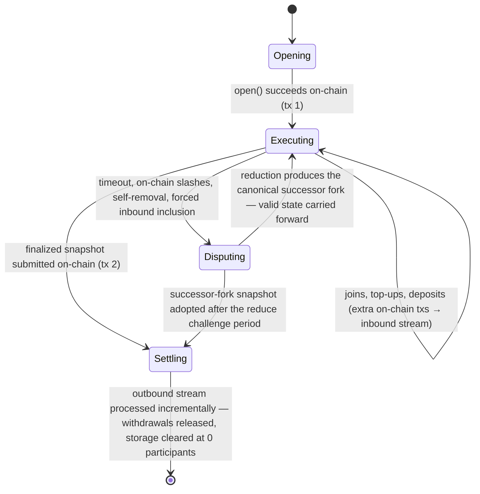
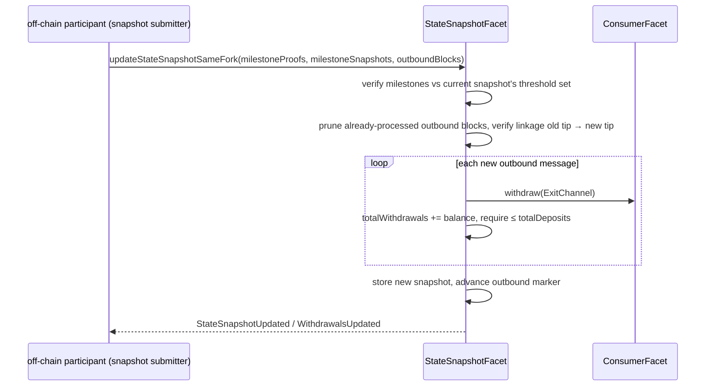

# Protocol Lifecycle

> **Agent status:** Maintained reverse-engineered draft.
> **Engineer verification:** Pending.
> **Status:** Draft; pending engineer verification.
> **Scope:** Defines the implementation-neutral protocol lifecycle behavior, assumptions, constraints, security properties, and black-box test plan.

## Contents

- [Purpose & observable contract](#1-purpose--observable-contract)
- [Lifecycle at a glance](#2-lifecycle-at-a-glance)
- [Phase 1 — Opening (on-chain, tx 1)](#3-phase-1--opening-on-chain-tx-1)
- [Phase 2 — Continuous execution (off-chain)](#4-phase-2--continuous-execution-off-chain)
- [Two paths to a snapshot-updating state](#5-two-paths-to-a-snapshot-updating-state)
- [Phase 3 — Disputes (on-chain fallback)](#6-phase-3--disputes-on-chain-fallback)
- [Phase 4 — Settlement (on-chain, tx 2)](#7-phase-4--settlement-on-chain-tx-2)
- [The four timing windows](#8-the-four-timing-windows)
- [Assumptions and constraints](#assumptions-and-constraints)
- [Security considerations](#security-considerations)
- [Requirements and invariants](#requirements-and-invariants)
- [Verification and test plan](#verification-and-test-plan)
- [Future Work](#future-work)

## 1. Purpose & observable contract

The lifecycle defines when a channel touches the base layer and what each touch accomplishes.
The design goal is that everything between opening and settlement is off-chain, free, and
real-time; the chain is touched to move value across the layer boundary and to adjudicate when
peers cannot cooperate.

**`REQ-LIF-1-A5BN02`.** The best-case complete lifecycle needs **at least two** base-layer transactions:

1. **Open/deposit** — `StateChannelManagerProxy.open`
   verifies the unanimously signed terms, deposits the committed assets, and records the genesis
   snapshot.
2. **Settlement** — a snapshot update
   (`StateSnapshotFacet.updateStateSnapshotSameFork` / `updateStateSnapshotFork`)
   that advances the on-chain snapshot and processes the outbound message stream, releasing
   withdrawals. This is the **normal** deposits-and-withdrawals path, not a dispute-only
   exceptional path.

The earlier claim that "opening is the one unavoidable on-chain step" is wrong: a participant who
wants their value back always needs the settlement transaction too. The real lifecycle can require
more transactions — joins and top-ups
(`JoinChannelFacet`),
block-calldata posts (`postBlockCalldata`), dispute uploads, reductions, challenges, fraud proofs,
and forced inbound inclusion.

## 2. Lifecycle at a glance

Fraud proofs run on a separate, immediate path beside this lifecycle: an objective violation seen
at any point can be proven on-chain at once and adds the offender to the on-chain slash set that
later dispute reductions consume. See [fraud-proofs.md](../disputes/fraud-proofs.md).

### Assumptions, constraints & dependencies

- The chain hosting the manager is live, honest, and final, and every participant can reach it
  through at least one honest RPC endpoint ([security/trust-model.md](../security/trust-model.md)).
- All deadlines are measured against chain-aligned time
  (`Clock`, [time.md](../protocol-model/time.md)).
- The integrator state machine is deterministic and its state serializes canonically
  ([concepts/state-machines.md](../protocol-model/state-machines.md)).

## 3. Phase 1 — Opening (on-chain, tx 1)

Participants submit a threshold-authorized open request to the base-layer adjudicator. The
application boundary accepts deposits and derives the genesis state; each off-chain participant
then observes the canonical open event and initializes the same channel and fork.

`open()` requires a non-zero channel id, opening terms whose deadline has not passed on chain
([`REQ-ENFADM-4-2NN96F` (Opening terms expire at their deadline)](../enforcement/admission-and-funds.md#req-enfadm-4-2nn96f)), at least two and at most a bounded maximum of participants, no duplicate participants, a signature from **every**
listed participant over the encoded `OpenChannel`, and at least two successful deposits. Deposits
run composably through the application boundary (`depositAssetsComposable`), atomically when
`OpenChannel.isAtomic` is set. The successful joins become the first inbound message block; the
application boundary builds the genesis state; the genesis `SnapshotData` commits to the state hash,
participants, stream tips, and deposit totals; and `forkId = keccak256(abi.encode(genesisSnapshotData))`
becomes the root fork identity ([concepts/history-and-commitments.md](../protocol-model/history-and-commitments.md)).

Later joins and top-ups are additional on-chain transactions that append to the **inbound** stream
and enter channel state when a block author packages them; see
[cross-layer-messages.md](./cross-layer-messages.md).

**`REQ-LIF-8-2HDG3A` — Enumerable open-channel lifecycle.** A successful opening
adds its channel ID exactly once to an enumerable manager-owned set after the genesis snapshot exists.
A failed or duplicate opening does not change that set. The final valid snapshot update that leaves zero
participants removes the ID while deleting the snapshot. Removal preserves every other member and permits
the fully closed ID to be opened and appended again later. Paged reads return the current set without
asserting participant availability or caller eligibility.

## 4. Phase 2 — Continuous execution (off-chain)

The scheduled participant authors and validates blocks, peers exchange confirmations and
signatures, and all participants advance the same deterministic state. The base layer is absent
from the happy path; calldata publication remains the data-availability fallback.

The deterministically scheduled author (`getNextToWrite()`) executes a transaction locally, builds
the block, signs it, and broadcasts it. Peers re-execute, verify author, linkage, and timing, then
sign and return signatures. Participants **do not wait** for a block to reach threshold finality
before building the next one — finality trails behind production. The full model, including the
three finality routes and the calldata fallback, is specified in [finality.md](../protocol-model/finality.md).

**`REQ-LIF-3-PDRTPY`.** A normal state transition MAY produce an outbound message — including an
`ExitChannel` — as an ordinary transition result. Exits are **not** limited to removal or
slashing, and **producing the message requires no finality**. Finality is required only when a
snapshot carrying that outbound tip is submitted on-chain.

## 5. Two paths to a snapshot-updating state

**`REQ-LIF-2-Z3Z9Y3`.** Exactly two paths lead to a state that can update the on-chain snapshot and support
withdrawals:

1. **Same-fork finality.** Every required participant signed (directly or via virtual votes —
   [finality.md](../protocol-model/finality.md)); the proof of finality (milestone proofs + milestone snapshots —
   [state-proofs.md](../disputes/state-proofs.md)) is submitted with the snapshot via
   `updateStateSnapshotSameFork`. the adjudicator checks the snapshot is newer, the milestones verify
   against the current on-chain snapshot's threshold set, and all pending inbound messages were
   consumed.
2. **Dispute resolution.** A dispute window reduces deterministically to a successor fork
   ([disputes.md](../disputes/disputes.md)); after the reduce challenge period (`evidenceTime`) expires,
   `updateStateSnapshotFork` adopts the successor fork's genesis snapshot. the adjudicator walks the
   `reducedResult` chain from the current on-chain fork, so several dispute generations can be
   adopted in one call. **For this protocol version:** when the reduction is computed and finalized
   on-chain, its result is recorded with the challenge period already elapsed, so adoption is not
   delayed — the deployment pays in gas instead of time. A challenge period that has still to run
   is the cost of the alternative, gas-saving path of committing to a reduction outcome.

Both paths converge on `_updateStateSnapshot`, which processes the outbound stream (below).

## 6. Phase 3 — Disputes (on-chain fallback)

The disputing participant constructs and audits evidence while the base-layer adjudicator owns the
window lifecycle, proof validation, reduction, and successor-fork commitment.

The valid dispute inputs are participant timeout, accumulated on-chain slashes, voluntary
self-removal, and forced inclusion of newer inbound messages ([disputes.md](../disputes/disputes.md)).
Uploading a dispute opens (or joins) a `DisputeWindow` for the disputed fork and records the
disputer's commitment immediately.

**`REQ-LIF-4-SW8GVY`.** Every initiated dispute runs through the dispute game and produces a **canonical
successor fork** — whether the submitted claim is ultimately accepted, rejected, or reduced away.
The reduction (`reduce` → `reduceOutputToSnapshotData`) deterministically folds the committed
disputes into a new genesis `SnapshotData`; its hash is the successor `forkId`; off-chain
execution resumes from that fork with valid non-final transitions carried forward
([finality.md §7](../protocol-model/finality.md)). An invalid committed dispute can be killed during the kill
period and its opener slashed, but the window it opened still resolves to a canonical outcome for
the fork; the exact kill semantics are specified (with their open questions) in
[disputes.md](../disputes/disputes.md).

**`REQ-LIF-7-0XZBDM`.** A committed dispute suspends off-chain execution on the disputed
fork. From the moment a participant observes a dispute committed against its current fork, it
MUST stop advancing that fork: blocks already queued for the fork are discarded, and newly
received blocks on the fork are rejected instead of validated. Execution resumes only on the
canonical successor fork ([`REQ-LIF-4-SW8GVY`](lifecycle.md#req-lif-4-sw8gvy)), with valid
non-final work carried forward — the pause costs time, not progress. A dispute against a fork
that is not the participant's current fork MUST NOT suspend execution on the current fork.
**For this protocol version:** the pause is bounded by the evidence and kill periods, i.e.
approximately `2 × evidenceTime` (§8) in the worst case where evidence arrives at the end of the
evidence period. The reduce challenge period does **not** extend it: the reduction is computed
on-chain from the complete committed dispute set, so every participant can derive the same
winning successor fork as soon as reduction is finalized and resume building on it immediately.
A pending reduce challenge period delays only on-chain snapshot adoption — that is, an immediate
withdrawal — never the resumption of off-chain execution. The runtime surfaces the pause and its
expected duration to the integrating application when the first dispute against the fork is
observed.

## 7. Phase 4 — Settlement (on-chain, tx 2)

The submitting participant selects the settlement path and assembles the required proof. The
base-layer adjudicator verifies it, handles benign races such as another peer settling first,
persists the snapshot, and invokes the application withdrawal boundary.

Settlement is **incremental outbound-stream processing** during a snapshot update, not a
standalone withdrawal call. `_updateStateSnapshot`:

1. prunes outbound message blocks the chain already processed (comparing against the stored
   outbound tip),
2. verifies the supplied range links the old tip to the new snapshot's committed tip,
3. processes each message (an `EXIT` message runs `withdrawAssetsComposable` → application boundary
   `withdraw`), accumulating `totalWithdrawals`,
4. **[`INV-LIF-5-ENQB91`](lifecycle.md#inv-lif-5-enqb91):** requires `totalWithdrawals <= totalDeposits` after every message
   (`CantWithdrawMoreThanDeposits`) — settlement conserves value,
5. stores the new snapshot and advances the outbound accounting; at 0 remaining participants the
   channel's storage is cleared and its ID is removed from the enumerable open-channel set.

The same mechanism serves normal exits, dispute-derived exits, and arbitrary outbound messages;
the stream model is specified in [cross-layer-messages.md](./cross-layer-messages.md).

## 8. The four timing windows

**`REQ-LIF-6-VG861M`.** Four protocol windows are configured on the manager at deployment
(`StateChannelManagerProxy`
deployment configuration; defaults in seconds in parentheses) and mirrored into the off-chain participant's
`timeConfig`. Each bounds a specific phase:

| Window              | Default | Bounds                                                                                                                                                                                                                                                                                                                                                                                                           |
| ------------------- | ------- | ---------------------------------------------------------------------------------------------------------------------------------------------------------------------------------------------------------------------------------------------------------------------------------------------------------------------------------------------------------------------------------------------------------------- |
| `p2pTime`           | 15      | The author's slot: the maximum block timestamp is the previous relevant timestamp + `p2pTime` (+ first-block grace). Producing later makes the slot objectively missed.                                                                                                                                                                                                                                          |
| `agreementTime`     | 5       | Signature collection: how long the author waits for the full threshold before falling back to posting block calldata on-chain (`the corresponding participant-state operation`); also the peer RPC timeout and the wait before an exiting participant escalates.                                                                                                                                                 |
| `chainFallbackTime` | 30      | Extra time to land the calldata post on-chain: the timeout clock for the next author runs for `p2pTime + agreementTime + chainFallbackTime` (+ grace) before a timeout dispute is opened (`the corresponding participant-state operation`), and `postBlockCalldata`'s `maxTimestamp` guard uses the same bound.                                                                                                  |
| `evidenceTime`      | 30      | Every on-chain dispute period: the evidence period (window creation + `evidenceTime`), the kill period (last evidence submission + `evidenceTime`), the reduce challenge period (reduction + `evidenceTime`), and the per-disputer throttle. A posted calldata commitment also extends the acceptable block-timestamp window by `evidenceTime` — the extra time the protocol grants when peers do not cooperate. |

The calldata fallback's cost and griefing exposure are a deliberate, known weakness of the current
design — see [security/data-availability.md](../security/data-availability.md). Chain-time
tracking, skew bounds, and timestamp validation rules are in [time.md](../protocol-model/time.md).

## Assumptions and constraints

The lifecycle assumes a live final chain, valid channel setup, deterministic off-chain execution, available
history/proofs, and timing windows that permit honest observation and response. Opening and settlement are
unavoidable chain boundaries; joins, top-ups, forced data publication, disputes, and fraud proofs add further
transactions as behavior requires. Phase transitions must be monotonic or explicitly recoverable, and no
failure may strand value in a state that neither execution nor adjudication can advance.

## Security considerations

Lifecycle security concerns ownership of deposits, authorization to advance state, availability during
offline periods, and atomic movement between phases. Tests must cover duplicate/reordered chain events,
partial opening, concurrent execution and joins, stale snapshot attempts, unavailable peers, dispute races,
failed settlement, retry/recovery, and all terminal states. The diagram is not sufficient evidence: every edge
and prohibited edge needs an observable oracle and must preserve value and canonical-history invariants.

The execution pause of [`REQ-LIF-7-0XZBDM`](lifecycle.md#req-lif-7-0xzbdm) is a bounded griefing surface: a
dispute-eligible participant can suspend the fork's off-chain execution for up to `2 × evidenceTime` by
committing a dispute. The bound on abuse is accountability rather than rate: a dispute must carry a valid
reason, and one that does not is killed during the kill period with its opener slashed — so an unfounded
suspension can be inflicted at most once per participant, at the cost of their stake. Sizing `evidenceTime`
therefore trades this pause length against the evidence and kill periods' own response budgets.

## Requirements and invariants

Targeted connection follows [`REQ-TJOIN-1-5VGR1F` (Independent public options)](../peer-communication/targeted-channel-join.md#req-tjoin-1-5vgr1f),
[`REQ-TJOIN-3-DCZKS6` (Verified synchronization and membership)](../peer-communication/targeted-channel-join.md#req-tjoin-3-dczks6), and
[`REQ-TJOIN-5-Q795M7` (Phase-specific failure)](../peer-communication/targeted-channel-join.md#req-tjoin-5-q795m7).
Submitted first joins use the local pending protection in
[`INV-MEMBERSHIP-PENDING-1-2H1T75` (Submitted joins are locally pending before acknowledgement)](../peer-communication/join-authorization.md#inv-membership-pending-1-2h1t75).

**[`REQ-LIF-1-A5BN02`](lifecycle.md#req-lif-1-a5bn02).** Best-case complete lifecycle needs at least two base-layer txs: open/deposit and settlement via a snapshot update that processes the outbound stream.

**[`REQ-LIF-2-Z3Z9Y3`](lifecycle.md#req-lif-2-z3z9y3).** Only two paths yield a snapshot-updating state: same-fork finality proof, or dispute reduction after the challenge window.

**[`REQ-LIF-3-PDRTPY`](lifecycle.md#req-lif-3-pdrtpy).** A normal transition may produce an outbound exit message; producing it needs no finality — finality is needed only at on-chain snapshot submission.

**[`REQ-LIF-4-SW8GVY`](lifecycle.md#req-lif-4-sw8gvy).** Every initiated dispute produces a canonical successor fork; execution resumes from it.

**`INV-LIF-5-ENQB91`.** Settlement conserves value: processed withdrawals never exceed deposits.

**[`REQ-LIF-6-VG861M`](lifecycle.md#req-lif-6-vg861m).** Four deployment-configured windows (`p2pTime`, `agreementTime`, `chainFallbackTime`, `evidenceTime`) bound the phases as specified in §8.

**[`REQ-LIF-7-0XZBDM`](lifecycle.md#req-lif-7-0xzbdm).** A committed dispute suspends off-chain execution on the disputed fork (queued blocks discarded, new blocks rejected) until execution resumes on the canonical successor fork; other forks are unaffected.

**[`REQ-LIF-8-2HDG3A`](lifecycle.md#req-lif-8-2hdg3a).** Successful open appends one current channel ID; final
zero-participant close removes it without corrupting the remaining set; failed operations are inert and a
fully closed ID may be opened again.

**`REQ-LIF-10-QR8NQ9` — Terminal runtime departure.** A runtime's membership ends
when it observes that its signer is in neither its local state nor the chain's participant and pending sets,
whatever removed it: its own leave, an exit the application authored without a leave (a bust), a slash or an
eviction by a dispute, or another participant's block. It then drops its membership (local `SYNCED`) and emits
`onLeftChannel` once; a removal by a snapshot it never produced is such an end, not an abort. Every drop of a
participant or pending joiner to `SYNCED` emits `onLeftChannel` once, whatever caused it; this includes a pending
join that is finally refused and a join whose authorization expired on chain before it landed, with or without a
leave call. A join failure that also aborts the runtime emits `onLeftChannel` before the abort. A pending joiner
whose join the chain has not shown is decided by its join first: the leave waits until the join lands or
expires. An exiting runtime, whether its exit started with the application-facing leave or with its own
exit block, posts the latest state snapshot it can on each finalized block after its exit block, with at most one
post in flight, until it observes its removal. Blocks finalized while a post runs queue one more post after it, unless
that post landed the exit: the block that finalizes the exit can arrive during a post, and a leaver commits no later
block. A post that is blocked, has nothing to send or is refused is not an outcome: the next finalized block posts
again. A post that runs after the channel's zero-participant close (other leavers' exits closed it first) has
nothing to send: it ends without error and reads no local history, which a member seated through a sync from a
later snapshot does not hold in full; the close ends the membership. A post already in flight when the close lands
(prepared against the open fork, then rejected at its estimate or mined after the close) is refused by the chain
for its fork mismatch; that is an expected chain refusal, and the close ends the membership. An expected chain refusal of an exit post MUST be recorded through the SDK's internal logger.
An unexpected error MUST propagate to the runtime's fatal error handling, not be swallowed or treated
as a normal refusal. RPC infrastructure outages remain subject to the
[SDK-wide availability assumption](../runtime/sdk.md#assumptions-and-constraints), not a feature-specific
recovery path. The exit lands as part of any posted snapshot that includes it, the
leaver's or another participant's. One leave watchdog runs from the start of the exit until settlement; when it
expires the leaver submits the normal self-removal dispute. While an exit is pending (from the leave call, and for
an exit with no leave call from its exit block), any dispute observed on the fork makes the leaver submit its own
dispute with self-removal at once, without waiting for the watchdog; a leaver that already disputed the fork
submits nothing more. A self-removal dispute that loses the evidence race waits for that window's reduction. A
started exit always leaves: a new fork that still holds the signer restarts the exit there as a requested leave,
including an application-authored exit with no leave call. The force-exit flag is never retracted. An
application-facing leave is terminal: after `onLeftChannel` the outer instance disposes the runtime, and a new
channel uses a fresh runtime. A failure that stops the exit is an internal failure and fatal for the runtime.

## Verification and test plan

### Requirement test matrix

Each row is a planned black-box test obligation, not an additional specification requirement. The requirement remains the authority. Execute the row through public protocol inputs from every applicable pre-state defined by this document. Every required permutation has a stable `P1`…`PN` suffix under its plan item. The list is exhaustive unless it explicitly says that boundary or pairwise representatives are sufficient; an omitted permutation needs an engineer-approved rationale.

| Plan item                                               | Requirements / invariants                             | Setup and stimulus                                                                                                                                                                                                                                                                       | Expected result                                                                                                                                                                                                     | Required permutations                                                                                                                                                                                                                                                                                                                                                                                                                                                                                                                                                                                                                                                                                                                                                                                                                                                                                                                                                                                                                                                                                                                                                                                                                                                                                                                                                                                                                                                                                                                                                                                                                                                                                                                                                                                                                                                                                                                                                                                                                                                                                                                                                                                                                                                                                                                                                                                                                                                                                                                                                                                                                                                                                                                                                                                                                                                                                                                                                                                                                                                                                                                                                                                                                                                                                                                                                                                                                                                                                                                                                                                                                                                                                                                                                                                                                                                                                                                                                                                                                                                                                                                                                                                                                                                                                                                                                                                                                                                                                                                                                                                                                                                                                                                                                                                                                                                                                                                                                                                            |
| ------------------------------------------------------- | ----------------------------------------------------- | ---------------------------------------------------------------------------------------------------------------------------------------------------------------------------------------------------------------------------------------------------------------------------------------- | ------------------------------------------------------------------------------------------------------------------------------------------------------------------------------------------------------------------- | ---------------------------------------------------------------------------------------------------------------------------------------------------------------------------------------------------------------------------------------------------------------------------------------------------------------------------------------------------------------------------------------------------------------------------------------------------------------------------------------------------------------------------------------------------------------------------------------------------------------------------------------------------------------------------------------------------------------------------------------------------------------------------------------------------------------------------------------------------------------------------------------------------------------------------------------------------------------------------------------------------------------------------------------------------------------------------------------------------------------------------------------------------------------------------------------------------------------------------------------------------------------------------------------------------------------------------------------------------------------------------------------------------------------------------------------------------------------------------------------------------------------------------------------------------------------------------------------------------------------------------------------------------------------------------------------------------------------------------------------------------------------------------------------------------------------------------------------------------------------------------------------------------------------------------------------------------------------------------------------------------------------------------------------------------------------------------------------------------------------------------------------------------------------------------------------------------------------------------------------------------------------------------------------------------------------------------------------------------------------------------------------------------------------------------------------------------------------------------------------------------------------------------------------------------------------------------------------------------------------------------------------------------------------------------------------------------------------------------------------------------------------------------------------------------------------------------------------------------------------------------------------------------------------------------------------------------------------------------------------------------------------------------------------------------------------------------------------------------------------------------------------------------------------------------------------------------------------------------------------------------------------------------------------------------------------------------------------------------------------------------------------------------------------------------------------------------------------------------------------------------------------------------------------------------------------------------------------------------------------------------------------------------------------------------------------------------------------------------------------------------------------------------------------------------------------------------------------------------------------------------------------------------------------------------------------------------------------------------------------------------------------------------------------------------------------------------------------------------------------------------------------------------------------------------------------------------------------------------------------------------------------------------------------------------------------------------------------------------------------------------------------------------------------------------------------------------------------------------------------------------------------------------------------------------------------------------------------------------------------------------------------------------------------------------------------------------------------------------------------------------------------------------------------------------------------------------------------------------------------------------------------------------------------------------------------------------------------------------------------------------------------- |
| `REQ-LIF-1-A5BN02.T1`   | [`REQ-LIF-1-A5BN02`](lifecycle.md#req-lif-1-a5bn02)   | Use the applicable black-box method in the verification strategy above; exercise the behavior through public inputs without implementation internals.                                                                                                                                    | Best-case complete lifecycle needs at least two base-layer txs: open/deposit and settlement via a snapshot update that processes the outbound stream.                                                               | `REQ-LIF-1-A5BN02.T1.P1` — valid case `REQ-LIF-1-A5BN02.T1.P4` — direct invalid/opposite case `REQ-LIF-1-A5BN02.T1.P2` — matching commitment `REQ-LIF-1-A5BN02.T1.P5` — mismatched commitment `REQ-LIF-1-A5BN02.T1.P6` — predecessor snapshot `REQ-LIF-1-A5BN02.T1.P7` — genesis snapshot `REQ-LIF-1-A5BN02.T1.P8` — stale fork `REQ-LIF-1-A5BN02.T1.P9` — foreign fork `REQ-LIF-1-A5BN02.T1.P3` — zero balance `REQ-LIF-1-A5BN02.T1.P10` — exact balance boundary `REQ-LIF-1-A5BN02.T1.P11` — one beyond boundary `REQ-LIF-1-A5BN02.T1.P12` — maximum value `REQ-LIF-1-A5BN02.T1.P13` — conservation check                                                                                                                                                                                                                                                                                                                                                                                                                                                                                                                                                                                                                                                                                                                                                                                                                                                                                                                                                                                                                                                                                                                                                                                                                                                                                                                                                                                                                                                                                                                                                                                                                                                                                                                                                                                                                                                                                                                                                                                                                                                                                                                                                                                                                                                                                                                                                                                                                                                                                                                                                                                                                                                                                                                                                                                                                                                                                                                                                                                                                                                                                                                                                                                                                                                                                                                                                                                                                                                                                                                                                                                                                                                                                                                                                                                                                                                                                       |
| `REQ-LIF-2-Z3Z9Y3.T1`   | [`REQ-LIF-2-Z3Z9Y3`](lifecycle.md#req-lif-2-z3z9y3)   | Use the applicable black-box method in the verification strategy above; exercise the behavior through public inputs without implementation internals.                                                                                                                                    | Only two paths yield a snapshot-updating state: same-fork finality proof, or dispute reduction after the challenge window.                                                                                          | `REQ-LIF-2-Z3Z9Y3.T1.P1` — valid case `REQ-LIF-2-Z3Z9Y3.T1.P5` — direct invalid/opposite case `REQ-LIF-2-Z3Z9Y3.T1.P2` — matching commitment `REQ-LIF-2-Z3Z9Y3.T1.P6` — mismatched commitment `REQ-LIF-2-Z3Z9Y3.T1.P7` — predecessor snapshot `REQ-LIF-2-Z3Z9Y3.T1.P8` — genesis snapshot `REQ-LIF-2-Z3Z9Y3.T1.P9` — stale fork `REQ-LIF-2-Z3Z9Y3.T1.P10` — foreign fork `REQ-LIF-2-Z3Z9Y3.T1.P3` — before deadline `REQ-LIF-2-Z3Z9Y3.T1.P11` — at deadline `REQ-LIF-2-Z3Z9Y3.T1.P12` — after deadline `REQ-LIF-2-Z3Z9Y3.T1.P13` — maximum honest skew `REQ-LIF-2-Z3Z9Y3.T1.P4` — malformed input `REQ-LIF-2-Z3Z9Y3.T1.P14` — adversarial input `REQ-LIF-2-Z3Z9Y3.T1.P15` — partial failure `REQ-LIF-2-Z3Z9Y3.T1.P16` — retry and recovery                                                                                                                                                                                                                                                                                                                                                                                                                                                                                                                                                                                                                                                                                                                                                                                                                                                                                                                                                                                                                                                                                                                                                                                                                                                                                                                                                                                                                                                                                                                                                                                                                                                                                                                                                                                                                                                                                                                                                                                                                                                                                                                                                                                                                                                                                                                                                                                                                                                                                                                                                                                                                                                                                                                                                                                                                                                                                                                                                                                                                                                                                                                                                                                                                                                                                                                                                                                                                                                                                                                                                                                                                                   |
| `REQ-LIF-3-PDRTPY.T1`   | [`REQ-LIF-3-PDRTPY`](lifecycle.md#req-lif-3-pdrtpy)   | Use the applicable black-box method in the verification strategy above; exercise the behavior through public inputs without implementation internals.                                                                                                                                    | A normal transition may produce an outbound exit message; producing it needs no finality — finality is needed only at on-chain snapshot submission.                                                                 | `REQ-LIF-3-PDRTPY.T1.P1` — valid case `REQ-LIF-3-PDRTPY.T1.P3` — direct invalid/opposite case `REQ-LIF-3-PDRTPY.T1.P2` — matching commitment `REQ-LIF-3-PDRTPY.T1.P4` — mismatched commitment `REQ-LIF-3-PDRTPY.T1.P5` — predecessor snapshot `REQ-LIF-3-PDRTPY.T1.P6` — genesis snapshot `REQ-LIF-3-PDRTPY.T1.P7` — stale fork `REQ-LIF-3-PDRTPY.T1.P8` — foreign fork                                                                                                                                                                                                                                                                                                                                                                                                                                                                                                                                                                                                                                                                                                                                                                                                                                                                                                                                                                                                                                                                                                                                                                                                                                                                                                                                                                                                                                                                                                                                                                                                                                                                                                                                                                                                                                                                                                                                                                                                                                                                                                                                                                                                                                                                                                                                                                                                                                                                                                                                                                                                                                                                                                                                                                                                                                                                                                                                                                                                                                                                                                                                                                                                                                                                                                                                                                                                                                                                                                                                                                                                                                                                                                                                                                                                                                                                                                                                                                                                                                                                                                                                                                                                                                                                                                                             |
| `REQ-LIF-4-SW8GVY.T1`   | [`REQ-LIF-4-SW8GVY`](lifecycle.md#req-lif-4-sw8gvy)   | Use the applicable black-box method in the verification strategy above; exercise the behavior through public inputs without implementation internals.                                                                                                                                    | Every initiated dispute produces a canonical successor fork; execution resumes from it.                                                                                                                             | `REQ-LIF-4-SW8GVY.T1.P1` — valid case `REQ-LIF-4-SW8GVY.T1.P4` — direct invalid/opposite case `REQ-LIF-4-SW8GVY.T1.P2` — matching commitment `REQ-LIF-4-SW8GVY.T1.P5` — mismatched commitment `REQ-LIF-4-SW8GVY.T1.P6` — predecessor snapshot `REQ-LIF-4-SW8GVY.T1.P7` — genesis snapshot `REQ-LIF-4-SW8GVY.T1.P8` — stale fork `REQ-LIF-4-SW8GVY.T1.P9` — foreign fork `REQ-LIF-4-SW8GVY.T1.P3` — malformed input `REQ-LIF-4-SW8GVY.T1.P10` — adversarial input `REQ-LIF-4-SW8GVY.T1.P11` — partial failure `REQ-LIF-4-SW8GVY.T1.P12` — retry and recovery                                                                                                                                                                                                                                                                                                                                                                                                                                                                                                                                                                                                                                                                                                                                                                                                                                                                                                                                                                                                                                                                                                                                                                                                                                                                                                                                                                                                                                                                                                                                                                                                                                                                                                                                                                                                                                                                                                                                                                                                                                                                                                                                                                                                                                                                                                                                                                                                                                                                                                                                                                                                                                                                                                                                                                                                                                                                                                                                                                                                                                                                                                                                                                                                                                                                                                                                                                                                                                                                                                                                                                                                                                                                                                                                                                                                                                                                                                                                                                              |
| `INV-LIF-5-ENQB91.T1`   | [`INV-LIF-5-ENQB91`](lifecycle.md#inv-lif-5-enqb91)   | Use the applicable black-box method in the verification strategy above; exercise the behavior through public inputs without implementation internals.                                                                                                                                    | Settlement conserves value: processed withdrawals never exceed deposits.                                                                                                                                            | `INV-LIF-5-ENQB91.T1.P1` — valid case `INV-LIF-5-ENQB91.T1.P3` — direct invalid/opposite case `INV-LIF-5-ENQB91.T1.P2` — zero balance `INV-LIF-5-ENQB91.T1.P4` — exact balance boundary `INV-LIF-5-ENQB91.T1.P5` — one beyond boundary `INV-LIF-5-ENQB91.T1.P6` — maximum value `INV-LIF-5-ENQB91.T1.P7` — conservation check                                                                                                                                                                                                                                                                                                                                                                                                                                                                                                                                                                                                                                                                                                                                                                                                                                                                                                                                                                                                                                                                                                                                                                                                                                                                                                                                                                                                                                                                                                                                                                                                                                                                                                                                                                                                                                                                                                                                                                                                                                                                                                                                                                                                                                                                                                                                                                                                                                                                                                                                                                                                                                                                                                                                                                                                                                                                                                                                                                                                                                                                                                                                                                                                                                                                                                                                                                                                                                                                                                                                                                                                                                                                                                                                                                                                                                                                                                                                                                                                                                                                                                                                                                                                                                                                                                                                                                                                             |
| `REQ-LIF-6-VG861M.T1`   | [`REQ-LIF-6-VG861M`](lifecycle.md#req-lif-6-vg861m)   | Use the applicable black-box method in the verification strategy above; exercise the behavior through public inputs without implementation internals.                                                                                                                                    | Four deployment-configured windows (`p2pTime`, `agreementTime`, `chainFallbackTime`, `evidenceTime`) bound the phases as specified in §8.                                                                           | `REQ-LIF-6-VG861M.T1.P1` — valid case `REQ-LIF-6-VG861M.T1.P3` — direct invalid/opposite case `REQ-LIF-6-VG861M.T1.P2` — before deadline `REQ-LIF-6-VG861M.T1.P4` — at deadline `REQ-LIF-6-VG861M.T1.P5` — after deadline `REQ-LIF-6-VG861M.T1.P6` — maximum honest skew                                                                                                                                                                                                                                                                                                                                                                                                                                                                                                                                                                                                                                                                                                                                                                                                                                                                                                                                                                                                                                                                                                                                                                                                                                                                                                                                                                                                                                                                                                                                                                                                                                                                                                                                                                                                                                                                                                                                                                                                                                                                                                                                                                                                                                                                                                                                                                                                                                                                                                                                                                                                                                                                                                                                                                                                                                                                                                                                                                                                                                                                                                                                                                                                                                                                                                                                                                                                                                                                                                                                                                                                                                                                                                                                                                                                                                                                                                                                                                                                                                                                                                                                                                                                                                                                                                                                                                                                                                                                                                        |
| `REQ-LIF-7-0XZBDM.T1`   | [`REQ-LIF-7-0XZBDM`](lifecycle.md#req-lif-7-0xzbdm)   | Open a channel and advance several blocks; commit a dispute through a public dispute input against the current fork; deliver further blocks on the disputed fork and on an undisputed control channel; complete reduction and observe the successor fork.                                | Execution on the disputed fork suspends (no state advance from queued or newly delivered blocks) and resumes only on the successor fork with valid non-final work carried forward; undisputed forks are unaffected. | `REQ-LIF-7-0XZBDM.T1.P1` — block delivered on the disputed fork after dispute commitment is rejected (no state advance) `REQ-LIF-7-0XZBDM.T1.P2` — blocks queued before dispute commitment are discarded, not executed `REQ-LIF-7-0XZBDM.T1.P3` — dispute against a non-current fork leaves current-fork execution running `REQ-LIF-7-0XZBDM.T1.P4` — execution resumes on the successor fork; valid non-final blocks are carried forward `REQ-LIF-7-0XZBDM.T1.P5` — pause is observable to the integrating application with the expected duration on the first committed dispute `REQ-LIF-7-0XZBDM.T1.P6` — duplicate dispute commitment on the same fork does not restart or extend the surfaced pause                                                                                                                                                                                                                                                                                                                                                                                                                                                                                                                                                                                                                                                                                                                                                                                                                                                                                                                                                                                                                                                                                                                                                                                                                                                                                                                                                                                                                                                                                                                                                                                                                                                                                                                                                                                                                                                                                                                                                                                                                                                                                                                                                                                                                                                                                                                                                                                                                                                                                                                                                                                                                                                                                                                                                                                                                                                                                                                                                                                                                                                                                                                                                                                                                                                                                                                                                                                                                                                                                                                                                                                                                                                                                                                                                                                                                                                                                                                                                                                                                                                                        |
| `REQ-LIF-8-2HDG3A.T1`   | [`REQ-LIF-8-2HDG3A`](lifecycle.md#req-lif-8-2hdg3a)   | Open one and several channels; read count and pages at all boundaries; attempt failed and duplicate opens; close first, middle, and last members through valid final zero-participant snapshots; repeat close; reopen a fully closed ID; reconstruct the live set from lifecycle events. | The enumerable set matches snapshot existence, preserves unaffected members through removal, remains inert on failure, pages safely, and agrees with the event-derived live set.                                    | `REQ-LIF-8-2HDG3A.T1.P1` — first and multiple append order; `REQ-LIF-8-2HDG3A.T1.P2` — duplicate/failed open inert; `REQ-LIF-8-2HDG3A.T1.P3` — zero/offset/past-end/truncated pages; `REQ-LIF-8-2HDG3A.T1.P4` — first removal; `REQ-LIF-8-2HDG3A.T1.P5` — middle swap-and-pop and reverse-index repair; `REQ-LIF-8-2HDG3A.T1.P6` — last removal; `REQ-LIF-8-2HDG3A.T1.P7` — repeated removal no-op; `REQ-LIF-8-2HDG3A.T1.P8` — reopen appends once; `REQ-LIF-8-2HDG3A.T1.P9` — indexer event set equals paged registry.                                                                                                                                                                                                                                                                                                                                                                                                                                                                                                                                                                                                                                                                                                                                                                                                                                                                                                                                                                                                                                                                                                                                                                                                                                                                                                                                                                                                                                                                                                                                                                                                                                                                                                                                                                                                                                                                                                                                                                                                                                                                                                                                                                                                                                                                                                                                                                                                                                                                                                                                                                                                                                                                                                                                                                                                                                                                                                                                                                                                                                                                                                                                                                                                                                                                                                                                                                                                                                                                                                                                                                                                                                                                                                                                                                                                                                                                                                                                                                                                                                                                                                                                                               |
| `REQ-LIF-10-QR8NQ9.T1` | [`REQ-LIF-10-QR8NQ9`](lifecycle.md#req-lif-10-qr8nq9) | Leave through the public runtime API from observer and participant states; drive fast settlement and dispute fallback.                                                                                                                                                                   | `onLeftChannel` fires once after the removal is observed, then the runtime is disposed; an observer gets `onLeftChannel` at once and disposes.                                                                      | `REQ-LIF-10-QR8NQ9.T1.P1` — fast fully signed snapshot; `REQ-LIF-10-QR8NQ9.T1.P2` — self-removal dispute; `REQ-LIF-10-QR8NQ9.T1.P3` — observer immediate disposal; `REQ-LIF-10-QR8NQ9.T1.P4` — fresh runtime selects another channel; `REQ-LIF-10-QR8NQ9.T1.P5` — a disposed leaver cannot sign a later block and remaining honest peers do not blacklist each other; `REQ-LIF-10-QR8NQ9.T1.P6` — a locally reduced fork that drops the leaver keeps its status and its leave pending until the chain's snapshot records the removal. A posted snapshot that drops a leaver cannot leave that leaver's JOIN pending: a JOIN is refused while the fork carries a dispute window, a same-fork post must consume every pending JOIN, and a reduction consumes the JOINs up to its window's expiry, so the removal alone proves the signer is in neither on-chain set.; `REQ-LIF-10-QR8NQ9.T1.P7` — an exit whose watchdog self-removal dispute cannot be submitted is a fatal runtime error; `REQ-LIF-10-QR8NQ9.T1.P8` — an exit whose watchdog dispute is refused because the window's evidence period ended waits, and the settled fork that drops the leaver emits `onLeftChannel`; `REQ-LIF-10-QR8NQ9.T1.P12` — an exit blocked by an unconsumed inbound join: a later finalized block's snapshot post consumes the join and lands the exit, with no dispute; `REQ-LIF-10-QR8NQ9.T1.P13` — an exit blocked by an inbound join that no block consumes: the leaver keeps posting, no dispute before the leave watchdog, then one self-removal dispute; `REQ-LIF-10-QR8NQ9.T1.P17` — the remaining participants post a snapshot that includes the exit: the leave settles and no self-removal dispute starts; `REQ-LIF-10-QR8NQ9.T1.P18` — a dispute observed while the leave awaits its leave turn makes the leaver submit its self-removal dispute at once, before the watchdog, and the leave completes only when the reduced snapshot drops it; `REQ-LIF-10-QR8NQ9.T1.P19` — a dispute observed after the exit block makes the leaver submit its self-removal dispute at once, before the watchdog, and `onLeftChannel` fires only when the reduced snapshot drops it; `REQ-LIF-10-QR8NQ9.T1.P20` — a participant slashed or evicted by a dispute, with no leave call, emits `onLeftChannel` once its removal is observed and does not abort; `REQ-LIF-10-QR8NQ9.T1.P21` — an exit the application authored without a leave call (a bust) posts like a leave and emits `onLeftChannel` once the snapshot drops it; `REQ-LIF-10-QR8NQ9.T1.P22` — a first join that is finally refused drops the runtime to `SYNCED` and emits `onLeftChannel` once; a race or authorization refusal that aborts the runtime emits it before the abort; `REQ-LIF-10-QR8NQ9.T1.P23` — a submitted join that does not land before its authorization expires on chain drops the runtime to `SYNCED` and emits `onLeftChannel` once, with no leave call; `REQ-LIF-10-QR8NQ9.T1.P24` — an expected exit-post chain refusal is recorded by the internal logger and retains normal next-finalized-block posting; `REQ-LIF-10-QR8NQ9.T1.P25` — an unexpected exit-post error reaches fatal runtime handling and is not swallowed as a refusal; `REQ-LIF-10-QR8NQ9.T1.P26` — an exit post of a member seated after an earlier exit landed (it does not hold that exit's outbound block) that runs only after the other leavers' exits closed the channel on chain sends nothing, raises no runtime error, and the member still gets `onLeftChannel`; `REQ-LIF-10-QR8NQ9.T1.P27` — an exit post prepared against the open fork and not yet estimated when the other leavers' exits close the channel is rejected at its estimate with the fork-mismatch refusal: the refusal is logged, no transaction is mined, no runtime error is raised and every member gets `onLeftChannel`; `REQ-LIF-10-QR8NQ9.T1.P28` — an exit post whose estimate passed against the open fork and that is mined after the other leavers' exits closed the channel reverts in its block; the revert is read back as the fork-mismatch refusal and logged, no runtime error is raised and every member gets `onLeftChannel` |
| `REQ-LIF-10-QR8NQ9.T2` | [`REQ-LIF-10-QR8NQ9`](lifecycle.md#req-lif-10-qr8nq9) | Exercise each stated input through the public verification, construction or audit boundary.                                                                                                                                                                                              | The explicit result in each permutation holds; rejected evidence has no unauthorized state effect.                                                                                                                  | `REQ-LIF-10-QR8NQ9.T2.P1` — Both founders get `onLeftChannel` after the last exit closes the channel and status becomes NOT_OPENED. `REQ-LIF-10-QR8NQ9.T2.P2` — Leaving an unobserved join waits for authorization expiry, then settles SYNCED with `onLeftChannel` and no dispute. `REQ-LIF-10-QR8NQ9.T2.P3` — JOIN observation while leave waits changes it to member exit handling; explicit disposal stops the unfinished member leave. `REQ-LIF-10-QR8NQ9.T2.P4` — A landed pending join whose self-removal reduction the leaver installs while the chain still lists it stays pending; the chain's snapshot that drops it lowers it to SYNCED on that fork and emits `onLeftChannel` while the table keeps authoring.                                                                                                                                                                                                                                                                                                                                                                                                                                                                                                                                                                                                                                                                                                                                                                                                                                                                                                                                                                                                                                                                                                                                                                                                                                                                                                                                                                                                                                                                                                                                                                                                                                                                                                                                                                                                                                                                                                                                                                                                                                                                                                                                                                                                                                                                                                                                                                                                                                                                                                                                                                                                                                                                                                                                                                                                                                                                                                                                                                                                                                                                                                                                                                                                                                                                                                                                                                                                                                                                                                                                                                                                                                                                                                                                                                                                                                                                                                                                                                                                                                                                                                                             |
| `REQ-LIF-10-QR8NQ9.T3` | [`REQ-LIF-10-QR8NQ9`](lifecycle.md#req-lif-10-qr8nq9) | Exercise each stated input through the public verification, construction or audit boundary.                                                                                                                                                                                              | The explicit result in each permutation holds; rejected evidence has no unauthorized state effect.                                                                                                                  | `REQ-LIF-10-QR8NQ9.T3.P1` — Both founders leave through the public runtime API, both get `onLeftChannel`, the channel disappears from the open-channel registry and on-chain participants become empty. `REQ-LIF-10-QR8NQ9.T3.P2` — With an unconsumed on-chain JOIN blocking exit snapshot updates, both founders submit self-removal disputes on the original fork without changing the chain snapshot first; each gets `onLeftChannel` and reduction seats the sole joiner. `REQ-LIF-10-QR8NQ9.T3.P3` — After an uncertain join submission preserves local pending status but never lands, leave waits for authorization expiry and resolves SYNCED with the address absent from both on-chain participant sets.                                                                                                                                                                                                                                                                                                                                                                                                                                                                                                                                                                                                                                                                                                                                                                                                                                                                                                                                                                                                                                                                                                                                                                                                                                                                                                                                                                                                                                                                                                                                                                                                                                                                                                                                                                                                                                                                                                                                                                                                                                                                                                                                                                                                                                                                                                                                                                                                                                                                                                                                                                                                                                                                                                                                                                                                                                                                                                                                                                                                                                                                                                                                                                                                                                                                                                                                                                                                                                                                                                                                                                                                                                                                                                                                                                                                                                                                                                                                                                                                                                                                                                                                                                            |

## Future Work

_Non-normative._

- Reduce settlement latency and cost: optimistic reduction commitments and fast-path finalization
  ideas are collected in [disputes.md](../disputes/disputes.md) Future Work.
- Alternative data-availability designs to cut the calldata fallback's fees and recovery latency;
  every candidate must state its new trust assumptions
  ([security/data-availability.md](../security/data-availability.md)).
- Define the destination of funds stranded in a channel that closes with zero participants.
- Batch settlement UX: `multicall` on the proxy already allows combining snapshot updates with
  other calls; document recommended patterns for integrators.
